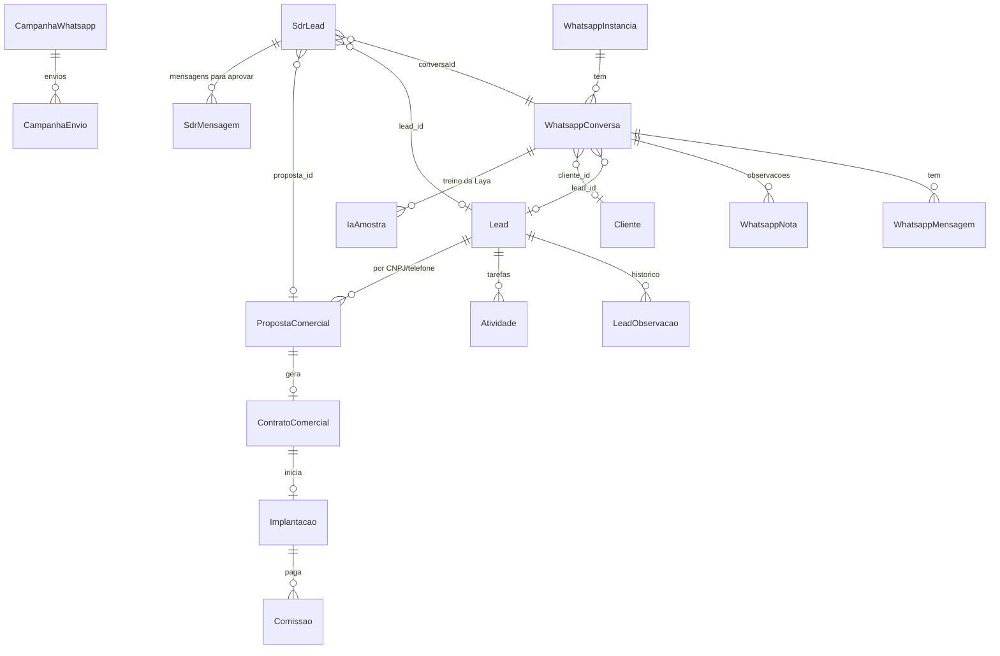

# Esquema do backend: CRM Comercial Prosystem

Versão 1.0 · 27/09/2026 · fonte da verdade: `backend/prisma/schema.prisma` (MySQL, Prisma 5, 91 modelos)

## 1. Diagrama das entidades principais

## 2. Comercial

### Lead (104 campos)
Identificação (`nome`, `razao_social`, `nome_fantasia`, `cnpj`, `empresa`, `segmento`, `cidade`, `estado`), perfil (`qtd_lojas`, `qtd_caixas`, `sistema_atual`), contato (`responsavel_nome`, `responsavel_telefone`, `responsavel_email`, `telefone`, `email`), funil (`etapa_comercial`, `etapa_sdr`, `etapa_funil`, `status`, `status_atendimento`, `temperatura` FRIO|MORNO|QUENTE|MUITO_QUENTE, `probabilidade`, `motivo_perda`), origem (`origem`, `utm_*`, `fbclid`, `campanha_nome`, `plataforma`, `link_origem`), responsável (`responsavel_id`, `vendedor_nome`, `atribuido_em`), fechamento (`fechamento_*`), ZapSign, auditoria (`created_by`, `deleted_at`).
- **"Leads para Distribuir"** = `etapa_sdr = 'QUALIFICADO'` e sem responsável próprio.
- **Nunca apagar** leads antigos (exclusão é lógica, `deleted_at`).

### LeadObservacao
Histórico do lead: `tipo` (SISTEMA, OBSERVACAO…), `descricao`, mudanças de coluna e de temperatura, autor.

### PropostaComercial (79 campos)
Cliente, `plano_selecionado` (BASIC|PRO|PLUS ou nome livre, normalizado por `planoNormal`), `mensalidade_basic/pro/plus`, `valor_implantacao`, `valor_conversao`, `desconto`, `valor_final`, `entrada`, `parcelas`, `valor_parcela`, `validade`, `status` (RASCUNHO, ENVIADA, VISUALIZADA, EM_NEGOCIACAO, ACEITA, CONTRATO_EM_GERACAO, CONTRATO_ENVIADO, CONTRATO_ASSINADO, EXPIRADA, PERDIDA, RECUSADA), `public_token`, comissões, WhatsApp (`wpp_conversa_id`, `wpp_enviada_em`, `wpp_followup_etapa`), desconto aprovado (`desconto_aprov_*`), pós-venda (`wpp_boasvindas_em`, `wpp_pesquisa_*`).

### ContratoComercial (56 campos)
Número, representante, plano, mensalidade, setup, ZapSign (`zapsign_*`, `signed_at`), `status` (…ASSINADO), comissão do vendedor.

- Fluxo de assinatura: `A_GERAR` (esperando dados) → `GERADO` → `ENVIADO_ASSINATURA` (com `zapsign_doc_token`, `zapsign_signing_url`, `sent_to_sign_at`) → `ASSINADO` (via webhook conferido) ou `PENDENTE_CORRECAO` (recusado). Dados de quem assina: `representante_nome`, `representante_cpf`, `representante_email`, `representante_telefone`.

### Implantacao, Comissao, MetaVendedor, Atividade
- `Implantacao`: técnico, etapas, datas, checklist, testes, arquivos.
- `Comissao`: papel (vendedor 15%, supervisão 5%), estágio, mês de pagamento.
- `Atividade`: `tipo`, `status`, `responsavel_id`, `data_prevista`, demo pelo WhatsApp (`whatsapp_conversa_id`, `lembrete_whatsapp_em`).

## 3. WhatsApp

| Modelo | Campos principais |
|---|---|
| **WhatsappInstancia** | `instancia_nome`, `numero`, `instance_token` (UAZAPI), `status` |
| **WhatsappConversa** | `contato_numero`, `contato_nome`, `dono_id` (null = sem dono), `lead_id`, `cliente_id`, `tipo_contato`, `etiqueta`, `prioridade`, `sla_prazo_em`, triagem (`bot_ativo`, `bot_estado`, `bot_dados` com cnpj/receita/cutucadas), cadência, `ia_sugestao` (Laya), `optout_campanhas`, `finalizada_em/por` |
| **WhatsappMensagem** | `direcao` (ENTRADA/SAIDA), `tipo`, `conteudo`, `midia_url`, `transcricao`, `status`, `enviada_por` (null = pessoa; `bot`, `assistente_ia`, `campanha`, `cadencia_automatica`, `caroline`, `julio`, `luiz_felipe`, `abertura_jessica`) |
| **WhatsappNota** | Observações da equipe: `texto`, `autor_*`, `lead_id` |
| **CampanhaWhatsapp / CampanhaEnvio** | Público, texto, status; envio por número com status e data |

## 4. Agentes e IA

| Modelo | Uso |
|---|---|
| **SdrLead** | Fila e estado de cada lead com um agente: `agente` (caroline|julio|luiz_felipe), `proposta_id`, `lead_id`, `conversaId`, `status` (FILA, AGUARDANDO, CONVERSANDO, DEMO, VENDEDORA, SEM_INTERESSE, SEM_RESPOSTA, HUMANO, SAIU), `tentativas`, `primeiro_envio_em`, `ultima_caroline_em` (última fala do agente), `ultima_lead_em`, `nota`, `nota_motivo`, `temperatura`, `temperatura_confirmada`, `resumo`, `desde`, `dados` (JSON: `dor_principal`, `cidade`, `sistema_atual`, `retomar_em`, `combinado`, `parou_em`, `ciclos`, `ciclo_em`, `entregar_em`, `entregue_em`, `intencao`) |
| **SdrMensagem** | Mensagens para aprovação: `texto`, `texto_final` (ajuste ou "o que mudar"), `status` (PENDENTE, APROVADA, EDITADA, DESCARTADA, ENVIADA_AUTO), `acao` (JSON longo, `@db.Text`) |
| **IaAmostra** | Exemplos confirmados pela equipe (treino da Laya): `texto`, `rotulos`, `sugestao` |
| **PesquisaSetor** | Pesquisas da Sofia: `tema`, `titulo`, `resumo`, `itens` (segmento, título, resumo, por que importa, mensagem sugerida), `fontes` |
| **AgenteInstrucao / AgenteMensagem** | Instruções gravadas e conversa com os agentes |

## 5. Configurações (`ConfiguracaoIntegracao`, chave → valor)

| Chave | Conteúdo |
|---|---|
| `assistente.caroline`, `assistente.sdr.julio`, `assistente.sdr.luiz_felipe` | JSON: `ativa`, `aprovar`, `limite`, `ativada_em`, `inicia_em`, `pausada_motivo` |
| `assistente.avisos.<userId>` | Avisos escolhidos por pessoa |
| `assistente.tira_duvidas`, `assistente.transcrever_auto` | Clarice |
| `assistente.pix_chave`, `assistente.pix_nome`, `assistente.gemini_chave` | PIX (chave e nome de quem recebe) e chave legada |
| `whatsapp.triagem.*` | Triagem ligada e materiais de farmácia e padaria |
| `ia.uso.<AAAA-MM-DD>` | Contagem OpenAI/Grok/Laya/evitadas/Whisper local/Groq |
| `ia.agentes.<AAAA-MM-DD>` | Uso por assistente: `{ agente: { openai, grok, whisper, groq, groq_reserva, groq_tokens, falhas, tokens_entrada, tokens_saida } }` (desde 29/10/2026) |
| `ia.rotas` | Modelo por função (Configurações › Modelos de IA): `{ <função>: { principal, reserva } }`, só as fora do automático (desde 29/10/2026) |
| `ia.groq.cota` | Última cota lida do Groq: `{ limite_dia, restante_dia, limite_tokens_min, restante_tokens_min, bloqueado_ate, atualizado_em }` (desde 29/10/2026) |
| `envio.<chave>` | Trava contra mensagens repetidas (data do último envio) |

## 6. Demais domínios (resumo)

- **Clientes e retenção:** Cliente (71 campos, incluindo `ddd` e telefones), ContatoCliente, CasoChurn, PlanoRetencao, HealthScore, CsatSurvey, PesquisaSatisfacao.
- **Usuários e segurança:** UsuarioCRM (`cargo`, `telefone`, `vende`, `admin_sistema`, `somente_leitura`), AuditoriaUsuario, CalendarToken.
- **Marketing legado:** Campanha, SequenciaEmail, Template.
- **Gestão:** IndicadorMensalCEO, RelatorioComercial, ResultadoAnualHistorico, LancamentoFinanceiro.
- **Conhecimento:** KbCategoria, KbArtigo.

## 7. Regras de mudança no banco

- Só mudanças **aditivas** (novas tabelas, colunas opcionais, alargar tipo); o deploy bloqueia qualquer diferença fora da lista autorizada.
- Backup (`mysqldump`) antes de cada publicação.
- Toda mudança de esquema atualiza este documento.

### Atualização 28/09/2026: resposta em até 1 minuto e dúvidas
- Quando o lead ou cliente escreve, a resposta do agente (Caroline, Julio, Luiz Felipe) sai **na hora, sem aprovação, em qualquer horário**: o agente espera 20 s para juntar mensagens seguidas e responde em cerca de 30 a 50 s (máximo ~1 min).
- A aprovação ("Aprovar antes de enviar") vale só para o que o agente puxa sozinho: primeiro contato e retomadas. Retomadas de quem já conversou, fora do horário comercial ou no sábado, também saem direto.
- Dúvida do cliente: (1) o agente procura no material e responde; (2) se não entendeu a pergunta, pergunta mais ao cliente; (3) só se o material não cobrir, avisa que confirma com a equipe (acao `duvida_fora_material`).
- Técnico: `caroline.service.ts` (`semAprovacao` inclui toda `fase === "resposta"`, `ESPERA_MS = 20_000`); `lib/assistente/sdr.ts` (regra NÃO INVENTE NADA reescrita). Sem mudança de schema. Regra também gravada como instrução da equipe no Escritório virtual.

### Atualização 28/09/2026: desistência vira "perdido" com motivo + lista News + Instagram
- Quando o cliente diz que não quer, ou que já fechou com outro sistema, o agente se despede com a porta aberta (sem fazer pergunta nessa despedida) e a IA devolve `motivo_perda` (PRECO | JA_TEM_FORNECEDOR | SEM_ORCAMENTO | TIMING | SEM_INTERESSE | FUNCIONALIDADE_AUSENTE | OUTRO, as mesmas chaves do funil e do relatório comercial).
- Quando há proposta (Luiz Felipe) ou o motivo é JA_TEM_FORNECEDOR, `marcarPerdidoNews` (caroline.service.ts) faz o seguinte:
  - Lead: `status/etapa_funil/etapa_comercial = PERDIDO`, `motivo_perda` recebe "CHAVE: o que o cliente disse", e uma linha é gravada em `LeadPerda`. Se a proposta não tiver lead vinculado, o sistema acha o lead pelo celular (últimos 8 dígitos) ou cria um com origem PROPOSTA.
  - Proposta: `status = PERDIDA` e uma linha em `PropostaHistorico` (tipo STATUS, com o motivo).
  - Etiqueta do sistema **News** (roxa, `sistema=true`) aplicada ao lead.
  - Mensagem automática com o Instagram: https://instagram.com/prosystemoficial.
- Campanhas (Zequinha): novo público **NEWS**, que reúne os leads com a etiqueta News e vem com um modelo de informativo que já traz o Instagram. O "SAIR" continua valendo.
- Sem mudança de schema (usa Etiqueta, LeadEtiquetaAplicada, LeadPerda e PropostaHistorico, que já existiam).

### Atualização 28/09/2026: vídeos e suporte vão para o setor de suporte
- Se o cliente pede vídeos (tutoriais, treinamento, "como usar"), ajuda técnica ou suporte, o agente (Caroline, Julio ou Luiz Felipe) usa a nova ação `encaminhar_suporte`, com `mensagens: []`, e não promete enviar vídeos.
- Em seguida o sistema envia o texto padrão `mensagemSuporte(agente)` (lib/assistente/sdr.ts): "O envio de vídeos, treinamentos e o suporte técnico são feitos pelo nosso setor de suporte. Eu sou o Luiz Felipe, do setor comercial…". A mensagem vai com o botão de link "💬 Falar com o suporte" (`LINK_CONTATO_GERAL`, o mesmo usado na triagem) e fica registrada na conversa.
- A função `encaminharSuporte` fica em caroline.service.ts. O lead continua em CONVERSANDO. Não há mudança de schema.

### Atualização 28/09/2026: conversa mais simples, direta e com os desafios da farmácia
- **Menos perguntas:** no máximo 2 perguntas de investigação na conversa inteira, e nunca repetir uma pergunta já respondida. Assim que o cliente diz qual é o problema, mesmo numa palavra ("demora"), o agente mostra em 1 ou 2 frases como o MATERIAL resolve e já oferece a demonstração (`oferecer_demo`, sem esperar a nota 60).
- **Resposta curta** ("nada", "isso") é tratada como sinal de pouca paciência: nada de mais perguntas abertas, o agente vai direto para a solução e a demonstração.
- **Pergunta direta:** "Qual é o maior problema que você quer resolver hoje na farmácia?", com o convite para explicar por áudio (os áudios são transcritos).
- **Dia a dia da farmácia (conhecimento geral)**, usado de forma natural, um exemplo por vez:
  - fila e demora no caixa;
  - estoque furado e remédio vencendo;
  - controlados e receitas (SNGPC);
  - convênios, PBM e Farmácia Popular;
  - fiado e crediário;
  - margem e preço;
  - cliente de uso contínuo que não volta;
  - fechamento de caixa;
  - nota fiscal e impostos.
- A solução para cada um desses problemas só vem do MATERIAL.
- Onde está no código: `promptCaroline` em lib/assistente/sdr.ts. Não há mudança de schema.

### Atualização 28/09/2026: pedido de prazo sempre com previsão + campanha/revisão com autorização
- **Luiz Felipe:** quando o cliente pede mais prazo, o agente nunca sai só agradecendo. Ele pede uma previsão ("pra quando você acha que consegue decidir? assim já te chamo nesse dia"), confirma a data e deixa a porta aberta.
- **Do dia 20 ao último dia do mês** (`janelaCampanhaAtiva`, horário de Brasília), ele também diz que temos campanhas ativas e que pode revisar a proposta, sem citar valores. Essa mensagem vem marcada com `revisar_proposta: true`, e aí:
  - ela sempre vai para "✋ Para você aprovar", mesmo sendo uma resposta;
  - a Jessica recebe um aviso no WhatsApp ("🙋 Autorização: … quer oferecer revisão da proposta") com o texto;
  - fora da janela, uma mensagem com essa marcação é descartada e nunca sai.
- **Código:** `promptCaroline` (parâmetro `janelaCampanha`) e `lerRespostaCaroline` em lib/assistente/sdr.ts; `falar` em caroline.service.ts. Não há mudança de schema.

### Atualização 28/09/2026: máquina de negociação do Luiz Felipe (autorização por botão no WhatsApp)
- **Pedido de autorização:** quando o Luiz marca uma mensagem com `revisar_proposta` (entre o dia 20 e o fim do mês, uma vez por mês por cliente), a mensagem fica PENDENTE e `pedirAutorizacaoNegociacao` (assistente-negociacao.service.ts) envia para a gestão, só a quem recebe o aviso `lead_qualificado` (o Thiago não recebe), um menu com:
  - a prévia da proposta: empresa, contato, plano, mensalidade, implantação e link;
  - a mensagem que vai para o cliente;
  - as opções de desconto: implantação -30% ou -20% e mensalidade -10% por 12 meses, com os valores de antes e depois.
- **Botões** (`lib/assistente/negociacao.ts`): `neg_30_<msgId>` "✅ Autorizar 30%", `neg_20_<msgId>` "✅ Autorizar 20%" e `neg_0_<msgId>` "❌ Não autorizar". `responderComandoGestao` encaminha para `responderAutorizacaoNegociacao`:
  - **Autorizar:** grava `SdrLead.dados.desconto_autorizado` (impl_pct, mens_pct 10, meses 12, valores de antes e depois, quem autorizou) e `campanha_mes`, aprova a mensagem (`decidirMensagem`) e confirma para a gestora.
  - **Não autorizar:** a mensagem sai trocada só pelo pedido de previsão de decisão e o cliente fica marcado com `campanha_recusada` no mês.
- **Com desconto autorizado:** o prompt do Luiz recebe `instrucaoDescontoAutorizado`, que manda ser comercial e conduzir ao fechamento. Ele apresenta a condição só em porcentagem, como campanha válida até o fim do mês. Se o cliente topar, usa a ação `aceitar_condicao`.
- **`aceitar_condicao` → `aplicarCondicaoNaProposta`:**
  - na proposta: `desconto` = X% da implantação, `valor_final` recalculado, `condicao_especial` com a mensalidade -10% por 12 meses, `desconto_aprov_status=APROVADO`, status EM_NEGOCIACAO e histórico RENEGOCIACAO;
  - reenvio pelo WhatsApp (`enviarPropostaWhatsapp`) com os botões de aceite de sempre, mais o texto "Condição da campanha aplicada";
  - aviso 🔥 para a gestão.
- **Sem desconto autorizado,** o Luiz continua proibido de oferecer valores ou condições.
- Não há mudança de schema. Teste: tests/negociacao.test.ts.

### Atualização 28/09/2026: campanha negociada vale 5 dias corridos
- A condição autorizada vale `VALIDADE_CAMPANHA_DIAS = 5` dias corridos, contados a partir do momento da autorização (`desconto_autorizado.em`). As funções `validadeCampanha` e `campanhaVigente` ficam em lib/assistente/negociacao.ts.
- O Luiz apresenta a condição como "válida por 5 dias (até DD/MM)". O texto "Condição da campanha aplicada" mostra a mesma data, e a confirmação enviada à gestora também.
- Passados os 5 dias, a condição deixa de ir para o prompt e `aplicarCondicaoNaProposta` recusa a aplicação.
- A oferta ao cliente passou a dizer "campanha ativa por poucos dias", no lugar de "campanhas ativas este mês".

### Atualização 28/09/2026: cliente nunca fica órfão por mensagem mandada do celular
- **Causa:** a Jessica mandou uma mensagem pelo celular sem assumir a conversa no CRM. `pessoaAssumiu` tratava isso como se uma pessoa tivesse assumido: o agente virava HUMANO, a conversa ficava sem dono e ninguém respondia o cliente.
- **Correção em `pessoaAssumiu`** (caroline.service.ts): o dono no CRM continua valendo como assumido. Já uma mensagem humana sem dono só conta como "pessoa conversando" se tiver sido enviada nos últimos 10 minutos.
- **Correção em `aoReceberDoLead`:** o SdrLead HUMANO volta para CONVERSANDO e o agente responde quando as quatro condições valem:
  - o cliente escreveu;
  - a conversa não tem dono;
  - a conversa não foi finalizada;
  - ninguém conversou nos últimos 10 minutos.
- A regra "uma pessoa assumiu, nenhum agente responde" continua valendo para quem assume pelo CRM (fica como dono) e para a conversa finalizada.
- Não há mudança de schema.

### Atualização 28/09/2026: lembrete da demonstração para a responsável
- As demonstrações marcadas pelo lead já eram gravadas como Atividade (tipo REUNIAO, `created_by = lead_whatsapp`) e aparecem na Agenda da responsável: o dono da conversa ou, sem dono, a Supervisão Comercial.
- **Novo:** `lembrarResponsavelDemo` (assistente-demo.service.ts) roda no agendador do assistente a cada 10 minutos. Quando uma reunião ativa começa em até 75 minutos, a responsável recebe no WhatsApp dela um aviso com:
  - "⏰ Lembrete: demonstração às HH:MM";
  - o título da reunião;
  - o nome e o número do cliente;
  - o link da reunião ou, se não houver, um alerta para enviá-lo.
- O aviso chega entre 65 e 75 minutos antes, portanto sempre com pelo menos 1 hora de antecedência. É uma vez só por reunião (trava `lembrete_demo_resp.<id>`).
- O lembrete do cliente, 2 horas antes, continua como estava. Não há mudança de schema.

### Atualização 28/09/2026: CRM como app de iPhone no celular (etapa 1 de 4)
- **Base:** guia de interface da Apple (HIG iOS), usado a partir de `reference/ios.md` das skills impeccable e anti-ui-slop. Vale só abaixo de 768px; no computador nada muda.
- **Barra de abas embaixo** (`components/mobile/AppIOS.tsx` › `BarraAbasIOS`):
  - WhatsApp, Leads, Propostas (gerador), Dashboard e Mais;
  - material translúcido com blur e linha fina de separação;
  - alvos de toque de 44pt, ícones de 24px e rótulos de 10px;
  - cor de ação azul do sistema (#007AFF, ou #0A84FF no escuro);
  - área segura da barra de início respeitada.
  - Uma aba só aparece se a pessoa tiver permissão para a tela, pelo mesmo filtro do menu (`gruposVisiveis`).
- **Folha "Mais"** (`FolhaMaisIOS`): sobe de baixo com alça e botão fechar, e traz o título grande "Mais". Mostra todas as outras telas liberadas em listas agrupadas no estilo Ajustes (ícone em quadrado arredondado, linha de 44pt, seta), com animação de folha iOS e respeito a `prefers-reduced-motion`.
- **Estrutura:** o menu hambúrguer foi escondido (a aba "Mais" substitui). A barra de cima respeita o notch e a Dynamic Island. O conteúdo tem espaço embaixo para a barra de abas, e a fonte do sistema (San Francisco) vale no celular.
- **Estilos** em `app/ios.css`, com tokens `--ios-*` para os modos claro e escuro (`.dark`).
- **Instalação na tela inicial:**
  - `app/manifest.ts`: standalone, `start_url` /whatsapp, ícones de 192 e 512 (também maskable);
  - `apple-touch-icon.png` de 180px, com a marca ▶ da Prosystem sobre fundo branco;
  - `appleWebApp` com o título "CRM Prosystem".
- **Próximas etapas:**
  - 2: WhatsApp e Leads (títulos grandes, listas e folhas);
  - 3: Propostas e Dashboard;
  - 4: telas do "Mais".

### Atualização 28/09/2026: celular no padrão iOS, etapa 2 (WhatsApp e Leads)
Tudo vale só abaixo de 768px, com classes `ios-*` em `app/ios.css`. No computador nada muda.
- **WhatsApp, lista** (estilo app Mensagens):
  - título grande "WhatsApp" de 34pt;
  - Conversas/Fila e Minhas/Sem dono/Todas/Finalizadas viram controles segmentados;
  - campo de busca iOS (preenchimento cinza, 17pt);
  - linhas de 76pt com avatar de 52pt e separador recuado;
  - selo "Conectado" e faixa "WhatsApp da empresa" escondidos no celular.
- **WhatsApp, conversa** (estilo iMessage):
  - a barra de abas some (classe `ios-em-chat` no body);
  - barra de navegação translúcida com "‹ Conversas", nome, ⓘ (detalhes) e ⋯ (ações);
  - bolhas de 18pt de raio, enviadas em azul do sistema e recebidas em cinza #E9E9EB, texto de 17pt;
  - campo de mensagem em pílula na barra translúcida, com área segura.
- **Folha de ações ⋯** (padrão action sheet): Assumir, Finalizar/Reabrir, Detalhes do atendimento, Prioridade, Etiquetar, Agendar reunião, Vincular a cliente da base, Transferir, Desvincular do funil, Excluir (em vermelho) e Cancelar. A fileira de botões só aparece no computador (`hidden md:contents`).
- **Detalhes ⓘ:** o painel lateral (Criar proposta, Observações, IA, funil etc.) abre como folha em tela cheia, com cabeçalho "Detalhes" e botão OK (estado `painelMobile`).
- **Leads:**
  - título grande "Central de Leads";
  - busca iOS em linha própria;
  - filtros como pílulas em faixa rolável horizontal;
  - "Novo Lead" em azul do sistema;
  - funil com uma etapa por página (coluna com a largura da tela e rolagem com encaixe), navegando pelas setas de 44pt, pelos pontos ou deslizando.
  - O passo das setas passou a medir a largura real da coluna (`colWidth()`), o que vale para o computador e para o celular.
- **Próximas etapas:**
  - 3: Propostas (gerador) e Dashboard;
  - 4: telas do "Mais".

### Atualização 29/09/2026: celular no padrão iOS, etapa 3 (Propostas e Dashboard)
Tudo vale só abaixo de 768px (`app/ios.css`). No computador nada muda.
- **Classes genéricas para outras telas:**
  - `ios-tela`: fundo agrupado #F2F2F7; os `.ps-card` viram cartões iOS com raio de 12, sem borda e sem sombra.
  - `ios-topo`: cabeçalho em coluna, com título grande de 34pt e subtítulo de 15pt.
  - `ios-seg-inline` e `ios-abas`: controles segmentados.
  - `ios-filtros`: busca iOS em linha própria e campos de 36 a 44pt.
  - `ios-lista-cartoes`: a tabela vira lista de cartões, com cabeçalho escondido, uma linha por cartão e botões de ação de 44pt.
  - `ios-modal-*`: o modal vira folha em tela cheia.
- **Propostas (gerador):**
  - título grande "Gerador de Proposta Comercial";
  - Lista/Kanban como segmentado;
  - "Nova Proposta" em botão largo azul do sistema, com 44pt;
  - indicadores em cartões iOS;
  - lista de propostas em cartões: empresa em 17pt, detalhes em 15pt e ações Ver/Editar/Link/WhatsApp com 44pt.
- **Formulário da proposta em folha de tela cheia:**
  - barra de título translúcida com área segura e botão fechar redondo;
  - passos com 44pt e a cor de ação do sistema;
  - campos em uma coluna, de 17pt e 44pt de altura (o `gridColumn: span 2` do FormField é anulado no celular);
  - botões do rodapé com 44pt.
- **Dashboard:**
  - título grande "Dashboard Executivo";
  - filtros e Atualizar com 36pt;
  - abas (`AbaTabs`) como segmentado rolável, com a aba ativa em cartão branco;
  - cartões iOS;
  - barras horizontais com rótulo de 92px para caber na tela.
- **Próxima:** etapa 4, com as telas do "Mais" (Escritório, Agenda, Contratos etc.), usando as classes genéricas.

### Atualização 29/09/2026: notificações no celular, bolinha no ícone e tela "Aprovar"
- **Notificações (Web Push):**
  - Tabela nova `PushInscricao` (id, usuario_id, endpoint único de 700, p256dh, auth, aparelho, created_at, ultimo_ok), com um registro por aparelho.
  - Biblioteca `web-push` no backend.
  - Chaves VAPID (`VAPID_PUBLIC_KEY`, `VAPID_PRIVATE_KEY`, `VAPID_SUBJECT`) só no `.env` do servidor, com chmod 600.
  - `services/push.service.ts`: `enviarPush(prisma, usuarioIds, {titulo, corpo, url, tag})` envia a todos os aparelhos da pessoa, grava `ultimo_ok` e apaga inscrições vencidas (404/410). Nunca lança.
  - `contagemPendencias` soma aprovações pendentes (gestão), conversas sem dono com mensagens não lidas e não lidas das conversas da pessoa.
- **Rotas** (`routes/push.ts`):
  - `GET /push/chave`
  - `POST /push/inscrever`
  - `POST /push/cancelar`
  - `POST /push/teste`
  - `GET /push/contagem`
  - `GET /assistente/aprovacoes` (gestão)
  - `POST /assistente/aprovacoes/:id/negociacao` com {pct: 0 | 20 | 30}
- **Quem dispara notificação:**
  - `enviarAvisoGestao`: todo aviso que vai pelo WhatsApp da gestão também vira notificação. Abre /aprovar quando o texto fala de aprovação ou autorização; senão, /whatsapp.
  - `pedirAutorizacaoNegociacao`: "🙋 Luiz Felipe pede autorização de campanha", abrindo /aprovar.
  - `lembrarResponsavelDemo`: "⏰ Demonstração às HH:MM", abrindo /atividades.
- **Negociação:** `decidirNegociacao` foi separada de `responderAutorizacaoNegociacao` e é usada pelos botões do WhatsApp e pela tela Aprovar. A mensagem pendente guarda `negociacao: true` no meta.
- **Frontend:**
  - `public/sw.js`: service worker que recebe o push, mostra a notificação, atualiza a bolinha (`setAppBadge`) e abre a URL ao tocar.
  - `components/mobile/NotificacoesApp.tsx`: registra o service worker e mostra o aviso flutuante "Receba avisos no celular" (Ativar / Agora não). No iPhone fora do app, o aviso ensina a instalar na Tela de Início.
  - Ao ativar, o app pede permissão, inscreve o aparelho e manda um push de teste.
  - A bolinha no ícone é atualizada a cada 60 s e ao voltar para o app.
- **Tela `/aprovar`** (item "Aprovar" no menu, só gestão): cartões iOS com tudo o que espera decisão, de todos os agentes.
  - Mensagens: Aprovar e enviar / Editar (enviar com meu ajuste) / Refazer (o que mudar?).
  - Campanhas: Autorizar 30% / Autorizar 20% / Não autorizar.
  - Mostra o tempo de espera e o link "Ver conversa"; atualiza a cada 30 s.

### Atualização 29/09/2026: app do CEO e etapa 4 (telas do "Mais")
- **CEO no celular:**
  - Abas próprias (`ABAS_CEO` em AppIOS.tsx): Painel (/dashboard) · Análise (/analise-comercial) · Previsão (/previsao) · Leads · Mais. A folha "Mais" traz o resto das telas de leitura dele (CEO_VISIVEL).
  - Indicadores do Painel (`KpiCard`) como widgets do iPhone: raio de 20, rótulo de 13pt sem caixa alta, valor de 28pt (34pt no destaque) com números tabulares. O primeiro indicador de cada grade ocupa a largura toda.
  - Análise Comercial e Previsão com `ios-tela`, `ios-topo` e título grande. Tabelas largas rolam dentro do próprio cartão.
  - Notificações liberadas para a conta de consulta: `/push/inscrever`, `/push/cancelar` e `/push/teste` entraram em `ROTAS_ESCRITA_LIBERADAS_LEITURA`, porque só mexem no aparelho da própria pessoa.
  - O CEO recebe só os avisos que já escolheu (resumo diário e contrato assinado).
  - A bolinha do CEO não conta aprovações, porque quem aprova é a Supervisão Comercial ou o Admin.
- **O app abre na tela de cada pessoa:** o manifest agora tem `start_url` "/", e o início redireciona conforme o cargo (CEO e gestão → Painel/Dashboard; vendedora → Radar; SDR → funil).
- **Etapa 4:** Escritório virtual, Atividades, Agenda, Contratos, Clientes e Campanhas ganharam `ios-tela` (fundo agrupado e cartões iOS) e título grande de 34pt no celular. Com isso, o plano de 4 etapas do app iOS está concluído.

### Atualização 29/09/2026: revisão para todos os iPhones
- **Como foi revisado:** prints automáticos (Playwright com emulação de iPhone) nos tamanhos 17 Pro Max 440×956, Air 420×912, 17 e 17 Pro 402×874 e 16e/SE 375×667. Foram medidos, em cada tela, os elementos que saem da largura: nenhum em 11 telas × 4 tamanhos, nas visões Supervisão e CEO.
- A revisão rodou no CRM local, com usuário fictício e sem servidor de dados; nenhuma credencial real foi usada.
- **Correções em `app/ios.css`:**
  - `100dvh` no lugar de `100vh`, para a tela não ficar atrás da barra do Safari; folhas com `88dvh` e `70dvh`.
  - Campos com 16px ou mais no celular, para o iPhone não dar zoom ao tocar.
  - Áreas seguras laterais com o celular deitado (topbar, conteúdo, abas e folhas), e barra de abas mais baixa em paisagem.
  - Até 380pt (16e/SE): título de 30pt, segmentados de 12pt, abas de 9,5pt, avatar de 46pt, widgets de 24/30pt, coluna do funil com 100vw−32.
  - A partir de 420pt (Pro Max/Air): bolhas de 74% e espaço de 12 nas grades.
  - Segmentados encolhem com reticências, sem estourar; nada cria rolagem lateral na página.
  - Margem lateral padrão de 16pt em todas as telas `ios-tela` (12pt até 380pt), inclusive no Escritório, que encostava na borda.
  - Rótulos pequenos em caixa alta quebram linha em vez de cortar (Atividades).
  - Em grade de 2 colunas com número ímpar de itens, o último ocupa a linha toda (Propostas).
  - Leads: busca em linha própria, filtros em pílulas que quebram linha (todos visíveis) e "Novo Lead" como botão principal azul de 44pt.
- **Alerta de reunião** (`AlertaReuniaoModal`): no celular fica acima da barra de abas. Antes, o botão "15 min antes" cobria a aba "Mais" e impedia o toque nela. O botão de configurar os minutos fica só no computador (`ios-so-computador`).
- **Tela Aprovar:** sem conexão, mostra "Sem conexão com o servidor…" (antes dizia "Só a gestão aprova"); o 403 explica que a tela é da Supervisão Comercial; e o subtítulo não fica preso em "Carregando…".

### Atualização 29/09/2026: ajustes a partir de print real (iPhone 17 Pro Max)
- **Seletor de visão do Dashboard** ("Como vendedora / Como supervisora / Administração", `VisaoSwitch`, classe `ios-visao`): agora é um controle segmentado iOS numa linha só. Os botões dividem a largura por igual, com 32pt de altura e 13pt de letra, cortando com reticências quando precisa; o selecionado fica em branco com sombra. Antes quebrava em duas linhas e cortava "supervisora".
- **Cartão MRR vazio:** a regra de fundo branco dos cartões (`.ios-tela .ps-card`) cobria o gradiente escuro do MRR, e o valor branco sumia. Agora o fundo branco só vale para cartões sem `background` próprio (`:not([style*="background"])`).
- **Barra de cima no celular:** o botão de tela cheia e as divisórias foram escondidos (`ios-so-computador`). O modo escuro, as conversas, as notificações e o perfil continuam, com área de toque de 44pt.
- **Filtro de vendedor + Atualizar** dividem a linha por igual.

### Atualização 29/09/2026: desempenho da Central de Leads
- **Diagnóstico:** o servidor responde rápido (`/leads/kanban` abaixo de 1 s nos registros). O travamento vinha do navegador desenhando um cartão para cada lead, em todas as etapas ao mesmo tempo, e isso também deixava o resto do CRM lento.
- **Correção** (`app/leads/page.tsx`):
  - cada etapa desenha só os primeiros 30 cartões (`CARTOES_POR_ETAPA`);
  - o botão "Mostrar mais (N restantes)" libera mais 60 por toque, com o estado `limiteEtapa` por etapa;
  - o contador da etapa, a busca, os filtros e a exportação continuam sobre todos os leads carregados.
- **Próximo passo possível:** enviar do servidor só os campos que o cartão usa, para diminuir o tamanho da resposta. Ainda não foi feito.

### Atualização 29/09/2026: desfecho real das reuniões e WhatsApp mais rápido
- **Concluir reunião** (`POST /atividades/:id/concluir`): para atividades do tipo REUNIAO, `desfechoDaReuniao` (lib/reuniao-desfecho.ts) lê o resultado escrito e as falas do cliente na conversa do WhatsApp (de 12 h antes do horário até agora, incluindo a transcrição de áudios).
  - Havendo sinal de que a reunião não aconteceu (não compareceu/não deu retorno/remarcar/adiar/deixar pra próxima/viagem/imprevisto/outro dia…), grava `CLIENTE_NAO_COMPARECEU` em vez de `REALIZADA`.
  - O lead recebe "⚠️ Reunião: cliente não compareceu", com o motivo detectado, e a resposta da rota explica isso à pessoa.
  - Teste: tests/reuniao-desfecho.test.ts.
- **Dados corrigidos:** as demonstrações de 29/09 (Redemed Suka Pharma 09:00 e Wellington Quaresma 10:00) passaram de REALIZADA para CLIENTE_NAO_COMPARECEU, com observação de correção no lead. Nas conversas, os clientes pediram para adiar ("Prefiro adiar" / "Deixar pra próxima").
- **WhatsApp:** `GET /whatsapp/conversas/:id/mensagens` agora devolve as 200 mensagens mais recentes (antes, as 200 mais antigas) e sem o base64 das mídias.
  - As mídias vêm marcadas como `midia:<id>` e são baixadas à parte por `GET /whatsapp/mensagens/:id/midia` (com o mesmo filtro de leitura da conversa e cache privado de 24 h).
  - No frontend, `components/whatsapp/MidiaMensagem.tsx` baixa cada foto, vídeo, áudio ou PDF só quando ele aparece na tela (IntersectionObserver), com cache em memória.
- **Computador:** a barra de abas do celular não aparece mais no computador. Por padrão, `.ios-tabbar` fica `display: none` e só vira `flex` abaixo de 768px. A regra de paisagem vale só em tela de toque.

### Atualização 29/09/2026: Bloco 1 (itens 1 a 4) e documento de NPS
- **Horário de Brasília no WhatsApp:** toda formatação de data e hora das telas `app/whatsapp/**` e `components/whatsapp/**` usa `timeZone: 'America/Sao_Paulo'`, independentemente do fuso do aparelho. Isso vale para mensagens, lista de conversas, prazo (SLA), observações e campanhas.
- **O que foi conversado vai para as observações do lead** (`services/obs-conversa.service.ts`, `registrarConversasNasObservacoes`, que roda no agendador a cada 10 min):
  - quando a conversa de um lead fica 30 min parada e o cliente respondeu desde o último registro, a IA (`resumirConversa`) grava na timeline do lead "💬 Conversa no WhatsApp com …", com Quem / O que foi conversado / O que falta / Oportunidade;
  - se o contato tem proposta, entra a linha "📄 Proposta (plano): PENDENTE / RECUSADA / ACEITA…";
  - o marcador por conversa fica em `ConfiguracaoIntegracao` (chave `obs_wpp.<conversaId>`), com até 12 resumos por rodada e janela de 48 h;
  - a primeira rodada registrou 12 conversas.
- **Proposta recusada:** `marcarPerdidoNews` também grava no lead "📄 Proposta RECUSADA pelo cliente (motivo)".
- **Informativo Prosystem (jornal):**
  - a etiqueta "News" foi renomeada para "Informativo Prosystem", com a mesma lista: 4 leads na virada;
  - todo `sem_interesse` com lead agora entra nessa lista, mesmo sem proposta; só os casos com proposta ou JA_TEM_FORNECEDOR viram "perdido";
  - o prompt dos agentes trata "já resolvi / já resolvemos / já temos sistema / já fechamos" como sem interesse (JA_TEM_FORNECEDOR);
  - o público das campanhas passou a se chamar "Informativo Prosystem" e aceita os dois nomes da etiqueta.
- **Documento novo:** `docs/comercial/pesquisa-satisfacao-e-nps.md`, com o formulário em 4 etapas, a fórmula do score de 0 a 100, as ações automáticas, o cálculo do NPS (estrelas × 2), o CSAT e sugestões (NPS padrão de 0 a 10, envio pela Mila, tarefa para detratores, metas).

### Atualização 29/09/2026: Kanban do WhatsApp por atendente (Bloco 1, item 6)
- A tela "Fila de Chamados" ganhou o seletor **👥 Por atendente** (padrão) / **📊 Por fase**.
- **Por atendente** (`colunasPorAtendente` em `app/whatsapp/page.tsx`):
  - uma coluna por agente (🤖 Caroline, Julio, Luiz Felipe, Clarice…, na ordem do funil e com a cor de cada um);
  - 🧭 Em triagem (Bia);
  - 👤 uma coluna por pessoa da equipe que é dona de conversas;
  - 📥 Sem dono.
  - Só aparecem as colunas que têm conversas. Tocar no cartão abre a conversa. Nessa visão não se arrasta cartão, porque quem define a coluna é o atendimento.
- **Por fase:** a visão de sempre (`estagio_funil`), em que se arrasta para mudar a fase.
- **Pendências registradas:**
  - item 5 (leads aguardando distribuição) espera a definição: agente continua ou vai direto para a vendedora;
  - Jornalista informativo (Bloco 4): envia **só para o Informativo Prosystem**, a partir das pesquisas da Sofia, com texto curto e simples e aprovação na tela Aprovar; a frequência ainda está a definir.

### Atualização 29/09/2026: Leads para Distribuir vão para o Julio (Bloco 1, item 5)
- `abastecerFila` do Julio (caroline.service.ts) coloca na frente da fila os leads de "Leads para Distribuir", pela mesma regra de `GET /leads/prontos-para-distribuir`: `etapa_sdr = QUALIFICADO` e sem vendedora, ou com a própria SDR que cadastrou.
- Depois deles vêm os demais leads, do mais novo para o mais antigo.
- Continuam valendo:
  - o limite diário único do número e o intervalo entre contatos;
  - não chamar quem conversou nos últimos 7 dias, quem pediu para sair ou quem tem proposta aberta (esses ficam com o Luiz Felipe).
- Se o lead demonstrar interesse, passa para a Caroline. Se for qualificado para a vendedora, volta para "Leads para Distribuir" já com a conversa e o resumo.
- **Jornalista informativo (Bloco 4, definição):** envia só para o Informativo Prosystem. Cada lead recebe no máximo um informativo a cada 20 a 25 dias, com os envios se revezando entre os leads da lista, para proteger o número.

### Atualização 29/09/2026: Bloco 2 — Desempenho do setor e Métricas da IA; ajuste das pesquisas da Sofia
- **Rota `GET /relatorios/desempenho?dias=7|30|90`** (gestão, `routes/desempenho.ts`) lê apenas dados que o CRM já registra:
  - **Agentes** (`SdrLead` criados no período, por agente): leads, contatados, responderam, efetivos (DEMO, VENDEDORA ou nota ≥ 60), demonstrações marcadas pelas conversas do agente, sem interesse, assumidas por pessoa e as taxas de resposta e de efetivos.
  - **Intervenções** (`SdrMensagem` por status): aprovadas sem mudar, editadas, refeitas (DESCARTADA), enviadas sozinhas, pendentes, e conversas assumidas por pessoa (HUMANO).
  - **Compromissos** (REUNIAO com data no período): marcados, realizados, não compareceu, cancelados, remarcados e pendentes; mais as outras atividades por tipo.
  - **Propostas:** mudanças de status (`PropostaHistorico` STATUS) por novo status, e propostas criadas.
  - **IA:** uso por dia (`ia.uso.AAAA-MM-DD`: OpenAI paga, Grok, Laya grátis), total e % sem custo.
  - **Laya:** vezes acionada e confirmações (`IaAmostra`).
- **Tela `/desempenho`** (item "Desempenho do setor" no menu, só gestão) e **janela "📊 Métricas da IA"** no Escritório virtual. As duas usam `components/desempenho/PainelDesempenho.tsx`:
  - período de 7, 30 ou 90 dias;
  - números em destaque;
  - barras de uma série com nome e valor escritos: respostas e efetivos por agente, o que aconteceu com os compromissos, mudanças de status das propostas, outras atividades e as suas decisões sobre as mensagens;
  - colunas por dia da IA paga e da Laya;
  - tabela com todos os números.
- **Primeira leitura (30 dias):**
  - Caroline: 10 leads, 6 responderam, 3 efetivos. Julio: 10 leads, 8 contatados, 4 responderam. Luiz Felipe: 20 leads, 7 responderam.
  - 71 mensagens enviadas sozinhas, 22 aprovadas, 5 refeitas e 1 conversa assumida.
  - 2 demonstrações marcadas, com 2 não comparecimentos.
  - 31 mudanças de status de proposta.
  - IA: 114 chamadas à OpenAI e Laya acionada 86 vezes (43% sem custo), com 42 confirmações.
- **Pesquisas da Sofia** (`PesquisasSofia.tsx`): os cartões não se sobrepõem mais (grade `minmax(min(280px,100%),1fr)`, `minWidth: 0` e quebra de texto em qualquer ponto). Os links crus "([site](url))" viram "🔗 site" clicável (`TextoComLinks`).

### Atualização 29/09/2026: Bloco 2 — Cronômetro de atividades longas e "Meu tempo"
- **Banco** (tabelas novas):
  - `Cronometro`: usuario_id, usuario_nome, titulo, atividade_id?, status RODANDO/PAUSADO/FINALIZADO, segundos acumulados sem as pausas, rodando_desde, resultado, iniciado_em, finalizado_em.
  - `CronometroEvento`: tipo INICIO/PAUSA/RETOMADA/FIM, com motivo e data.
- **Rotas** (`routes/cronometro.ts`, cada pessoa só mexe nos próprios cronômetros e tem um aberto por vez):
  - `GET /cronometros/ativo`
  - `POST /cronometros` {titulo}; responde 409 se já houver um aberto
  - `POST /cronometros/:id/pausar` {motivo}, com motivo obrigatório
  - `POST /cronometros/:id/retomar`
  - `POST /cronometros/:id/finalizar` {resultado?}
  - `GET /cronometros/relatorio?dias=` (a gestão pode passar `usuario_id`), que devolve total, horas por dia, tempo por título, pausas por motivo e a lista
- **Tela:**
  - **Cartão flutuante em todas as telas** (`components/cronometro/Cronometro.tsx`, montado no DashboardLayout, canto inferior esquerdo):
    - fechado, é um botão "⏱ 00:12:34" (verde rodando, âmbar pausado);
    - aberto, mostra o título, o tempo correndo, Pausar (pede o motivo), Retomar, Finalizar ("Como terminou?"), o link Meu tempo e "↗ Destacar";
    - no celular fica acima da barra de abas e some dentro de uma conversa.
  - **Janelinha destacável** `/cronometro`: janela pequena separada, para acompanhar mesmo usando outros programas. Sincroniza com o CRM a cada 20 s e na hora de cada ação, também entre abas.
  - **Relatório `/meu-tempo`** (item "Meu tempo" no menu):
    - cronômetro e tempo total em 7, 30 ou 90 dias, com a média por dia trabalhado;
    - gráfico de horas por dia;
    - barras de tempo por tarefa;
    - pausas por motivo;
    - tabela com tarefa, início, tempo, pausas, situação e como terminou.
- **Teste no servidor:** iniciar, recusar o segundo aberto, pausar com motivo, retomar, finalizar e gerar o relatório funcionaram, e o registro de teste foi apagado.

### Atualização 29/09/2026: Helena ligada para os clientes novos (até 90 dias do contrato)
- A Helena (pós-venda) está **ligada** e cuida dos clientes novos, até 90 dias depois do contrato assinado. A **Mila (CS)**, quando for criada, fica com a base: clientes com 8 meses ou mais e os que assinaram este ano.
- Ao ligar, `desde` passa a ser hoje − 90 dias (`JANELA_CLIENTE_NOVO_DIAS`), e não mais "a partir de agora".
- **Fluxo:**
  1. Boas-vindas, para contratos assinados há até 7 dias.
  2. Acompanhamento ("como está a implantação? ficou alguma pendência?") para quem passou dos 7 dias sem receber nada, até 90 dias (`elegivelAcompanhamento`, `textoAcompanhamento`). Vale como primeiro contato.
  3. Pesquisa de satisfação 30 dias depois, com os botões Ótima / Regular / Ruim, como já existia.
- **Proteção do número:** no máximo 3 mensagens de pós-venda por rodada (a cada 10 min, em horário comercial), das mais recentes para as mais antigas. Antes podiam sair até 50 de uma vez.
- **Na virada:** 1 cliente vai receber boas-vindas e 6 vão receber acompanhamento, aos poucos.

### Atualização 29/09/2026: Bloco 3 — agentes aprendem com as conversas que a equipe assume
- **`aprendizadoDaEquipe`** (caroline.service.ts, exportada):
  - busca as respostas escritas por pessoas (SAIDA sem remetente automático) nos últimos 30 dias, com texto ou áudio transcrito de 25 caracteres ou mais;
  - pega a mensagem do cliente logo antes de cada resposta;
  - forma até 6 pares "Cliente → Equipe", um por conversa, dos mais recentes;
  - guarda em cache por 30 min.
- **Uso no prompt:**
  - Caroline, Julio e Luiz Felipe (`promptCaroline`, parâmetro `aprendizado`) recebem a seção "COMO A EQUIPE RESPONDE QUANDO ASSUME A CONVERSA", com a orientação de aprender o jeito, a abordagem e os argumentos, fazer igual ou melhor, sem copiar palavra por palavra e nunca repetir dados de outro cliente;
  - a Clarice (tira-dúvidas, `autoResponderDuvida`) recebe a mesma seção.
- Isso soma com o aprendizado que já existia, pelas mensagens editadas na aprovação (`exemplosEditados`).
- **Primeira leitura:** 6 exemplos reais, incluindo áudios transcritos da Jessica.
- **Nova abordagem inicial (item 11):** fica para depois de criar o agente Especialista em vendas de software (Bloco 4), que vai construí-la junto, como pedido.

### Atualização 29/09/2026: Bloco 4 — Rafael, especialista em vendas de software; novos agentes no escritório
- **Novos agentes** (`lib/assistente/escritorio.ts` › AGENTES):
  - **Rafael**: especialista em vendas de software (ativo).
  - **Olívia**: concorrentes.
  - **Heitor**: prospectador.
  - **Mila**: CS da base.
  - **Joana**: jornalista do Informativo Prosystem.
  - Mila e Joana aparecem como "Em construção" (Olívia e Heitor já foram construídos) até cada um ser construído.
  - A sala isométrica ganhou a 4ª fileira de mesas (D 7,4 → 9,7 e novo corredor em y 7,05), com aparência própria para cada novo agente.
- **Tabela nova `EspecialistaDoc`:** tipo (POP / PROCESSO / EXEMPLO / DICA / ALERTA / ABORDAGEM), título, conteúdo em markdown, agente_alvo, status (PROPOSTO / APROVADO / ARQUIVADO), versão, fontes, origem, quem decidiu e quando. O mesmo título ganha nova versão, e vale sempre a última aprovada.
- **`services/especialista.service.ts`:**
  - `estudarVendas(tema?)`: pesquisa na internet as práticas de especialistas de vendas do Brasil (B2B/SaaS, SDR, negociação, pós-venda) e de ERP/PDV para varejo pelo WhatsApp, e gera de 3 a 6 POPs, processos, exemplos e dicas para aprovar.
  - `revisarConversas()`: olha as conversas das últimas 48 h.
    - Conversas deixadas de lado: a última mensagem é do cliente, sem resposta há 2 h ou mais.
    - Até 12 conversas avaliadas pela IA (não satisfatórias, com o problema e como melhorar, mais dicas para o time).
    - Grava um documento ALERTA e avisa a gestão pelo WhatsApp e pela notificação.
  - `proporAbordagem()`: para Caroline, Julio e Luiz Felipe, pega a taxa de resposta real, as primeiras mensagens reais (respondeu / não respondeu), o material aprovado e a pesquisa na internet. Propõe diagnóstico, diretriz e 3 exemplos de primeira mensagem.
  - `decidirDoc`: aprovar arquiva as versões anteriores. Uma ABORDAGEM aprovada vira `AgenteInstrucao` do agente com o prefixo "ABORDAGEM INICIAL (aprovada pela gestão…)", substituindo a anterior; a partir daí o agente usa no primeiro contato e nas retomadas.
  - `rodarRafael`: revisão de segunda a sexta às 17h e estudo às quartas às 9h, uma vez por dia (trava de envio único).
  - `cadernoRafael`: todos os documentos aprovados em markdown.
- **Rotas** (`routes/especialista.ts`, só gestão):
  - `GET /especialista/docs`
  - `POST /especialista/estudar | revisar | abordagem`: rodam em segundo plano, com trava para não repetir
  - `POST /especialista/docs/:id/decidir`
  - `GET /especialista/caderno`
- **Painel do Rafael no Escritório** (`components/escritorio/PainelRafael.tsx`):
  - botões Propor nova abordagem, Revisar conversas agora, Estudar agora (com tema opcional) e baixar o Caderno do Rafael;
  - abas Para aprovar / Abordagens / Revisões / POPs / Processos / Exemplos / Dicas;
  - cada documento abre para leitura, com Aprovar (e aplicar no agente) ou Arquivar.
- **Primeira proposta de abordagem**, já gerada e esperando aprovação:
  - Caroline: 70% de resposta. Mantém a abertura direta sobre a rotina, citando a campanha e o negócio do cliente.
  - Julio: 50%. Troca o genérico "ainda está procurando ou já resolveu?" por uma pergunta sobre a prioridade atual.
  - Luiz Felipe: 35%. Troca a pergunta dupla "avaliou ou já resolveu?" por uma pergunta sobre o próximo passo ou a dúvida pendente.

### Atualização 29/09/2026: etapa do lead avança sozinha na Central de Leads
- **Auditoria:** os agentes não moviam o lead de coluna. Havia:
  - 9 leads conversando com agente mas em "Novo Lead";
  - 4 leads com proposta em "Novo Lead" e 1 em "Qualificado";
  - 1 lead com demonstração marcada em "Novo Lead";
  - 3 leads sem interesse em "Novo Lead";
  - 1 lead na etapa `ACEITO`, que não tem coluna no quadro e por isso fica invisível.
- **`lib/etapa-lead.ts`:** `avancarEtapaLead(leadId, alvo, motivo, quem)` e `deveAvancar`.
  - Só avança: NOVO_LEAD → PRIMEIRO_CONTATO → EM_ATENDIMENTO → QUALIFICADO/AGUARDANDO_RETORNO → PROPOSTA_A_GERAR → PROPOSTA_ENVIADA → EM_NEGOCIACAO.
  - Nunca mexe em Fechado, Perdido, Aceito, colunas personalizadas de quadros ou leads GANHO/PERDIDO.
  - Cada avanço vira observação "➡️ Avançou para …: motivo" no lead.
- **Onde avança:**
  - agente envia mensagem → Primeiro Contato (se o SDR tem proposta, Proposta Enviada);
  - lead responde → Em Atendimento;
  - lead marca demonstração → Qualificado;
  - proposta enviada pelo WhatsApp → Proposta Enviada;
  - cliente topa a condição da campanha → Em Negociação.
- **Correção dos dados:** 13 leads avançaram pela mesma regra. Os leads sem interesse sem proposta não foram movidos (aguardando definição), e o lead em ACEITO também ficou como estava.
- Teste: tests/etapa-lead.test.ts.

### Atualização 29/09/2026: definições da Jessica sobre as etapas
- **Sem interesse sem proposta:** entram só no Informativo Prosystem (etiqueta), com a observação "📰 Sem interesse agora… Não é perda: a porta fica aberta". Não viram Perdido e ficam na etapa em que estavam. Leads ajustados: Lisifarma, Thatiane Frederico da Silva e Drogaria Caiuá.
- **Etapa ACEITO:** o quadro já exibe leads nessa etapa dentro da coluna Fechado (`leads.ts`, normalização da etapa antiga), então eles não somem. O lead Alex Borges (status GANHO) teve a etapa gravada como FECHADO, com observação, para ficar coerente em relatórios e filtros.

### Atualização 29/09/2026: Olívia (concorrentes) ligada
- **`pesquisarConcorrentes(foco?)`** (especialista.service.ts): pesquisa na internet os concorrentes de PDV/ERP para farmácias/drogarias e padarias/confeitarias, com recursos, preço público, avaliações (Google, Reclame Aqui, apps), reclamações e elogios comuns, e fonte.
  - Tom factual, sem inventar notas nem preços e sem falar mal de concorrente.
  - Grava dois documentos no painel do Rafael:
    - **CONCORRENCIA** "Panorama da concorrência", com as oportunidades para a Prosystem;
    - **EXEMPLO** "Quando o cliente cita um concorrente", com respostas respeitosas.
  - Avisa a gestão pelo WhatsApp e pela notificação.
- **Integração com o Rafael:** os documentos de concorrência aprovados entram no material que ele usa em `proporAbordagem`. O Caderno do Rafael ganhou a seção "Concorrência".
- **Rotina:** a cada 15 dias, na terça entre 9h e 12h (trava de 13 dias). Também dá para rodar na hora pelo botão "🔍 Olívia: pesquisar concorrentes" no painel do Rafael (usa o campo de tema como foco), rota `POST /especialista/concorrentes`.
- **Escritório:** a Olívia aparece ligada, com o número de panoramas e o histórico.
- **Primeira pesquisa (29/09):** mapeou Trier, HOS Farma (preço público de R$ 299 a R$ 549/mês), Linx Big Farma, A7Pharma, Saipos, ConnectPlug, Sischef e outros, com avaliações, reclamações comuns (suporte demorado, estoque, SNGPC) e 8 respostas prontas. Está esperando aprovação.

### Atualização 29/09/2026: agentes nunca repetitivos
- **Caso real (Gustavo Castro):** o cliente disse "estou em viagem, assim que voltar entro em contato". O Luiz Felipe cutucou 2 h depois e ainda respondeu ao 👍, repetindo a mesma ideia três vezes.
- **Correções** (`caroline.service.ts` › `falar` e `lib/assistente/sdr.ts`):
  1. **Só confirmação** (`ehSoConfirmacao`: 👍, emojis, ok, obrigado, blz, valeu, combinado…) depois da fala do agente: ele não responde. O lead fica AGUARDANDO, com retomada leve em 7 dias ou na data já combinada.
  2. **Cliente adiou:** a IA devolve `adiar_dias`, porque o prompt manda confirmar uma vez e preencher os dias, com 7 como padrão. O lead fica AGUARDANDO com `retomar_em` às 9h30 do dia e observação "⏸ Cliente pediu para retomar depois…". Sem mensagens nem cutucada de 2 h até lá.
  3. **Trava de repetição** (`semelhanca`, bigramas): uma mensagem com semelhança de 0,6 ou mais a uma das 4 últimas do agente não sai, e o agente espera até o dia seguinte. O prompt também ganhou a regra "NUNCA SEJA REPETITIVO".
- O Gustavo ficou em espera até 06/10, às 9h30.
- Testes: tests/sdr-repeticao.test.ts, incluindo as mensagens reais do caso.

### Atualização 29/09/2026: Heitor (prospecção no Google Maps) construído

**O que faz**
- Busca drogarias, farmácias e padarias no Google Maps.
- Trabalha **por região, em ondas**, e só passa de cidade quando a atual acaba:

  | Onda | Região |
  |---|---|
  | 1 | Grande Vitória (Vitória, Vila Velha, Serra, Cariacica, Viana, Guarapari, Fundão) |
  | 2 | Interior do Espírito Santo (31 cidades) |
  | 3 | Vizinhos: leste de MG, norte do RJ, sul da BA |
  | 4 | Sudeste e capitais |

- Dentro de cada cidade, faz primeiro a cidade inteira e depois bairro por bairro. A IA lista até 25 bairros com comércio de rua; cidade com menos de 60 mil habitantes fica só com a busca da cidade inteira.

**Máximo de dados por estabelecimento**
- Do Google Maps: nome, categoria, telefone, endereço completo, bairro, nota e número de avaliações, horário e link.
- Do site do estabelecimento, quando existe:
  - Instagram, Facebook e LinkedIn;
  - WhatsApp (links wa.me e api.whatsapp);
  - e-mails;
  - CNPJ, validado pelos dígitos verificadores.
- Da Receita (BrasilAPI, dado público), quando há CNPJ:
  - razão social, porte, data de abertura, situação e CNAE;
  - **sócios**: o sócio-administrador vira o responsável do lead.
- O que ele não usa: Instagram e LinkedIn fechados exigem conta logada, o que arrisca bloqueio. Para isso fica o Agent-Reach, de forma manual no computador.

**Quem fica de fora**
- Redes grandes, por uma lista fixa (Drogasil, Raia, Pague Menos, Pacheco, Santa Lúcia, Farmes, supermercados etc.) ou pelo mesmo nome aparecendo 3 ou mais vezes.
- Categoria fora do perfil: veterinária, hospital, distribuidora, supermercado.
- Fechado no Google ou CNPJ inativo.
- **Quem já está no CRM**, pelos últimos 8 dígitos do telefone ou pelo CNPJ: lead (inclusive excluído), conversa de WhatsApp, cliente ou fila de agente.

**WhatsApp confirmado**
- Antes de cadastrar, confere na UazAPI (`POST /chat/check`, só consulta, nada é enviado) qual número tem WhatsApp.
- A ordem é: WhatsApp do site, depois celular, depois fixo.
- Sem WhatsApp, o estabelecimento fica com status SEM_WHATSAPP e não vira lead.

**Cadastro**
- O lead é criado com:
  - origem `PROSPECCAO`, temperatura FRIO, `etapa_sdr` NOVO_LEAD;
  - campanha "Prospecção Heitor", plataforma Google Maps;
  - `created_by` heitor;
  - observação completa com tudo o que foi encontrado, também registrada no histórico de observações.
- Cria a conversa no WhatsApp da empresa.
- Põe o lead na fila da **Caroline** (`SdrLead` agente caroline, status FILA, `criado_por` heitor, `dados.prospeccao` true).
- O Heitor nunca manda mensagem.

**Primeiro contato (Caroline)**
- Abertura própria de contato ativo:
  - apresenta-se como Caroline, da Prosystem, de Vitória/ES;
  - diz em uma frase por que está chamando, com um gancho do dia a dia do segmento;
  - faz uma pergunta fácil: se é o responsável ou qual sistema usa;
  - nunca diz que o cliente se inscreveu;
  - não cita a nota do Google;
  - usa o nome do sócio só se tiver certeza de que é ele quem atende.
- A mensagem de encerramento também tem versão própria, sem "você se inscreveu".

**Proteção do número**
- A abordagem dos leads do Heitor entra no limite diário **único** do número, com o intervalo sorteado e o horário de sempre.
- Eles vão sempre **por último**, depois da campanha, das propostas e da base.
- Têm também um teto próprio por dia ("Abordagens por dia", padrão 15, de 0 a 30).

**Rotina**
- Dias úteis, das 7h às 18h (Brasília), no máximo uma rodada por hora, até a cota de cadastros do dia ("Leads por dia", padrão 30, de 1 a 60).
- Em cada rodada:
  1. Primeiro completa e cadastra os pendentes, das lojas com mais avaliações para as com menos.
  2. Depois busca até 4 bairros.
- Se o WhatsApp da empresa estiver desconectado ou a checagem não responder, para e tenta de novo na rodada seguinte. O motivo aparece no painel.

**Tela (Escritório › painel do Heitor)**
- Botões "Ligar o Heitor" / "Desligar" e "Buscar agora".
- Números do dia: leads, abordados, esperando a Caroline, total de leads e estabelecimentos vistos.
- Posição atual (onda, cidade, bairro X de Y), com barra de progresso das cidades e as ondas.
- Ajuste de leads por dia, abordagens por dia e segmentos.
- Lista filtrável: virou lead, sem WhatsApp, já no CRM, rede grande, todos.
- Aviso quando a Caroline está desligada.
- No Escritório virtual, o Heitor aparece ligado ou desligado, com "cadastrados hoje" e "na fila da Caroline".

**Técnico**
- Ferramenta aberta `google-maps-scraper` v1.18.1 (gosom), binário em `/opt/heitor/gmaps` na VPS, com Chrome sem tela (Playwright) e as bibliotecas do sistema instaladas.
- Chamada: `-json -depth 6 -lang pt-BR -email -c 2 -exit-on-inactivity 2m`, com a etiqueta `#!#q<n>` em cada busca para saber o segmento.
- Arquivos temporários em `/opt/heitor/trabalho`. Variáveis `HEITOR_GMAPS_BIN` e `HEITOR_PASTA` são opcionais.
- Tabela nova `ProspeccaoLocal`:
  - `place_id` único;
  - dados do Maps, do site e da Receita;
  - status NOVO, CADASTRADO, SEM_WHATSAPP, JA_NO_CRM, REDE, FORA_DO_PERFIL ou FECHADO, com o motivo;
  - `lead_id` e `sdr_id` do cadastro.
- Configuração em `ConfiguracaoIntegracao` chave `heitor.config` (JSON): ligado, cotas, segmentos, cursor (onda, cidade, bairro), bairros de cada cidade, última rodada e último erro.
- Arquivos:
  - `lib/assistente/heitor.ts`: regras puras (ondas, buscas, redes, perfil, telefone, leitura do site, CNPJ, sócio, observação), com testes em `tests/heitor.test.ts` (8 testes);
  - `services/heitor.service.ts`: rodada, agendador, cadastro e painel;
  - `routes/heitor.ts`: `GET /heitor/painel`, `POST /heitor/config`, `POST /heitor/rodar`, só gestão;
  - `verificarWhatsapp` em `evolution.service.ts`;
  - `components/escritorio/PainelHeitor.tsx`.
- Caroline:
  - `promptCaroline` recebe `lead.prospeccao` (cidade e bairro);
  - `rodarCaroline` deixa os leads com `criado_por` heitor por último e respeita `envios_dia`.
- Começa **desligado**: a gestão liga no painel.

### Atualização 02/10/2026: decisor indicado pela loja vira lead novo

- **Problema:** quando o número da loja respondia "fulano não faz parte da empresa, o telefone dele é X", o agente (Julio, Caroline ou Luiz Felipe) pedia desculpa pelo engano e o número passado se perdia.
- **Agora:**
  - o agente lê o WhatsApp, o nome e o cargo passados na conversa e preenche `novo_contato` na resposta;
  - agradece, diz que vai falar direto com a pessoa e encerra com a porta aberta, sem pedir desculpa como se fosse engano;
  - se a loja só disse o nome, o agente pede o WhatsApp.
- **Cadastro (`registrarDecisorIndicado` em `services/caroline.service.ts`):**
  - cria um **lead novo**, sem apagar nem alterar o da loja: origem `INDICACAO`, campanha "Decisor indicado pela loja", temperatura FRIO;
  - copia do lead da loja a empresa, o CNPJ, o segmento e a cidade;
  - grava observação nos dois leads; no lead da loja ficam o decisor e o número dele (`dados.decisor`, `dados.decisor_numero`);
  - cria ou reaproveita a conversa e coloca o contato na **fila da Caroline** (`SdrLead` status FILA, `dados.indicacao`). A fila já respeita o limite de primeiros contatos, o intervalo e o horário do número.
- **Não cadastra quando o número:**
  - é o mesmo da loja;
  - já está em conversa com um agente;
  - é de cliente ativo;
  - está marcado para não falar com agentes.
  - Nesses casos fica só a observação no lead da loja.
- **Primeira mensagem (`aberturaIndicacao` em `lib/assistente/sdr.ts`):**
  - a Caroline se apresenta e diz que pegou o contato com a equipe da loja;
  - pergunta qual sistema usam hoje;
  - nunca diz que a pessoa se inscreveu.
- **Validação:** `lerNovoContato` só aceita celular brasileiro válido (`numeroWhatsapp`).
- **Testes:** em `tests/sdr-caroline.test.ts`.

### Atualização 02/10/2026: Portal de Implantação, fase 1 (cronômetro e esperas)

Desenho completo: `docs/superpowers/specs/2026-10-02-portal-implantacao-servicos-design.md`. Ele substitui o quadro do Trello dentro do Portal Técnico e prevê 8 fases; a 7ª é o agente de implantação no Escritório.

- **Banco (só acréscimos):**
  - `ImplantacaoSessao`: cada play do técnico, com tipo DEMANDA, SUPORTE, REUNIAO ou INTERNO; etapa INSTALACAO, CONVERSAO, TREINAMENTO ou CORRECAO; início, fim, `origem_fim` (PAUSA, TROCA, ESPERA, AUTO_23H59 ou CORRECAO) e `corrigido_por`;
  - `ImplantacaoEspera`: tipo PROGRAMACAO, CLIENTE ou PROCESSAMENTO, motivo, o que resolver, responsável, início, fim, quem resolveu e a resposta.
- **Regras:**
  - só uma sessão aberta por técnico: o play em outra demanda fecha a anterior (TROCA) e registra a troca na linha do tempo das duas;
  - abrir uma espera pausa o cronômetro, se ele estiver naquela demanda;
  - o processamento automático (uma importação, por exemplo) não conta como trabalho;
  - uma sessão esquecida aberta fecha às 23h59:59 do dia em que começou (verificação a cada 15 min, `iniciarSchedulerCronometro`);
  - a gestão (ou a supervisão técnica) corrige horários, e cada correção fica registrada.
- **Contas (`lib/implantacao/cronometro.ts`, puro):**
  - união de intervalos: duas demandas na mesma hora contam uma hora;
  - jornada configurável em `ConfiguracaoIntegracao` (`implantacao.jornada`); o padrão é 08h às 18h, almoço das 12h às 13h, segunda a sexta (9h), e 07h em dia de virada (10h);
  - o tempo fora da jornada é hora extra;
  - aproveitamento = tempo dentro da jornada ÷ jornada;
  - tempos por demanda: trabalho por etapa, esperas por tipo (quantidade, duração, abertas) e prazo total desde a assinatura.
- **Rotas (`routes/implantacao-cronometro.ts`):**
  - `GET /implantacoes/cronometro/atual`;
  - `POST /implantacoes/cronometro/play` e `/pausa`;
  - `GET /implantacoes/cronometro/dia` (a gestão escolhe o técnico);
  - `PATCH /implantacoes/sessoes/:id` (correção, só a gestão);
  - `GET /implantacoes/:id/tempos`;
  - `POST /implantacoes/:id/esperas`;
  - `POST /implantacoes/esperas/:id/resolver` (gestão, quem abriu, o responsável ou o técnico da demanda);
  - `GET /implantacoes/esperas/abertas`;
  - `GET /implantacoes/cronometro/jornada`.
- **Tela (`components/implantacao/Cronometro.tsx`):**
  - barra no topo do Portal Técnico: o que está rodando, relógio, Pausar, "Outra atividade" (Suporte, Reunião, Tarefa interna), horas de hoje e aproveitamento;
  - em cada implantação: etapa, Play ou Pausar e "Espera" (programação com o Sinval, cliente ou processamento);
  - aba nova **Meu dia**: trabalhado, na jornada, aproveitamento, hora extra, registros do dia e esperas abertas com "Resolvido".
- **Testes:** em `tests/implantacao-cronometro.test.ts`.

### Atualização 02/10/2026: Portal de Implantação, fases 2 a 8 (quadro, serviços, SLA, avisos, virada e cobrança, cliente, treinamento, correções, painel, Otávio e ofertas)

Desenho: `docs/superpowers/specs/2026-10-02-portal-implantacao-servicos-design.md`. Tudo fica dentro do Portal Técnico (`/portal-tecnico`).

**Banco (só acréscimos; nada é apagado):**
- **`Implantacao`, campos novos:**
  - `modulo` (IMPLANTACAO ou SERVICO), `tipo_servico`, `coluna`;
  - `coleta` (Json) e `tela_suporte_arquivo_id`;
  - `sla_aviso`;
  - `venda_adicional_id` (único) e `cliente_id`;
  - `contato_whatsapp` e `contato_email`;
  - `virada_inicio_em` e `virada_fim_em`;
  - `cobranca_lancada_em` e `cobranca_lancada_por`;
  - `token_cliente` (único) e `concluida_fila_em`.
  - `contrato_id` passou a aceitar vazio, porque o serviço não tem contrato.
- **Campos novos em tabelas existentes:**
  - `ImplantacaoChecklistItem.fase` (fase do treinamento);
  - `ImplantacaoSessao.ocorrencia_id`;
  - `ImplantacaoEspera.lembrete_em`.
- **Tabelas novas:** `AvisoTecnico`, `ImplantacaoTreinamentoFase`, `ImplantacaoOcorrencia`, `ImplantacaoComunicacao` (única por demanda, marco e canal) e `OfertaCliente`.

**Regras (`lib/implantacao/portal.ts`, puro, com testes em `tests/implantacao-portal.test.ts`):**
- **Colunas do quadro** (as do Trello): BackLog, A fazer, Em andamento, Acompanhamento e Treinamento, Concluído, Validado Supervisão, Finalizado e Cancelados. As demandas antigas caem na coluna pela etapa de execução.
- **Prazo (SLA):**
  - em risco a partir de 80% do tempo; estourado depois do prazo;
  - padrões: conversão 15 dias até a virada e 30 até finalizar; banco zerado 10 e 25; serviço 3 dias úteis;
  - tudo configurável no portal.
- **1º vencimento:** 30 dias após o início de uso, no primeiro dia da lista 01, 05, 10, 15, 20 ou 25 igual ou posterior. Depois do dia 25, vai para o dia 01 do mês seguinte.
- **Comissão:** o mês de pagamento é o mês seguinte ao 1º vencimento (`confirmarImplantacao`).
- **Progresso para o cliente:**
  - conta Instalação + Conversão (banco zerado: só Instalação);
  - a implantação só chega a 100% com "Loja virada";
  - o serviço chega a 100% com o seu checklist completo.
- **Avisos ao cliente (`marcosDevidos`):**
  - marcos: CONTRATO, P30, P50, P80, VIRADA e TREINO_n;
  - cada marco vai uma vez só;
  - dos percentuais alcançados de uma vez, vai só o maior, e os menores ficam como PULADO;
  - a virada pula os percentuais que faltaram.
- **Treinamento em 3 fases:** Caixa e PDV; Estoque, compras e cadastros; Financeiro e gestão. O checklist ganhou "Mensagerias WhatsApp" e "Prosystem Dashboard", que estavam no cartão do Trello.

**Fluxos integrados:**
- **Serviços:** o card do kanban de serviços (cross-sell) indo para "Em execução" cria a demanda no módulo Serviços (`criarServicoDaVenda`), com checklist do tipo (troca de CNPJ, comunicação, impressora, banco de dados, outro) e prazo de 3 dias úteis. Os técnicos são avisados. Ao finalizar no quadro, o card comercial vai para "Concluído" e o envio ao Thiago continua com a vendedora.
- **Contrato assinado:** a implantação nasce com a página do cliente (`token_cliente`), o WhatsApp e o e-mail do responsável da proposta e os prazos pelo tipo.
- **Designação do técnico:** cria as fases do treinamento e avisa o técnico.
- **Virada:**
  - "Iniciar virada" exige a tela do Suporte anexada e avisa a gestão;
  - "Loja virada" grava o início de uso, calcula o 1º vencimento, recalcula o mês da comissão, move para Acompanhamento e Treinamento e avisa a gestão para lançar a cobrança;
  - a gestão recebe aviso todo dia útil até marcar "Cobrança lançada".
- **Mensagens ao cliente (`rodarPortal`, a cada 10 minutos, dias úteis das 8h às 18h, até 3 por rodada):**
  - texto escrito pela IA com o contexto real (nome, loja, etapa, passos feitos, próximos passos, tempo dedicado), sem falar de esperas nem problemas; se a IA falhar, vai um texto padrão com os mesmos dados;
  - WhatsApp (gravado no Inbox) e e-mail no visual da Prosystem, com barra de progresso, etapas e botão "Acompanhar passo a passo";
  - a mensagem da virada é as **boas-vindas** e sempre traz, em texto fixo: o 1º vencimento, a confirmação do e-mail dos boletos e a regra do boleto (enviado 10 dias antes; se não chegar, pedir a segunda via pelo menos 24 horas antes pelo suporte, (27) 99779-8103).
- **Pós-venda (Helena):** nas implantações com página do cliente, as boas-vindas não saem mais na assinatura. A mensagem da virada marca `wpp_boasvindas_em`, e a pesquisa de satisfação conta a partir dela.
- **Programação (Sinval, sem usuário no CRM):**
  - página `/programacao/<link>` sem login, com as pendências e o botão "Resolvido";
  - com o WhatsApp dele configurado, recebe cada pendência na hora e um lembrete depois de 4 horas úteis (configurável);
  - pode responder "resolvido" pelo WhatsApp;
  - o técnico recebe aviso urgente quando a pendência é resolvida.
- **Avisos para o técnico:**
  - a gestão envia pelo portal (normal ou urgente; urgente também vai por WhatsApp);
  - o técnico vê no sino do topo, com som, e marca como lido;
  - a gestão vê quem leu;
  - o sistema também avisa: prazo em risco ou estourado, espera longa, serviço novo, designação.
- **Otávio (agente novo do Escritório):**
  - **vigia:** demanda sem técnico; ficha incompleta; tela do Suporte faltando; cliente sem contato; demanda parada 3 dias sem espera; correção alta aberta há mais de 1 dia; play ligado há mais de 5 horas;
  - **responde no WhatsApp** o técnico e a programação, com os dados reais das demandas.
- **Agente de oferta:**
  - depois da virada (15 dias, configurável), oferece um item do catálogo que o cliente não usa;
  - 1 oferta por cliente a cada 30 dias, até 2 por rodada;
  - nunca oferece se uma pessoa estiver atendendo a conversa;
  - **começa desligado, até o catálogo ser preenchido** nas Configurações.

**Rotas (`routes/implantacao-portal.ts`):**
- Quadro e ficha:
  - `GET /implantacoes/quadro?modulo=`;
  - `PATCH /implantacoes/:id/coluna` (Finalizado exige virada feita e nenhuma correção aberta; Validado e Cancelados só a gestão);
  - `GET /implantacoes/:id/portal`;
  - `PUT /implantacoes/:id/coleta`;
  - `POST` e `GET /implantacoes/:id/tela-suporte`;
  - `PATCH /implantacoes/:id/prazos`.
- Avisos: `POST` e `GET /implantacoes/avisos`, `POST /implantacoes/avisos/:id/lido` e `/lidos`.
- Virada e cobrança: `POST /implantacoes/:id/virada/iniciar` e `/concluir`, `POST /implantacoes/:id/cobranca-lancada`, `GET /implantacoes/cobrancas-pendentes`.
- Treinamento e correções: `PATCH /implantacoes/fases/:id`, `POST /implantacoes/:id/ocorrencias`, `PATCH /implantacoes/ocorrencias/:id`.
- Página do cliente: `POST /implantacoes/:id/pagina-cliente` (demanda antiga: os marcos que já passaram ficam como PULADO).
- Públicas: `GET /publico/acompanhamento/:token`, `GET /publico/programacao/:token`, `POST /publico/programacao/:token/esperas/:id/resolver`.
- Gestão: `GET` e `PUT /implantacoes/portal/config` (prazos, programação, jornada, agentes, catálogo), `GET /implantacoes/painel?de&ate`.

**Telas:**
- **Portal Técnico, abas novas:**
  - **Quadro** e **Serviços**: arrastar e soltar, etiquetas, progresso, prazo, espera e correção;
  - **Avisos**, com sino no topo;
  - para a gestão: **Painel da implantação** (aproveitamento e horas por técnico, esperas e o que mais trava, prazos, viradas, prazo médio, horas por cliente, cobranças a lançar) e **Configurações**.
- **Ficha da demanda** (gaveta lateral): Resumo (tempos, paradas, prazos, aviso ao técnico), Ficha de coleta (com a tela do Suporte), Checklist, Virada e cobrança, Treinamento (fases, Play por fase), Correções (Play por correção), Tempos, Cliente (link e mensagens enviadas) e Histórico.
- **Páginas públicas:** `/acompanhamento/<link>` (cliente) e `/programacao/<link>` (Sinval).
- **Escritório:** Otávio na sala, com painel (abre as configurações do portal).

### Atualização 02/10/2026 (tarde): demandas antigas, quadro de 60 dias e virada retroativa

- **Demandas anteriores ao portal** (contrato antes de 02/10/2026, `ehLegado` em `lib/implantacao/portal.ts`):
  - ficam no CRM, mas não geram nenhum aviso automático: nem mensagem ao cliente, nem oferta, nem aviso de prazo ou falta para a gestão e o técnico;
  - a cobrança delas aparece só no painel da gestão, fora do aviso diário;
  - `enviarMarco` também recusa demanda antiga, como trava final.
- **Avisos à gestão agrupados:** prazos em risco ou estourados e demandas sem técnico chegam num único resumo por rodada, e não mais uma mensagem por demanda. Motivo: no primeiro deploy, as 14 implantações antigas geraram cerca de 20 mensagens no WhatsApp da gestão.
- **Quadro:** mostra só as demandas com contrato (ou entrada do serviço) nos **últimos 60 dias** (`DIAS_QUADRO`).
- **Virada retroativa** (só a gestão):
  - na aba Virada e cobrança, informa a data em que a loja começou a usar (`POST /implantacoes/:id/virada/concluir` com `{ data }`);
  - não exige "Iniciar virada" nem a tela do Suporte;
  - calcula o 1º vencimento e o mês da comissão a partir dessa data;
  - não manda mensagem ao cliente nem aviso.

### Atualização 02/10/2026: endereço curto da TV do Escritório

- **Endereço:** `/t/<código>` (`app/t/[codigo]/page.tsx`) leva à `/tv/escritorio?chave=...`. Serve para digitar no controle de monitores e TVs que não aceitam transmitir a aba do Chrome.
- **Rotas:**
  - `GET /painel-tv/atalho/:codigo`: devolve a chave da TV; tem um atraso de 400 ms para frear tentativas em sequência;
  - `POST /painel-tv/atalho` (gestão): mostra o código, ou cria um novo; com `{ trocar: true }`, troca o código.
- **Configuração:** o código fica em `ConfiguracaoIntegracao` com a chave `painel_tv.atalho` (6 caracteres) e aparece em Configurações › Painel da TV.
- **Menu:** o Portal Técnico agora abre sempre o `/portal-tecnico` do próprio CRM. A variável `NEXT_PUBLIC_PORTAL_URL` apontava para o app do Railway, que está fora do ar.

### Atualização 02/10/2026: TV pelo IP

- Monitores cujo navegador não abre o https do domínio (ex.: Samsung M5) podem abrir a TV pelo IP: `http://179.199.134.177:3010/t/<código>`.
- Aberta pelo IP, a página busca os dados no mesmo IP, porta 3011 (`app/t/[codigo]` e `app/tv/escritorio`).
- O CORS libera só essa origem.

### Atualização 02/10/2026: texto das mensagens de serviço

- **Serviço** (o cliente já usa o Prosystem): não recebe boas-vindas. O aviso inicial diz que o pedido do serviço foi recebido e já está na fila do técnico.
- **Tempo dedicado:** só aparece na mensagem e no e-mail quando passa de 1 minuto.

### Atualização 02/10/2026: página Início do Portal Técnico, tarefas avulsas e telas antigas escondidas

- **Início** (primeira aba do Portal Técnico, `components/implantacao/Inicio.tsx`, `GET /implantacoes/inicio`):
  - saudação pelo horário e **frase do dia** (`lib/implantacao/frases.ts`: 30 frases do dia a dia da implantação, a mesma para todos no dia);
  - **Meu dia**: trabalhado, tempo na jornada, hora extra e aproveitamento;
  - **Minhas tarefas** e **Recados**;
  - **Pede atenção agora**: prazo estourado ou em risco, demanda parada, virada em andamento, treinamento marcado para os próximos 7 dias e, para a gestão, demanda sem técnico.
- **Tarefas avulsas:**
  - `AvisoTecnico` ganhou `tipo` (AVISO ou TAREFA), `prazo` e `concluida_em`;
  - a gestão cria tarefa ou recado no próprio Início (urgente também vai por WhatsApp);
  - o técnico conclui ou reabre (`POST /implantacoes/tarefas/:id/concluir`);
  - tarefa ligada a uma demanda vai para o histórico dela ao ser concluída;
  - nenhuma tarefa é criada automaticamente.
- **Telas escondidas, sem apagar nada:**
  - "Demandas (SLA)", no menu do Portal Técnico;
  - aba "Histórico" (Solicitações de serviço), na ficha do cliente.
  - As duas liam a tabela `SolicitacaoServico`, que nunca foi criada em produção, e por isso apareciam sempre zeradas.

### Atualização 02/10/2026: Portal Técnico unificado e de tela cheia

- **Quadro único** (`QuadroDemandas`):
  - implantações e serviços juntos, com filtro **Tudo / Implantações / Serviços** e a contagem de cada um;
  - `GET /implantacoes/quadro` sem `modulo` devolve tudo;
  - as colunas se esticam para ocupar a largura da tela;
  - quando não há nada em andamento, mostra uma mensagem explicando o que entra e quando.
- **Menu:** saíram "Serviços" (agora é o filtro do Quadro) e a lista antiga "Implantações" (Datas/Executar), sem apagar código.
- **Início:** os itens de "Pede atenção agora" abrem direto o card da demanda no Quadro.
- **Tela cheia e responsiva:**
  - Início em grade fluida (4 colunas em tela grande, 2 em notebook ou tablet, 1 no celular), sem largura máxima;
  - Configurações em duas colunas;
  - ficha da demanda com até 1100px;
  - abaixo de 900px, o menu lateral vira só ícones e o topo esconde o título.

### Atualização 02/10/2026: sino de novidades do Portal Técnico

- **O sino abre uma caixa de "Novidades"** com os últimos 20 avisos: nova implantação, novo serviço, tarefa, recado, prazo.
- **Ao abrir, marca tudo como lido** e o contador zera.
- **Cada item abre o card da demanda** no Quadro.
- **Quem recebe:** `avisarEquipe` manda a novidade para os técnicos de implantação, a supervisão técnica e os ADMIN quando:
  - um contrato assinado gera uma implantação (`lib/comissao-fluxo.ts`);
  - um serviço entra em execução.
- As novidades ficam só no portal, sem WhatsApp.

### Atualização 02/10/2026: Onboarding técnico (primeiro contato, antes de qualquer ação)

- **O que é:** responsabilidade do técnico, com prazo de 2 dias úteis após a designação. A aba "Onboarding" do Portal Técnico agora é o **Onboarding técnico**. A tela antiga dependia de `Licenca`, sempre vazia, e ficou no código, fora de uso.
- **Roteiro** (`ONBOARDING_SECOES` em `lib/implantacao/portal.ts`, 21 itens tirados da Fase 1.0 do portal antigo), em 10 seções:
  - Apresentação; Diagnóstico da empresa; Estrutura; Infraestrutura; Equipamentos; Fiscal; Estoque e migração; Financeiro e integrações; Operação e treinamento; Fechamento;
  - o último item é **"Diagnóstico aprovado pelo cliente"**.
  - É semeado como grupo `ONBOARDING` na designação, antes de Instalação, Conversão e Treinamento.
- **Trava** (`onboardingOk`; não vale para serviços nem para demandas anteriores a 02/10/2026). Enquanto o onboarding não estiver 100%:
  - o play só aceita a etapa "Onboarding técnico" (etapa nova `ONBOARDING` no cronômetro);
  - os itens dos outros grupos não podem ser marcados;
  - o card não sai de BackLog ou A fazer;
  - "Iniciar virada" fica bloqueado.
- **Conclusão automática:** `Implantacao.onboarding_concluido_em` é gravado sozinho quando o último item é marcado, e volta a vazio se algum item for desmarcado.
- **Aprovação pelo cliente:**
  - a página `/acompanhamento/<link>` mostra o **Diagnóstico da sua loja** (os dados da ficha de coleta);
  - o cliente aprova com o nome completo (`POST /publico/acompanhamento/:token/aprovar-diagnostico`);
  - isso marca o item de aprovação, grava `onboarding_aprovado_em` e `onboarding_aprovado_por` e avisa o técnico.
- **O que o cliente vê:** o onboarding aparece como um passo só, "Primeiro contato e diagnóstico", sem os itens internos. Ele entra no percentual de andamento.
- **Ficha de coleta:** ganhou usuários, responsável pelo sistema, internet, inscrição estadual, CSC, outros equipamentos, volume de produtos, controle de lote, integrações, horário e dias de pico, janela da implantação, pessoas a treinar e modalidade.
- **Telas:**
  - tela **Onboarding técnico**, em kanban: Sem técnico, Primeiro contato, Diagnóstico, Aprovação do cliente e Concluído, com prazo e atraso;
  - aba "Onboarding técnico" na ficha da demanda, com o roteiro por seção e o botão de copiar o link para o cliente aprovar;
  - cadeado 🔒 nos cards do Quadro.
- **Otávio:** avisa o técnico quando o onboarding passa do prazo.
- **Rota:** `GET /implantacoes/onboarding`.

### Atualização 02/10/2026: 15 perguntas principais do primeiro contato

- **As perguntas** (`PERGUNTAS_PRIMEIRO_CONTATO`), na ordem em que o técnico pergunta:
  - máquinas, faturamento, caixas, impressora NFC-e, etiquetas, colaboradores, PBMs;
  - financeiro, corretor tributário, gerencial, SNGPC, comunicação, banco único, preço único e TEF.
- **Ficha de coleta:** viraram o grupo "Primeiro contato".
- **Aba Onboarding técnico:** aparecem como um formulário no topo.
- **Item novo do roteiro** "Perguntas principais do primeiro contato respondidas":
  - marca sozinho ao salvar a ficha com as 15 preenchidas, e desmarca se alguma for apagada;
  - não pode ser marcado à mão sem as respostas.
- **Página do cliente:** as respostas aparecem no diagnóstico que ele aprova.

### Atualização 02/10/2026: técnicos só no Portal Técnico, designação no card e leitura confirmada de recados

- **Acesso do técnico:** cargos `TECNICO`, `TECNICO_IMPLANTACAO` e `TECNICO_SUPORTE` entram direto no Portal Técnico após o login e não abrem nenhuma outra tela do CRM (qualquer rota do `DashboardLayout` redireciona para `/portal-tecnico`; helper `ehSoPortalTecnico` em `frontend/lib/auth-context.tsx`). No portal, o botão flutuante "← CRM" vira **Sair** para eles. A Supervisão Técnica continua com o menu completo. As rotas da API não mudaram (o bloqueio é de tela).
- **Designar técnico no card:** no resumo do card do Quadro, a gestão escolhe o **Técnico responsável** (`POST /implantacoes/:id/designar`). Só depois disso o card aparece no Quadro do técnico (regra que já existia: técnico vê só os cards designados a ele). A lista (`GET /implantacoes/tecnicos`) vem dos usuários **ativos** com cargo `TECNICO`, `TECNICO_IMPLANTACAO`, `TECNICO_SUPORTE` ou `SUPERVISAO_TECNICA`: cadastrou em Usuários, já aparece.
- **Recados só do card designado:** para quem não é gestão, recados e tarefas ligados a um card só aparecem se o técnico for o designado naquele card (filtro `soDoDesignado` em `/implantacoes/avisos`, contador de não lidos e página Início). Recados sem card continuam aparecendo. Os avisos automáticos "Nova implantação" e "Novo serviço para executar" (`avisarEquipe`) agora vão só para Supervisão Técnica e Admin.
- **Leitura confirmada:** tocar no recado (Início, sino ou aba Avisos) abre um popup com o texto completo; só o botão **Confirmo que li** marca `lido_em`. O sino não marca mais tudo como lido ao abrir e o botão "Marcar todos como lidos" saiu. Componente `frontend/components/implantacao/ConfirmarLeitura.tsx`.
- **Radar da supervisão:** na página Início, a gestão vê o quadro **Leitura dos recados**: para quem foi cada recado (da gestão ou automático para o técnico do card), quando foi enviado e se já confirmou a leitura (com data e hora) ou não.

### Atualização 02/10/2026: ficha do cliente no card e portal recomeçando em 02/10

- **Contato em evidência:** no topo do card (gaveta da demanda) aparece um bloco destacado com o **nome do contato** e o **telefone** em letra grande, com os botões **Ligar** (`tel:`) e **WhatsApp** (`wa.me`). Ordem de preferência: contato da ficha de coleta, telefone do contato no cadastro, 2º contato, WhatsApp dos avisos, telefones 1, geral e 2 (sem repetir número). Sem telefone, o bloco fica vermelho avisando.
- **Tipo da demanda** em etiqueta no topo do card (ex.: "Serviço · Banco de dados", "Implantação · conversão de X").
- **Aba "Ficha do cliente"** (para técnico e gestão): blocos Demanda (tipo, serviço vendido, plano, vendedor, técnico, entrada), Empresa (razão social, fantasia, CNPJ, IE, código, segmento, regime tributário, grupo técnico, situação, cliente desde), Contatos (todos os nomes, telefones e e-mail), Endereço e Observações do cadastro. **Sem dados financeiros** (mensalidade, valores, vencimentos, pagamentos, observações financeiras) e sem CPF/RG do responsável. `GET /implantacoes/:id/portal` passa a devolver `cliente_ficha` (select só com esses campos; acha o cliente por `cliente_id` ou pelo CNPJ), `tipo_demanda` e `servico_descricao`.
- **Portal recomeça em 02/10/2026:** constante `CORTE_PORTAL` (02/10/2026 00:00 de Brasília) em `backend/src/lib/implantacao/portal.ts`. Quadro, onboarding e Início só mostram demandas com assinatura a partir dessa data (`desdeQuadro()`); recados, tarefas, contador do sino e radar de leitura só os criados a partir dela; o robô de avisos (Otávio) não avisa mais sobre demandas criadas antes. **Nada foi apagado**: tudo continua no banco e no CRM.

### Atualização 02/10/2026: recado lido sai da tela do técnico

- Depois que o técnico toca em **Confirmo que li**, o recado some da lista dele (Início, sino e aba Avisos). Não é apagado do banco: continua no radar **Leitura dos recados** da supervisão, com data e hora da confirmação. (`/implantacoes/avisos` e Início filtram `lido_em: null` para o próprio usuário.)

### Atualização 02/10/2026: leitura de recado no histórico do card

- Quando o recado é ligado a uma demanda, a confirmação de leitura entra no **Histórico** do card do cliente: "✅ <técnico> confirmou a leitura do recado de <quem enviou>: <texto>" (`POST /implantacoes/avisos/:id/lido` grava `ImplantacaoAtividade`).

### Atualização 02/10/2026: Satisfação (CSAT) só para a supervisão

- O item **Satisfação** do Portal Técnico (grupo Suporte) só aparece para a gestão técnica (CEO, Admin, Supervisão Comercial/Técnica). O técnico não vê o menu nem abre a tela.

### Atualização 02/10/2026: observações do card e responsável da empresa (decisor)

- **Aba "Observações" no card do cliente** (Portal Técnico), com dois blocos:
  - **Observações compartilhadas:** técnico e supervisão escrevem e veem tudo.
  - **Minha observação pessoal (🔒):** só quem escreveu vê; não é compartilhada com ninguém, nem com a supervisão.
  - Cada um apaga só as próprias observações.
  - Tabela nova `ImplantacaoObservacao` (`implantacao_id`, `autor_id`, `autor_nome`, `texto`, `privada`, `created_at`). Rotas: `GET/POST /implantacoes/:id/observacoes` (o GET devolve as compartilhadas + só as pessoais do próprio usuário) e `DELETE /implantacoes/observacoes/:obsId` (só o autor).
- **Responsável da empresa (decisor):** a supervisão informa nome e telefone no topo do card (botão "+ Informar responsável da empresa"). Aparece em destaque verde, acima do contato, com **Ligar** e **WhatsApp**, para o técnico falar direto com quem decide. Só a gestão edita (`PATCH /implantacoes/:id/decisor`, `exigirGestao`); fica em `coleta.decisor_nome` / `coleta.decisor_telefone`, preservado quando o técnico salva a ficha de coleta, e registrado no Histórico do card. Também aparece na aba Ficha do cliente.

### Atualização 02/10/2026: bloco Demanda da Ficha do cliente reorganizado

- Tipo da demanda em etiqueta ao lado do título; "O que foi vendido" em caixa de largura total (fundo suave, barra lateral); Plano, Vendedor, Técnico e Entrou em em 4 mini-cartões com ícone (2 por linha no celular). Técnico não designado aparece em vermelho. Demais blocos alinhados pelo topo.

### Atualização 02/10/2026: redesenho do card da demanda (estilo ordem de serviço)

- **Direção:** card como ordem de serviço calma, SaaS moderno e leve. Bordas finas (`var(--t-card-border)`), quase sem cor; azul ProSystem #2E6EAB só em ação, telefone e tipo da demanda; verde só no ícone do WhatsApp. Sem caixas coloridas pesadas.
- **Cabeçalho:** tipo da demanda em azul acima do nome; nome do cliente 20px/650 com tracking negativo; linha discreta com CNPJ · plano · técnico; progresso com % em números tabulares.
- **Faixa de contatos** (`PainelContatos`, substitui `ResponsavelEmpresa` + `ContatoDestaque`): um painel com duas linhas (Decisor e Contato), nome + telefone clicável e botões redondos de Ligar/WhatsApp (área de toque ampliada). Supervisão edita o decisor ali mesmo ("Informar decisor" / "Editar").
- **Ficha do cliente:** "Demanda" com o texto do que foi vendido solto, em parágrafo legível, e Plano/Vendedor/Técnico/Entrou em em linha; Empresa, Contatos e Endereço como lista de definição (rótulo à esquerda 170px, valor à direita, linhas finas; empilha no celular). Telefones clicáveis.
- **Observações:** blocos "Equipe" e "🔒 Só para mim" com campo de texto embutido em painel e lista com divisórias finas.

### Atualização 03/10/2026: primeiro contato (onboarding) concentrado no card

- Implantação com onboarding pendente: o card **já abre na aba Onboarding técnico** (uma vez por abertura; o técnico pode trocar de aba) e mostra no topo a faixa **"Primeiro contato pendente"** com o progresso (X de Y itens) e o botão **Iniciar/Continuar primeiro contato**. A faixa some quando o onboarding fica concluído.
- O item **Onboarding técnico** do menu do portal agora é só da supervisão (visão geral de todas as implantações). O técnico faz o onboarding dentro do card.
- Serviços não têm onboarding (continua igual).

### Atualização 03/10/2026: Fase 1 do plano de UX do Portal Técnico (próximo passo, etapas que travam, carga, botões, busca)

Origem: documento "Portal Técnico ProSystem: pesquisa de UX e o que falta" (03/10/2026), lacunas 1, 4, 5, 10 e 12.

**Regra única (`backend/src/lib/implantacao/portal.ts`):** `proximoPasso()`, `pendenciasIniciarVirada()`, `pendenciasConcluirVirada()`, `pendenciasValidacao()`. Testes em `backend/tests/implantacao-proximo-passo.test.ts`.
- Ordem da implantação: Designar (supervisão) → Primeiro contato → Ficha de coleta (regime tributário + contato) → Preparar a virada → Iniciar virada → Loja virada → Treinamento (fase N de M) → Correções → Pedir validação → Validar (supervisão) → Finalizar (supervisão).
- Serviço: Designar → Executar o checklist → Correções → Pedir validação → Validar → Finalizar.
- Cada passo diz quem age (técnico, supervisão), a aba do card e a etapa do cronômetro.

**Etapas que travam:**
- *Iniciar virada* exige: onboarding concluído, ficha de coleta (regime + contato), itens "Uninfe e Certificado" e "Copy (backup)"; na conversão também "Conversão dos dados" e "Validar Produtos"; e a tela do Suporte anexada. Item que não existe no card não trava; demanda antiga (antes do portal) não trava.
- *Loja virada* exige: virada iniciada e o item "Emitir uma nota de saída NFCE em Operação".
- *Concluído* (pedir validação ou arrastar) exige: implantação com loja virada, todas as fases do treinamento realizadas e nenhuma correção aberta; serviço com o checklist completo.
- A supervisão pode **liberar mesmo assim** a virada (confirmação na tela); a liberação fica no Histórico com a lista do que faltava. O técnico não pode.
- **Validar, Finalizar e Cancelar** passam a ser só da supervisão (Finalizar era livre antes).

**Escopo por papel:**
- Cargos `TECNICO`, `TECNICO_IMPLANTACAO` e `TECNICO_SUPORTE` só veem e mexem nas demandas designadas a eles (antes o filtro valia só para `TECNICO_IMPLANTACAO`). Helper `ehCargoTecnico`, usado no portal, no cronômetro e em `/implantacoes`.
- Técnico do card: **Começar agora** (move para Em andamento quando cabe e dá play na etapa certa), **Abrir <aba>**, **Pedir validação**.
- Supervisão e admin: **Designar** (seletor com a carga de cada técnico), **Validar**, **Devolver ao técnico** (com recado urgente), **Finalizar**, liberar virada com pendências, **carga da equipe** no topo do Quadro.

**Rotas novas:**
- `POST /implantacoes/:id/pedir-validacao`: confere `pendenciasValidacao`, move para Concluído, pausa o cronômetro do técnico naquela demanda, registra no Histórico e avisa a gestão (sino da Supervisão Técnica/Admin + WhatsApp da aprovadora).
- `POST /implantacoes/:id/devolver` (supervisão): volta para Em andamento (ou Acompanhamento, se a loja já virou), registra o motivo e manda recado urgente ao técnico.
- `GET /implantacoes/busca?q=`: busca por cliente, CNPJ, técnico ou vendedor (até 12), dentro do escopo de quem busca.
- `GET /implantacoes/tecnicos?carga=1` (supervisão): acrescenta `ativas`, `em_virada` e `horas_mes` a cada técnico.
- `GET /implantacoes/:id/portal` devolve `proximo_passo`; `GET /implantacoes/quadro` devolve `proximo_passo` (chave, título, quem) por cartão.
- `POST /virada/iniciar` e `/virada/concluir` aceitam `forcar: true` só da supervisão; os erros de pré-requisito trazem `data.pendencias`.

**Tela:**
- Card: faixa **Próximo passo** no topo ("Sua vez" / "Com a supervisão" / "Com <técnico>"), com o que falta em lista e os botões do papel de quem vê. Substitui a faixa de primeiro contato.
- Aba Virada: passo "Pré-requisitos da virada" com o que falta.
- Quadro: cada cartão mostra "→ próximo passo" (azul quando é a vez de quem está olhando); supervisão vê a **Carga da equipe**.
- Topo do portal: **Buscar (Ctrl+K / ⌘K)**, com ↑ ↓ e Enter para abrir o card.

### Atualização 03/10/2026: Fase 2 do plano de UX do Portal Técnico (agenda, operação assistida, modelos, uma só verdade)

Origem: documento de pesquisa de UX (lacunas 2, 3, 6 e 8). Operação assistida definida pela Jessica em **5 dias úteis**.

**Agenda da virada e do treinamento**
- Campos novos em `Implantacao`: `virada_agendada_para`, `virada_duracao_h`, `virada_remarcacoes`, `virada_lembrete_em`. Em `ImplantacaoTreinamentoFase`: `lembrete_em`.
- `POST /implantacoes/:id/agendar-virada` (técnico do card ou supervisão): data/hora no futuro, duração opcional; remarcar exige motivo (cliente pediu, problema técnico, aguardando programação, outro) e conta em `virada_remarcacoes`; outra virada do mesmo técnico no mesmo dia devolve 409 e pede confirmação. O cliente recebe a data no WhatsApp com o que preparar (marco `AGENDA_VIRADA`); remarcação avisa a supervisão.
- Marcar a data de uma fase do treinamento avisa o cliente (`AGENDA_TREINO_<n>`) e rearma o lembrete.
- Robô do portal (a cada 10 min, horário comercial, a partir das 9h): lembrete ao cliente no dia útil anterior à virada (`LEMBRETE_VIRADA`, com aviso ao técnico) e a cada fase marcada (`LEMBRETE_TREINO_<n>`). Limite de 3 mensagens por rodada, como as demais mensagens ao cliente.
- Próximo passo: depois da ficha de coleta vem **Agendar a virada com o cliente**; os passos seguintes mostram a data agendada.
- Tela: bloco **Agenda da virada** na aba Virada (agendar/remarcar); etiqueta "📅 Virada dd/mm hh:mm" no cartão do Quadro; seção **Agenda** (próximos 14 dias, viradas e fases) no Início — do técnico, só as dele; da supervisão, a equipe toda com o nome do técnico; bloco **Datas combinadas** na página de acompanhamento do cliente.

**Operação assistida (5 dias úteis)**
- Tabela nova `ImplantacaoAssistida` (`implantacao_id`, `dia` YYYY-MM-DD, `vendas_ok`, `nfce_ok`, `estoque_ok`, `observacao`, `ocorrencia_id`, técnico; único por demanda + dia).
- Vale para implantações com loja virada a partir de 03/10/2026. Os dias são os 5 dias úteis seguintes ao dia da virada.
- `POST /implantacoes/:id/assistida`: registra a checagem de um dia que já chegou. Problema em algum item exige observação, abre uma **correção** ligada ao card (gravidade alta se vendas ou NFC-e) e avisa a supervisão.
- Corre **junto** com o treinamento (decisão: o caixa precisa estar treinado no dia da virada); a checagem do dia aparece como próximo passo antes do treinamento. **Pedir validação/Concluído exige os 5 dias checados.**
- Robô: a partir das 15h, lembra o técnico da checagem do dia que ainda não foi feita (uma vez por dia).
- Etapa nova do cronômetro: **Operação assistida** (`ASSISTIDA`).
- Tela: aba **Operação assistida X/5** no card (os 5 dias, situação de cada um e o formulário do dia).

**Modelos de checklist**
- `ConfigPortal.modelos` (segmento → itens de Instalação, Conversão e Treinamento) e `ConfigPortal.extras_sistema` (sistema de origem → itens extras na Conversão). O checklist padrão foi para `CHECKLIST_PADRAO` na lib.
- Na designação, a implantação recebe o modelo do segmento do cliente (cadastro do cliente, comparação sem acento e maiúsculas) ou o padrão, mais os extras do sistema anterior. Ao preencher a ficha de coleta com um sistema de origem novo, os extras que faltam entram no checklist.
- Tela: em Configurações, **Modelos de checklist por segmento** (um item por linha, novo modelo começa com o padrão) e **Itens extras por sistema de origem**. Itens com "certificado", "backup/Copy", "Conversão dos dados", "Validar Produtos" e "NFCE em Operação" seguem travando a virada.

**Uma só verdade (coluna x etapa)**
- A coluna do quadro manda; `etapa_execucao` é sempre gravada junto (`etapaDaColuna`) em mover coluna, iniciar virada, pedir validação e devolver. A rota antiga `POST /implantacoes/:id/etapa` grava a coluna correspondente (`colunaDaEtapa`) e finalizar por ela é só da supervisão.
- A coluna precisa combinar com os marcos (`colunaIncoerente`): loja virada não volta para antes de Acompanhamento; virada iniciada não volta para A fazer; Acompanhamento só depois de "Loja virada".

### Atualização 03/10/2026: Fase 3 do plano de UX do Portal Técnico (tarefas do cliente, saúde do card, passagem ao suporte, card em 5 grupos, vistas do quadro)

Origem: documento de pesquisa de UX (lacunas 7, 9 e 11 + melhorias de UX/UI do card e do quadro).

**Tarefas do cliente**
- Tabela nova `ImplantacaoTarefaCliente` (título, descrição, prazo, status PENDENTE/ENVIADA/CONCLUIDA, `exige_arquivo`, resposta em texto, arquivo, devolução, contagem de lembretes). Sem FK de propósito (collation das tabelas antigas); a ligação é garantida pelo código.
- Arquivo enviado pelo cliente fica em disco (`ARQUIVOS_CLIENTE_DIR`, padrão `/root/arquivos-clientes/<implantação>/`), até 15 MB; só a equipe logada baixa (`GET /implantacoes/tarefas-cliente/:tid/arquivo`). **Essa pasta não entra no backup do banco.**
- Padrões em Configurações (`ConfigPortal.tarefas_cliente`; vem com certificado A1, XMLs do último mês e lista de usuários). Criadas na designação de implantações (prazo de 3 dias úteis) ou pelo botão "Pedir os itens padrão"; o técnico pede itens extras no card.
- Rotas: `POST /implantacoes/:id/tarefas-cliente` (item ou `padrao: true`), `PATCH /implantacoes/tarefas-cliente/:tid` (CONCLUIR, DEVOLVER com motivo — o cliente recebe no WhatsApp —, REABRIR, EXCLUIR), públicas `GET /publico/acompanhamento/:token` (devolve `tarefas_cliente`) e `POST /publico/acompanhamento/:token/tarefas/:tarefaId` (arquivo em data URL e/ou texto).
- Robô (horário comercial, a partir das 9h, até 3 mensagens por rodada): aviso inicial com o link da página (`TAREFAS_CLIENTE`); depois do prazo, lembrete a cada 2 dias úteis, até 3 (`LEMBRETE_TAREFAS`); esgotados, aviso à supervisão para ligar ao decisor. Enquanto houver item vencido, abre sozinho uma espera "Cliente" (motivo começa com "Tarefa do cliente vencida"), que fecha sozinha quando o cliente envia ou a equipe resolve.
- Envio do cliente: card registra no Histórico, técnico recebe recado, status vira "Enviado, conferir"; o técnico marca "Conferido" ou "Pedir para reenviar".
- Tela: sub-aba **Tarefas do cliente** (grupo Cliente) e seção **O que precisamos de você** na página de acompanhamento (botão de arquivo de 44 px, pensado para celular).

**Saúde do card** (`saudeDoCard`)
- Vermelho: prazo estourado, correção grave aberta, ninguém trabalhou há 5+ dias (sem espera aberta). Amarelo: prazo em risco, parado há 3+ dias, espera aberta há 2+ dias, tarefa do cliente vencida, sem técnico há 1+ dia. Fora da execução (Concluído em diante) fica verde.
- Quadro: ponto colorido no cartão (com os motivos ao passar o mouse) e filtro **Em risco**; card: linha de atenção no topo com os motivos.

**Passagem ao suporte**
- Campos novos em `Implantacao`: `validado_em`, `resumo_suporte`, `pesquisa_enviada_em`.
- Ao mover para **Validado**, monta o resumo (`montarResumoSuporte`): tipo e datas, técnico, decisor e contato, respostas da ficha de coleta, correções feitas e as 10 últimas observações da equipe (nunca as pessoais). Sem dados financeiros.
- `GET /implantacoes/resumo-suporte?cliente_id=`: o resumo validado mais recente do cliente (por `cliente_id` ou CNPJ). Aparece no **topo do ticket** (Tickets & SLA) e na Ficha do cliente do card.
- Pesquisa de satisfação: o robô manda o link `/pesquisa` no WhatsApp 2 dias úteis depois da validação (`PESQUISA`, uma vez).

**Card em 5 grupos**
- Visão geral (Resumo) · Cliente (Ficha do cliente, Tarefas do cliente, Ficha de coleta, Página do cliente) · Execução (Onboarding, Checklist, Virada, Operação assistida, Treinamento, Correções) · Conversa (Observações, Histórico) · Tempos. Pílulas escolhem a aba dentro do grupo; o próximo passo continua abrindo a aba certa.

**Vistas do quadro** (seletor Quadro · Lista · Calendário · Equipe)
- Lista: tabela com saúde, cliente, coluna, próximo passo, técnico e prazo; ordena ao clicar no cabeçalho.
- Calendário: mês com viradas agendadas e fases de treino marcadas; navegação por mês.
- Equipe (só supervisão): 14 dias por técnico com viradas e treinos, e as demandas ativas de cada um, piores primeiro.

### Atualização 05/10/2026: fase "Interessados" no Kanban do WhatsApp

- Coluna nova **Interessados** (`INTERESSADO`), entre Novo Contato e Em Negociação, na vista "Por fase" do WhatsApp da empresa.
- Entra sozinho (`backend/src/services/funil-whatsapp.service.ts`, regra pura em `backend/src/lib/funil-whatsapp.ts`): conversa em **Novo Contato** cujo contato mandou mensagem nos **últimos 7 dias** e tem sinal de interesse — Laya viu intenção "comprar", qualificação da IA quente ou morna, ou temperatura (IA ou lead vinculado) morna, quente ou muito quente.
- Fica de fora: cliente, equipe, parceiro, fornecedor, terceiro, "outro", etiquetas de suporte/financeiro/equipe/pessoal, atendimento finalizado e quem pediu para sair das campanhas.
- Quando roda: 1 min após o boot (organiza o que já existe), a cada 10 min e na hora em que a Laya analisa a conversa. Só tira de Novo Contato: nunca puxa quem a equipe moveu para outra fase; arrastar continua livre.
- Testes em `backend/tests/funil-whatsapp.test.ts`.

### Atualização 05/10/2026: Portal Técnico completo (o que faltava do documento de pesquisa de UX)

**Indicadores (seção 7 do documento)** — `GET /implantacoes/indicadores?mes=YYYY-MM` (supervisão), no topo do Painel da implantação:
- Dias até a virada (conversão e banco zerado, dias corridos da assinatura à loja virada, **sem a espera do cliente**), % de viradas no prazo (prazo ajustado), horas de espera por causa (programação, cliente, processamento), retrabalho (correções abertas até 30 dias depois da virada, por virada), horas de cronômetro por implantação concluída, satisfação (média de `nota_atendimento` das pesquisas de clientes com implantação validada) e viradas remarcadas.
- Mês escolhido x mês anterior (seta verde/laranja), cor pela meta, detalhe por técnico ao tocar. Contam só demandas a partir de 02/10/2026. Lógica pura: `indicadoresViradas`, `msEsperaCliente`, `prazoAjustado`.
- Metas em Configurações (`ConfigPortal.metas`, padrão `METAS_PADRAO`: conversão 15 d, banco zerado 10 d, 90% no prazo, 1 retrabalho por virada, 20 h por implantação, satisfação 4,5, 2 remarcações).

**Prazo pausado na espera do cliente**: o tempo de esperas "Cliente" (abertas e fechadas) soma no prazo da demanda. Vale no quadro, no card ("prazo pausado +Xh"), no Início, na saúde do card, nos avisos de prazo do robô e nos indicadores.

**Início**
- Técnico: topo "Seu dia hoje" com as horas trabalhadas contra a jornada e a lista **Sua vez** (demandas em que o próximo passo é dele, piores primeiro, com o ponto de saúde). A frase do dia foi para o rodapé.
- Supervisão: topo "O que pede a sua ação" com 4 números clicáveis — sem técnico, em risco, esperando validação, recados de técnicos sem leitura.
- `GET /implantacoes/inicio` devolve `sua_vez` e `acao`.

**Quadro**
- Cartão enxuto: etiquetas, nome com ponto de saúde, próximo passo, prazo e **iniciais do técnico**; progresso virou uma linha fina de 3px no rodapé (sem %).
- Filtros rápidos: **Meus**, **Virada esta semana**, **Esperando cliente** (somam com Em risco e a busca).
- Finalizado e Cancelados ficam **recolhidos** (só o contador, aceitam arrastar); toque para abrir. Saiu a caixa "Ocultar finalizados".

**Card**
- **Linha de marcos** no topo (Primeiro contato → Coleta → Virada → Assistida → Treinamento → Validação; serviço: Designado → Execução → Concluído → Validado) no lugar da barra de %.
- Celular (até 640px): card em tela cheia e **barra fixa no rodapé** com Ligar, WhatsApp e Play/Pausar.

**Notificações**
- Sino agrupa as novidades do mesmo card ("Farmácia X: 3 novidades").
- Preferência de cada pessoa (no rodapé do sino): também no WhatsApp **só urgentes** (padrão), **tudo** ou **nada**. O portal recebe tudo sempre. `GET/PUT /implantacoes/minhas-preferencias`, gravado em `ConfiguracaoIntegracao` (`implantacao.pref.<usuário>`); respeitado em `avisarTecnico`.

**Padrão visual**: `.interface-design/system.md` com cores, tipografia, espaços, componentes e o que evitar.

### Atualização 05/10/2026: arquivos dos clientes no backup

- O backup do servidor (`backend/scripts/backup-diario.cjs`, cron 6h e 17h) agora compacta a pasta dos arquivos enviados pelos clientes na página de acompanhamento (`ARQUIVOS_CLIENTE_DIR`, padrão `/root/arquivos-clientes`) em `_arquivos-clientes.tar.gz` dentro de cada pasta de backup, com a contagem e o tamanho no `_resumo.json` e no log.
- Vai junto para o computador da Jessica (`sync-backup-vps.py`) e para o MEGA, com a mesma retenção de 14 dias no servidor.
- Falha ao compactar entra como erro do backup: o vigia (`backup-monitor.service.ts`) avisa a gestão no WhatsApp.
- Restaurar: `tar -xzf _arquivos-clientes.tar.gz -C /root` (recria `/root/arquivos-clientes`).

### Atualização 05/10/2026: card mais completo (testes de conversão, arquivos, inventário técnico, comprovação do treinamento, exportar indicadores)

- **Testes de conversão de volta ao card** (Execução › Testes de conversão): os 7 testes criados na designação (Produtos, Clientes, Fornecedores, Estoque, Financeiro, Fiscal/NF-e, Vendas) só apareciam na tela antiga. Resultado Ok / Divergência (exige observação) / Não se aplica / Reabrir, com quem testou e quando, e registro no Histórico. **Na conversão, teste sem conferir ou divergente trava "Iniciar virada"** (`pendenciasTestes`; a supervisão pode liberar). Rotas com escopo do técnico: `POST /implantacoes/:id/testes-conv`, `PATCH /implantacoes/testes-conv/:tid`.
- **Arquivos e links do card** (Cliente › Arquivos): upload até 15 MB gravado em disco (`ARQUIVOS_CLIENTE_DIR/<implantação>/`, `url = disk:<caminho>`, entra no backup), links, baixar e remover (a tela do Suporte não pode ser removida por aqui). `POST /implantacoes/:id/anexos`, `GET /implantacoes/anexos/:aid/download` (lê disco ou data URL antiga), `DELETE /implantacoes/anexos/:aid`.
- **Inventário técnico** (Cliente › Inventário técnico): tabela nova `InventarioTecnico` (por `cliente_id` ou CNPJ; itens = equipamento, descrição, ID de acesso remoto, observação; versão do Prosystem; observações). Botão "Preencher pela ficha de coleta" (caixas, impressora, balança, gaveta, etiquetas, TEF). Recusa texto com "senha". Aparece também no **ticket do suporte**. `GET/PUT /implantacoes/:id/inventario`, `GET /implantacoes/inventario-cliente?cliente_id=`.
- **Comprovação do treinamento**: campos `participantes`, `confirmado_em`, `confirmado_por` em `ImplantacaoTreinamentoFase`. Na página de acompanhamento, fase realizada pede ao cliente os nomes de quem participou e o nome de quem confirma (`POST /publico/acompanhamento/:token/treinamento/:faseId/confirmar`); o card mostra a confirmação ou "aguardando o cliente".
- **Exportar indicadores** em planilha (CSV com `;`, abre no Excel) no Painel.

### Atualização 05/10/2026: termo de aceite assinado e relatório final em PDF

- **PDFs** (`backend/src/lib/implantacao-pdf.ts`, pdfmake, mesma identidade do contrato): relatório final (cliente, tipo, datas, técnico, o que foi feito por etapa, conferência dos dados convertidos, treinamento com participantes confirmados, operação assistida, ajustes feitos, equipamentos, contato do suporte) e termo de aceite (o mesmo resumo + declaração de conclusão e aceite; contratante = decisor).
- **Termo de aceite** (`services/implantacao-termo.service.ts`): gerado e enviado ao ZapSign (`/docs/` com `base64_pdf`, assinatura na tela, aviso por WhatsApp/e-mail) quando a supervisão **valida**. Signatário: decisor (nome + telefone) ou, sem ele, o contato da ficha de coleta. Sem signatário ou sem ZapSign configurado, fica registrado no Histórico e a supervisão envia pelo card ("Enviar/Reenviar termo"). Campos novos em `Implantacao`: `aceite_status` (ENVIADO/ASSINADO/RECUSADO), `aceite_doc_token`, `aceite_sign_url`, `aceite_enviado_em`, `aceite_assinado_em`, `aceite_pdf_url`.
- **Assinatura**: o webhook dos contratos (`/webhook/zapsign`) agora também reconhece o termo (`tratarWebhookTermo`), conferindo o status direto no ZapSign; assinado → registra, guarda o PDF assinado e avisa a supervisão; recusado → avisa para ligar ao cliente.
- **Próximo passo "Finalizar"** mostra a situação do termo; finalizar sem assinatura pede confirmação.
- **Rotas**: `POST /implantacoes/:id/termo-aceite` (supervisão), `GET /implantacoes/:id/relatorio.pdf[?termo=1]` (equipe), `GET /publico/acompanhamento/:token/relatorio.pdf` (cliente, depois da validação).
- **Tela**: botões "Relatório final (PDF)" e "Prévia do termo de aceite" no Resumo do card; na página do cliente, "Assinar o termo de aceite" e "Baixar o relatório (PDF)".

### Atualização 05/10/2026: pós-implantação 30/60/90 dias e Google Agenda

- **Pós-implantação**: tabela nova `ImplantacaoPosVenda` (marco 30/60/90, prevista, feita, respostas, risco). O robô cria as 3 checagens para toda implantação com loja virada a partir de 03/10/2026 e, quando vencem, manda ao técnico uma tarefa com prazo de 3 dias. O técnico liga para a loja e registra no **Início › Pós-implantação**: usa o sistema todo dia, usa o financeiro, SNGPC, satisfação 1 a 5, dificuldade e observação. **Risco** (nota até 3, não usa todo dia ou SNGPC com problema) avisa a supervisão e abre um **caso de retenção** (`CasoChurn`, se o cliente está no cadastro e não tem caso aberto). Supervisão vê também os riscos dos últimos 30 dias. Rotas: `GET /implantacoes/pos-venda`, `POST /implantacoes/pos-venda/:pid`. O Resumo do card mostra a situação das 3 checagens.
- **Google Agenda** (`services/agenda-google.service.ts`, mesmo token "system" da Agenda Google do CRM): agendar/remarcar a virada cria ou atualiza um evento (duração prevista, padrão 4 h) com o **técnico convidado** pelo e-mail dele; marcar a data de uma fase do treinamento cria um evento de dia inteiro, e desmarcar remove. Campos `Implantacao.virada_evento_google` e `ImplantacaoTreinamentoFase.evento_google`. Sem a agenda conectada, o portal segue normal, sem evento.

### Atualização 05/10/2026: parceria de revenda não é lead (lembrete de demonstração e revisão do Rafael)

- `enviarLembretesDemo` (services/assistente-demo.service.ts): reunião ligada a uma conversa de **parceiro, equipe, fornecedor ou terceiro** (`contatoSemAgentes`: tipo de contato ou etiqueta) não recebe mais o lembrete "sua demonstração da Prosystem"; a atividade é marcada como lembrada para não tentar de novo.
- Revisão diária do Rafael (services/especialista.service.ts): conversa sobre **parceria, revenda, representação ou indicação** não é tratada como lead nem como demonstração; o alerta orienta identificar o contato como Parceiro no Inbox, cadastrar em Representantes/Candidatos e a Jessica conduzir.
- Origem: alerta do Rafael sobre Wagner Caldas (05/10/2026), que era uma conversa de nova parceria de revenda.
- Manual de uso do Portal Técnico publicado no Claude Docs: "Manual do Portal Técnico: como executar uma demanda" (fluxo completo em 12 etapas, papéis, travas, avisos e perguntas frequentes).

### Atualização 05/10/2026: apresentação para leads de padaria (link e botão no WhatsApp)

- Página estática "Prosystem para Padarias" (entregue pela Jessica, `apresentacao-padaria.zip`) publicada em **https://comercial.prosystemnet.com/apresentacao/padaria** (`frontend/public/apresentacao/padaria/`, reescrita curta em `next.config.ts`: `/apresentacao/:nome` → `/apresentacao/:nome/index.html`). Endereço provisório "SEU-SUBDOMINIO" trocado pelo real; imagem de prévia do link (`img/og.jpg`, 1200×630, recortada da foto principal); caminhos das imagens absolutos.
- A página não grava dados: o formulário só monta a mensagem para o WhatsApp da empresa.
- WhatsApp do CRM: bloco **Apresentação** no painel lateral da conversa (`components/whatsapp/EnviarApresentacaoWpp.tsx`), abaixo do Enviar proposta: "Enviar apresentação · Padarias" abre a mensagem pronta (com o primeiro nome do contato) para ajustar e enviar; "ver" abre a página. A do segmento do contato aparece primeiro. Nova apresentação: pasta em `public/apresentacao/<nome>/` + item na lista do componente.

### Atualização 05/10/2026: apresentação de padaria definitiva

- `frontend/public/apresentacao/padaria/index.html` trocado pela versão definitiva enviada pela Jessica (mesmo link e mesmas imagens; mesmos ajustes de endereço real, imagem de prévia e caminhos absolutos).

### Atualização 05/10/2026: formulário da apresentação vira lead no CRM (atendimento prioritário)

- Página `/apresentacao/padaria`: o formulário "Fale com um especialista" ganhou o campo **Seu WhatsApp** (obrigatório) e um campo invisível contra robôs. Ao tocar em "Enviar pelo WhatsApp", a página manda os dados ao CRM (`POST /api/publico/leads/apresentacao`, `keepalive`) e segue abrindo o WhatsApp da empresa com a mensagem pronta, como antes.
- Rota pública em `backend/src/routes/leads.ts` (`/publico/leads/apresentacao`): sem login, limite de 5 envios por IP a cada 10 min, campo invisível descarta robôs. Cria o lead **QUENTE**, sem vendedora (fila **Leads para distribuir**), origem `APRESENTACAO_PADARIA`, campanha "Apresentação Padaria", segmento Padaria, nome/padaria/cidade/UF/caixas/interesse, problemas marcados no diagnóstico e UTMs; observação de sistema "atendimento prioritário". Telefone já cadastrado: não duplica, reaquece o lead (QUENTE) e registra a volta.
- Aviso imediato à gestão no WhatsApp ("🔥 Lead novo pela apresentação de padaria").
- A conversa do WhatsApp desse número ganha **prioridade crítica** e o vínculo com o lead (na hora, ou 2 e 10 minutos depois, quando o cliente chega pelo WhatsApp).

### Atualização 05/10/2026: apresentação de padaria mais rápida

- Foto principal em WebP com duas versões (celular até 900 px: 65 KB; computador: 157 KB) no lugar do JPG de 278 KB, com pré-carregamento.
- Demais imagens recomprimidas (só onde ficou 15% menor ou mais); imagens que o celular baixa: de 835 KB para 523 KB.
- Fontes do Google carregadas sem bloquear a primeira exibição (preload + troca para stylesheet).
- Cache de 7 dias para `/apresentacao/:nome/img/*` em `next.config.ts` (antes: no-cache a cada visita). Ao trocar uma imagem por outra com o mesmo nome, quem já abriu pode ver a antiga por até 7 dias: prefira um nome novo.

### Atualização 05/10/2026: apresentações de farmácia e do sistema

- Publicadas a partir da pasta enviada pela Jessica (`nova pasta 2`): **/apresentacao/farmacia** ("Prosystem para o seu Varejo", apresentação em slides), o PDF em **/apresentacao/farmacia/apresentacao-prosystem.pdf** e **/apresentacao/sistema** ("Prosystem Gestão Inteligente", a mesma página do artifact enviado).
- Otimização na publicação: imagens embutidas em base64 extraídas para arquivos WebP (repetidas viram uma só), carregamento sob demanda, fontes sem bloqueio e prévia do link (Open Graph com a tela do Painel de Indicadores). Farmácia: de 470 KB para 60 KB de página + 31 KB de imagens; sistema: de 229 KB para 67 KB + 24 KB. Cache de 7 dias das imagens (regra já existente).
- As páginas não coletam dados (a calculadora de ganho é só simulação; o contato é pelos botões do WhatsApp da empresa).
- Botão no WhatsApp do CRM (bloco Apresentação): Farmácias, Farmácias (PDF) e Varejo (sistema), além de Padarias; a do segmento do contato aparece primeiro.
- Página do sistema, seção "Sua rotina antes e depois": o seletor Sem/Com Prosystem agora convida ao clique. Até o primeiro toque ele pulsa com brilho ciano, um reflexo passa sobre "Sem Prosystem" e aparece a dica "Toque para comparar" (some depois do toque). Quando a seção entra na tela (45% visível), a página demonstra sozinha uma vez: mostra "Sem Prosystem" e, 2,4 s depois, volta para "Com Prosystem", a menos que a pessoa já tenha tocado. A cada troca, os cartões entram em cascata (70 ms entre eles) com um brilho ciano rápido. Quem pede "reduzir movimento" no aparelho não vê nenhuma animação nem a demonstração. Só CSS e JS dentro de `frontend/public/apresentacao/sistema/index.html`, sem coleta de dados.
- Botão de apresentação no campo de mensagem do WhatsApp (05/10/2026): ao lado do ✨ (sugerir resposta) há um botão com ícone de tela (`BotaoApresentacaoWpp`, em `frontend/components/whatsapp/EnviarApresentacaoWpp.tsx`). Ele abre um painel sobre o campo com as apresentações (a do segmento do contato primeiro, marcada "do segmento", e o link "ver" de cada uma). Ao escolher, mostra a mensagem pronta, editável, com "Enviar no WhatsApp" e "Voltar". O envio usa a mesma rota do envio manual (`enviarWhatsappMensagem`), a mensagem aparece na conversa e a conversa fica marcada como sua, igual a uma mensagem digitada. Fecha com Esc, com um toque fora e ao trocar de conversa. O bloco Apresentação do painel lateral continua. No celular, `ios.css` ganhou a exceção `.ios-compositor .apres-pop button` para os botões do painel não herdarem o tamanho de 36 px dos botões do campo.

### Atualização 05/10/2026: agentes enviam a apresentação do segmento

Pedido da Jessica: os agentes sabem que temos apresentação para padarias e para farmácias, mandam no primeiro contato de forma persuasiva e retomam quem já foi contatado sem ter recebido. Padaria recebe a de padaria, farmácia a de farmácia.

- **Regra (backend/src/lib/assistente/sdr.ts):** `URL_APRESENTACAO` (padaria e farmácia), `MARCA_APRESENTACAO` (`prosystemnet.com/apresentacao/`, que identifica no histórico qualquer apresentação já enviada, pelo agente, pela Bia ou pelo botão do WhatsApp), `apresentacaoDoSegmento(segmento, empresa)` (o segmento decide antes do nome da empresa; varejo ou sem pista = nenhuma) e `garantirLinkApresentacao` (se a IA esquecer o link, ele vai no fim da última mensagem, numa linha própria).
- **Prompt dos agentes (`promptCaroline`, campo `apresentacao`):** com a apresentação pendente, a instrução é OBRIGATÓRIA na resposta: mandar no espírito de "estamos aqui para te mostrar como o Prosystem vai adiantar a sua vida na padaria/farmácia: separei uma apresentação rápida, leva poucos minutos", com o link exato numa linha própria; no primeiro contato vai junto com a apresentação de quem escreve. Não manda se o cliente disse que não tem interesse, que já fechou com outro ou pediu para não receber mensagens. Já enviada: não reenvia e, se fizer sentido, pergunta de leve se ele viu.
- **Quem manda (`apresentacaoPara` em caroline.service.ts):** Caroline e Julio, em qualquer fala (primeiro contato, resposta, retomada, encerramento) enquanto a apresentação não estiver na conversa. Ficam de fora: Luiz Felipe e leads com proposta (já receberam a proposta), recuperação de proposta, segmento desconhecido e o primeiro contato ativo (prospecção do Heitor e indicação), que vai sem link para proteger o número: nesses o link sai na primeira resposta do cliente. O link só é garantido quando a conversa segue (`continuar` ou `oferecer_demo`), nunca em despedida.
- **Retomada de quem já foi contatado (`retomarComApresentacao`, passo 2c da rodada):** leads da Caroline e do Julio em espera (AGUARDANDO), já contatados, sem a apresentação na conversa, com a última fala do agente há 1 dia útil ou mais e sem resposta pendente. Recebem UMA retomada no contexto ("continuando do ponto em que parou", sem se reapresentar, sem cobrar) com o link e uma pergunta leve. Marca `dados.apresentacao_retomada` (data) antes de falar, para nunca repetir. Proteção do número: uma por rodada, com o intervalo sorteado dos primeiros contatos (4 a 9 min), no máximo 20 por dia, só nos horários de retomada (9h–11h30 e 14h–17h, dias úteis). Não fura horário combinado com o cliente (`retomar_em`), não entra em recuperação de proposta, já cliente, contato marcado como não lead, nem em quem está esperando a mensagem de encerramento (que já leva o link). Passa pela aprovação como toda retomada, se a aprovação estiver ligada. Conta como uma das tentativas da cadência.
- **Conversas assumidas por uma pessoa:** não ganham mensagem extra (regra das 2 retomadas continua); o link vai dentro dessas retomadas, se ainda não foi enviado.
- **Bia (triagem, `triagem-executor.service.ts`):** o material do segmento agora sempre sai (`temMaterial` = sempre) e o texto ganha, se ainda não tiver o link, "Estamos aqui para te mostrar como o Prosystem vai adiantar a rotina da sua farmácia/padaria. Separei uma apresentação rápida, leva poucos minutos:" com o link. Imagem e PDF configurados continuam iguais.
- **Testes:** `backend/tests/sdr-apresentacao.test.ts` (segmento, link garantido, prompt com e sem apresentação).

### Atualização 05/10/2026: nova demanda chega no WhatsApp do técnico

- Antes, o aviso "Nova demanda para você" era de prioridade normal e, pela preferência padrão do técnico (WhatsApp só para urgentes), ficava só no portal e na notificação. Agora a designação (`POST /implantacoes/:id/designar`) manda sempre no WhatsApp do técnico, com o título "🆕 Nova demanda", o cliente, o tipo (serviço, conversão ou banco zerado) e o link do portal (`/portal-tecnico`). Só não manda se o técnico escolheu "WhatsApp: nenhum" nas preferências do portal.
- `avisarTecnico` (implantacao-portal.service.ts) ganhou `whatsapp: true` (manda mesmo sendo aviso normal), `titulo` e devolve `whatsapp`: ENVIADO, SEM_TELEFONE (cadastro sem celular válido), DESLIGADO (preferência "nenhum"), FALHOU (WhatsApp da empresa desconectado ou erro no envio) ou NAO_SE_APLICA.
- A rota de designação responde `aviso_whatsapp`. No portal, quem designa vê um aviso quando o WhatsApp não saiu, com o motivo e o que fazer (ex.: colocar o celular do técnico em Usuários e designar de novo). Enviado com sucesso não mostra nada.
- O WhatsApp sai do número da empresa para o celular do cadastro do técnico (Usuários → telefone).

### Atualização 06/10/2026: Prints e Histórico do card

Pedido da Jessica: lugar específico e de acesso fácil no card para prints (suporte, conversas, avisos), colando direto o print, com observação em cada um, edição e exclusão registradas na auditoria; e um histórico do card desde a execução, com pausas e motivo, e um campo de OBS que aceita print.

- **Aba "Prints" (grupo próprio no topo do card):** escolhe a categoria (Print do suporte, Conversa, Aviso, Outro) e cola com Ctrl+V em qualquer lugar da aba, toca em "Colar print" (lê a área de transferência quando o navegador deixa) ou "Escolher imagens" (várias de uma vez; no celular abre galeria/câmera). Cada print aparece como rascunho com a categoria e um campo de observação antes de salvar. A galeria filtra por categoria, abre o print em tela cheia, e quem enviou (ou a gestão) edita a observação ou exclui. Gestão marca "Ver excluídos (auditoria)" para ver o que foi apagado, com quem e o motivo.
- **Imagem:** reduzida no navegador antes de enviar (até 1920 px, JPEG 85%), gravada em disco na pasta dos arquivos dos clientes (`ARQUIVOS_CLIENTE_DIR`, que já tem backup), servida só com login (`GET /implantacoes/registros/:rid/imagem`).
- **Tabela nova `ImplantacaoRegistro`** (sem FK de propósito): tipo PRINT ou OBS, categoria, texto, imagem (caminho, nome, tipo, tamanho), autor, editado_em/por, excluido_em/por/motivo.
- **Rotas (`backend/src/routes/implantacao-registros.ts`):** `GET/POST /implantacoes/:id/registros` (`?excluidos=1` só gestão), `PATCH /implantacoes/registros/:rid` (editar a observação), `DELETE /implantacoes/registros/:rid` (exclusão lógica, com motivo opcional), `GET /implantacoes/:id/historico`. Técnico só mexe nas demandas dele; editar/excluir só quem escreveu ou a gestão.
- **Auditoria:** editar grava `CARD_EDITOU_REGISTRO` (antes e depois) e excluir grava `CARD_EXCLUIU_REGISTRO` (texto, imagem, quem enviou, motivo) em AuditoriaUsuario. A tela Auditoria ganhou o módulo **Portal Técnico** com esses eventos. Excluído some do card, mas a linha e a imagem ficam guardadas.
- **Aba "Histórico do card" (grupo Histórico, junto com Observações):** linha do tempo única, por dia, do mais recente para o mais antigo: execução (play), pausas com o motivo, trocas de demanda, esperas e fim de espera, recados da gestão (com lido/não lido), observações (as pessoais só para quem escreveu), prints e eventos do sistema. Filtros: Tudo, Execução e pausas, Esperas, Observações e prints, Recados, Sistema. No topo, o campo **Observação no histórico** aceita texto e um print (Ctrl+V, "Colar print" ou "Imagem"). Montagem pura em `backend/src/lib/implantacao/historico.ts` (testada em `tests/implantacao-historico.test.ts`).
- **Motivo da pausa:** o botão Pausar (barra do topo, botões da demanda e rodapé do celular) abre "Por que vai pausar?" com motivos de um toque (Intervalo / almoço, Fim do expediente, Reunião, Sem acesso ao cliente, Problema técnico) ou escrito. Vai para `ImplantacaoSessao.motivo_pausa` (coluna nova) e para o histórico ("⏸ Lucas pausou: Intervalo / almoço"). A janela lembra que esperar cliente ou programação é **Espera** (o prazo para de contar).

### Atualização 06/10/2026: a equipe de agentes como sociedade (mural da equipe)

Pedido da Jessica: os agentes estavam individualistas, trocando pouco; precisam repassar o contexto das coisas e as dúvidas de todos, com o Rafael como chefe máximo, e trocar experiência entre si.

- **Causa encontrada:** a memória entre agentes e as conversas da sala ficavam só na memória do servidor e se perdiam a cada reinício (todo deploy); poucos eventos geravam troca; dúvidas e contexto não chegavam ao Rafael.
- **Mural da equipe (tabela nova `AgenteNota`, no banco):** de, para (agente, "equipe" ou "rafael"), tipo (CONTEXTO, DUVIDA, RESPOSTA, EXPERIENCIA, ORIENTACAO, CONVERSA, REUNIAO), assunto, texto, falas, ref (conversa do cliente) e resolvida_em. Serviço `backend/src/services/equipe.service.ts`.
- **Nada se perde:** `conversas-agentes.ts` ganhou o gancho de persistência (cada conversa entre agentes vira nota CONVERSA) e `recarregar`; no boot, `iniciarEquipe` recarrega conversas das últimas 24 h e a memória de cada agente dos últimos 14 dias.
- **Mural no raciocínio de todos:** `instrucoesPara` (usada no prompt de todos os agentes) acrescenta o mural: cada agente vê o que é para ele e para a equipe nos últimos 7 dias (orientações, respostas, experiências, reuniões, contexto); o Rafael, como chefe, vê tudo das últimas 48 h e as dúvidas em aberto.
- **Passagem de bastão com contexto:** Bia → Caroline (o que apurou na triagem: segmento, cidade, sistema atual, empresa, CNPJ) e Julio → Caroline (dor, sistema atual, cidade, decisor, momento, termômetro), ligados à conversa do cliente. Na conversa, Caroline/Julio/Luiz Felipe recebem "O que os colegas passaram sobre este cliente" (`contextoDaEquipe`).
- **Dúvidas sobem para o Rafael:** "dúvida fora do material" vira nota DUVIDA para o Rafael. Quando ele pesquisa e responde (`pesquisarDuvida`) ou responde na reunião, a dúvida fica respondida e a resposta (RESPOSTA) vale para toda a equipe.
- **Experiências compartilhadas:** demonstração oferecida (a dor e a mensagem que funcionou) e lead perdido (motivo e o que o cliente disse) viram EXPERIENCIA para a equipe.
- **Orientações do Rafael:** cada treinamento vira ORIENTACAO para o agente treinado (resumo e as 5 primeiras regras).
- **Reunião diária da equipe (`reuniaoDaEquipe`):** dias úteis, entre 8h e 10h, uma vez por dia (em `rodarRafael`). O Rafael lê o mural das últimas 24 h, o estado de cada agente no Escritório e as dúvidas em aberto, e grava: a ata (REUNIAO, com resumo e até 5 aprendizados para todos), uma orientação para cada agente que precisa (até 8), as respostas às dúvidas que consegue responder com segurança pelo material, e o diálogo da reunião (aparece na sala do Escritório). Sem nada novo em 24 h, não faz reunião.
- **Escritório › Mural da equipe:** lista do mais recente para o mais antigo, com filtros (Reuniões, Orientações do Rafael, Dúvidas em aberto/respondidas, Respostas, Experiências, Passagem de bastão, Conversas) e o botão **Reunião da equipe agora**. Rotas: `GET /assistente/escritorio/mural` e `POST /assistente/escritorio/reuniao` (só gestão).
- **Testes:** `backend/tests/equipe-memoria.test.ts` (gravação das conversas, recarga no boot, falha ao gravar não derruba a operação).

### Atualização 06/10/2026: "O que fazer" na Visão geral do card de serviço

Pedido da Jessica: na Visão geral do card, um resumo da demanda a executar (ex.: "Realizar troca de CNPJ X para Y" e com quem falar, com o telefone).

- **Regra única (backend):** `resumoDaDemanda(imp, venda, historico)` em `backend/src/lib/implantacao/portal.ts`, só para `modulo = SERVICO`. Devolve `{ acao, detalhes[[rótulo, valor]], observacao, autorizador }`.
  - **Troca de CNPJ:** frase "Realizar a troca de CNPJ de X para Y" e detalhes CNPJ antigo/novo com as razões sociais. Fonte, nesta ordem: último `HistoricoCnpjCliente` do cliente; senão o `resumo_tecnico` salvo em `VendaAdicional.observacoes` (JSON da troca); senão o texto da vendedora ("ANTIGO … - NOVO …" e "CNPJ:"). O texto financeiro (valores) nunca vai para o técnico.
  - **Comunicação:** "Configurar a comunicação entre N lojas" (ou "Incluir a loja…") com Loja 1, Loja 2… (código - nome) de `lojas_detalhe`/`lojas_nomes`.
  - **Demais serviços:** "Executar: {descrição vendida | parceiro | tipo do serviço}".
  - `observacao` = observações livres da venda (sem a linha "Lançamento retroativo"); `autorizador` = `autorizador_nome` da venda.
- **API:** `GET` do card (`implantacao-portal.ts`) passa a devolver `resumo_demanda`; a busca da venda inclui `cliente_id, observacoes, lojas_detalhe, lojas_nomes, autorizador_nome` e, para troca de CNPJ, o último `HistoricoCnpjCliente`.
- **Tela (`Portal.tsx`, componente `ResumoDemanda`):** primeiro bloco da aba Visão geral (Resumo). Seção "O que fazer": a frase em 15px/600, lista de definição com o de/para, linha "Falar com" (decisor, se houver; senão o contato principal da ficha) com ligar e WhatsApp, autorizador e observação da venda. Botão **Copiar resumo** copia tudo em texto para colar no WhatsApp ou no suporte. Implantação não muda.
- **Troca de CNPJ: dados antigos e dados novos (pedido da Jessica, 06/10/2026):** em vez de uma linha de/para, o card mostra dois blocos lado a lado (empilhados no celular): **Dados antigos** e **Dados novos** com CNPJ, razão social, nome fantasia, inscrição estadual, endereço, CEP, telefone e e-mail. `ResumoDemanda` ganhou `grupos: { titulo, itens }[]` e `aviso`. Fontes dos antigos, em ordem: `metadados.antes` do último `EventoCliente` TROCA_CNPJ, `HistoricoCnpjCliente`, seção "▸ CLIENTE" do resumo técnico, texto da vendedora; se o cadastro ainda está com o CNPJ antigo, o próprio cadastro. Fontes dos novos: o cadastro do cliente quando o CNPJ dele já é o novo (título "Dados novos (já no cadastro do CRM)"), senão histórico, seção "▸ NOVOS DADOS" do resumo técnico e texto da vendedora. Se o cadastro ainda tem o CNPJ antigo, aparece o aviso "O cadastro do CRM ainda está com os dados antigos." O Copiar resumo leva os dois blocos.
- **Testes:** `backend/tests/implantacao-resumo-demanda.test.ts` (7 casos: implantação sem resumo, troca pelo histórico, pelo resumo técnico, pelo texto da vendedora sem vazar valores, comunicação, serviço com autorizador, serviço sem venda).

### Atualização 06/10/2026: Dashboard de vendas para a base (cross-sell e up-sell) e página do CEO

Pedido da Jessica: com as vendas para a base de 2026 lançadas (retroativas), um dashboard dentro do módulo Cross-sell e um dashboard dedicado ao CEO, com período mais vendido, mês a mês, ranking de serviço mais vendido, vendedores e comissões, lista de clientes e o crescimento do MRR (aumento de mensalidade).

- **Duas receitas, sempre separadas:** *receita única* = `VendaAdicional.valor_venda` (setup/serviço, cobrado uma vez); *MRR de expansão* = quanto a mensalidade da base cresceu. Regra `mrrDaVenda`: COMUNICAÇÃO soma o acréscimo de cada loja em `lojas_detalhe`; com `acrescimo_mensal > 0`, o acréscimo; sem acréscimo (upgrade lançado quando `Cliente.mensalidade_base` já estava no valor novo), `mensalidade_nova − mensalidade_anterior`; troca de CNPJ e serviço = 0. ARR de expansão = MRR × 12.
- **Decisão dos lançamentos retroativos:** nos 9 upgrades em que a mensalidade-base do cliente já era o valor novo, a base NÃO foi baixada (MRR da base, churn e ranking de técnicos usam só `mensalidade_base`); a venda ficou com `acrescimo_mensal = 0` e o antes/depois em `mensalidade_anterior`/`mensalidade_nova`, que o dashboard usa.
- **Regra única (backend):** `backend/src/lib/crosssell-dashboard.ts` → `montarDashboardCrossSell(vendas, comissoes, { inicio, fim })` devolve `totais` (vendas, receita_unica, mrr_expansao, arr_expansao, ticket_medio, clientes), `meses` (todos os meses do período, inclusive vazios: vendas, receita_unica, mrr, mrr_acumulado, por_tipo), `trimestres`, `por_tipo` (ranking: mais vendido primeiro, empate pela receita), `destaques` (melhor mês em vendas/receita/MRR, melhor trimestre, tipo mais vendido / maior receita / maior MRR), `vendedores` (vendas, receitas e comissão de VENDEDOR total/paga/a pagar), `comissoes` (vendedor, supervisão, pagas, a pagar) e `lista`. Canceladas e comissões canceladas ficam fora. Mês no fuso de São Paulo.
- **API:** `GET /vendas-adicionais/dashboard?inicio=AAAA-MM-DD&fim=AAAA-MM-DD` (padrão: ano atual). Data da venda = `data_venda` → `data_confirmacao` → `created_at`. Escopo: vendedor vê só as próprias vendas; gestão e CEO, todas. Comissões: `Comissao` com `referencia_id` da venda e tipo `VENDA_ADICIONAL`/`SUPERVISAO_VENDA_ADICIONAL`.
- **Tela:** componente `frontend/components/crosssell/DashboardCrossSell.tsx` (recharts), usado em duas telas: aba **📊 Dashboard** do módulo Cross-sell (`/indicacoes`) e página **Vendas para a base** (`/cross-sell-ceo`, menu do CEO/gestão, liberada na conta de consulta do CEO). Conteúdo: filtros de período (Este ano, Últimos 12 meses, Este trimestre, Personalizado); 5 indicadores (MRR de expansão com ARR, Receita única, Vendas e clientes, Ticket médio, Comissões a pagar e pagas); faixa de destaques; Mês a mês em barras com seletor (Vendas / Receita única / MRR); Crescimento do MRR acumulado (área); Ranking por tipo de serviço (barras horizontais + tabela com % da receita); Vendedores e comissões; Vendas do período com busca, filtro por tipo e **Exportar planilha** (CSV com ; e BOM para o Excel).
- **Visual:** uma cor (azul `#2E6EAB`) por gráfico de série única, sem legenda; dica ao passar o mouse com as três medidas; tabelas com números alinhados à direita e `tabular-nums`; tudo empilha no celular sem rolagem lateral da página.
- **Testes:** `backend/tests/crosssell-dashboard.test.ts` (8 casos: MRR da comunicação, do upgrade com e sem acréscimo, troca/serviço sem MRR, totais sem canceladas e fora do período, meses vazios e MRR acumulado, ranking e destaques, vendedores e comissões, lista).

### Atualização 06/10/2026: Painel da IA (visão panorâmica do Escritório virtual)

Pedido da Jessica: um dashboard mais completo do Escritório virtual, com o máximo de informação, numa página própria no menu, para ter visão panorâmica. Blocos escolhidos: funil dos agentes, produtividade por agente, atendimento e horários, equipe/qualidade/mercado.

- **Página:** `/painel-ia` ("Painel da IA", menu Comercial logo abaixo do Escritório virtual; CEO, ADMIN e Supervisão Comercial; incluída na conta de consulta do CEO). Filtro Hoje / 7 dias / 30 dias.
- **API:** `GET /assistente/painel-ia?periodo=hoje|7d|30d` (só gestão, `requireGestor`), cache de 60 s por período. Serviço `backend/src/services/painel-ia.service.ts` → `montarPainelIa(prisma, { inicio, fim })`; contas puras em `backend/src/lib/painel-ia.ts`.
- **Quem mandou cada mensagem (`remetenteDe`):** `WhatsappMensagem.enviada_por` = `bot` → Bia, `assistente_ia` → Clarice, `cadencia_automatica` → Luiz Felipe, ids de agente (caroline, julio, luiz_felipe, otavio…) → o agente; id de usuário, `abertura_jessica` ou vazio (celular) → pessoa.
- **`resumirMensagens`:** recebidas, enviadas por agentes e por pessoas, % feito pelos agentes, falhas; por agente: mensagens, conversas, conversas em que o cliente respondeu depois da 1ª mensagem do agente, falhas; 1ª resposta (1ª entrada → 1ª saída depois dela) com mediana em minutos separada por agente/pessoa e conversas sem resposta; mapa dia da semana × hora das mensagens recebidas (fuso de SP); série por dia.
- **Funil (`montarFunil`):** contatos novos no WhatsApp → qualificados/interessados (`estagio_funil` ≠ NOVO_CONTATO) → demonstrações marcadas (REUNIAO com conversa do WhatsApp ou criada pela Lurdinha) → propostas enviadas → vendas fechadas (`data_aceite`). Passagem da etapa anterior e conversão desde o topo; se uma etapa é maior que a anterior (propostas de outros canais), a passagem não aparece ("inclui outros canais"). Origem dos leads novos (`Lead.origem`).
- **Agentes que abordam leads (SdrLead):** Caroline, Julio e Luiz Felipe: abordados (1º envio no período), responderam (dos abordados), demos, passados para pessoa, sem interesse, fila e mensagens para aprovar.
- **Produtividade por agente (17):** situação atual (reusa `montarEscritorio`: trabalhando, ligado sem ação, desligado, observação e última ação), mensagens, conversas, % que respondeu e entregas do período de cada um (demos e lembretes, campanhas, boas-vindas e pesquisas, conversas analisadas e exemplos da Laya, tarefas e descontos da Marta, pesquisas da Sofia, documentos do Rafael/Olívia/Mila/Joana, empresas do Heitor, avisos do Otávio).
- **Agora:** conversas esperando resposta (`nao_lidas > 0`), ativas sem dono nos últimos 7 dias, mensagens de agente esperando aprovação.
- **Equipe, qualidade e mercado:** mural (dúvidas, em aberto, respostas, orientações, experiências, contexto, conversas, reuniões) e a última reunião; clientes da base (boas-vindas, pesquisas e nota, CSAT do suporte, implantações em andamento e em espera, avisos do Otávio); aprendizado e mercado (Laya, Sofia, Rafael, Olívia, Mila, Joana, documentos esperando aprovação, campanhas do Zequinha).
- **Visual:** indicadores 26/650; barras horizontais azuis no funil e nos rankings; gráfico de mensagens por dia com 3 séries (paleta validada para daltonismo: #2a78d6, #eb6834, #1baf7a, com legenda e dica); mapa de horários em rampa azul de um tom, com legenda "menos → mais" e o pico; tabelas com rolagem própria no celular.
- **Testes:** `backend/tests/painel-ia.test.ts` (9 casos). Conferido com os dados reais dos últimos 30 dias (só leitura) antes de publicar.

### Correção 06/10/2026: alertas de implantação atrasada no sino

Problema relatado pela Jessica: o sino (Alertas) mostrava "Implantação ATRASADA … virada/instalação atrasada em 96 a 109 dias" para implantações de junho/julho.

- **Causa:** a consulta do sino (`GET` de alertas em `backend/src/routes/complementos.ts`) usava a régua antiga: qualquer implantação com `prazo_virada` vencido e sem `data_instalacao`. Não respeitava o recomeço do portal em 02/10/2026 (decisão: o que entrou antes não gera aviso automático), não contava a virada/conclusão feitas no portal (`virada_fim_em`, `concluida_fila_em`), nem colunas finais, nem a pausa do prazo pela espera do cliente.
- **Correção:** regra única `alertaPrazoDemanda(i, esperas, agora, 3)` em `backend/src/lib/implantacao/portal.ts`: ignora cancelada, assinatura antes de `CORTE_PORTAL` e colunas CONCLUIDO/VALIDADO/FINALIZADO/CANCELADOS; implantação olha a virada até ela ser feita (portal ou fluxo antigo) e depois a finalização; serviço olha só a conclusão; prazo ajustado pela espera do cliente (`prazoAjustado`); avisa a partir de 3 dias antes e marca atrasada depois do prazo. O sino busca as candidatas desde o corte (com as esperas) e aplica a regra. Títulos: "Implantação ATRASADA" / "Serviço ATRASADO" / "Prazo de … próximo"; "vence hoje" quando é o dia.
- **Efeito com os dados de 06/10/2026:** das 12 demandas que alertavam, 11 eram de antes do recomeço e saíram; ficou só a Gurifarma (serviço, conclusão em 3 dias). Nada foi apagado do banco.
- **Testes:** `backend/tests/implantacao-alerta-prazo.test.ts` (7 casos).

### Atualização 06/10/2026: relatórios de cross-sell e up-sell dentro do Painel do CEO

Pedido da Jessica: os relatórios de cross-sell e up-sell ficam dentro do Painel do CEO, não numa página à parte.

- **Dashboard Executivo (`/dashboard`, o Painel do CEO):** nova aba **Cross-sell & Up-sell**, logo depois de "Comercial & Pipeline", com o `DashboardCrossSell` completo (modo CEO): MRR de expansão e ARR, receita única, vendas e clientes, ticket médio, comissões; destaques (mais vendido, maior MRR, melhor mês e trimestre); mês a mês com seletor; crescimento do MRR acumulado; ranking por tipo de serviço com tabela e % da receita; vendedores e comissões; lista de vendas com busca, filtro e exportação.
- **Link direto para aba:** `/dashboard?aba=crosssell` (vale para qualquer aba: comercial, crosssell, retencao, equipe, funis, manuais), lido no carregamento da página.
- **`/cross-sell-ceo`:** virou redirecionamento para `/dashboard?aba=crosssell`; o item "Vendas para a base" saiu do menu (evita duas telas iguais). A aba Dashboard do módulo Cross-sell (`/indicacoes`) continua.

### Correção 06/10/2026: "número não está no WhatsApp" no envio

Relato da Jessica: erro "UazAPI POST /send/text → 500: the number 5593992395940@s.whatsapp.net is not on WhatsApp" ao mandar mensagem.

- **Diagnóstico:** conversa aberta em 05/10 pelo campo "Novo" com 55 93 99239-5940 (Mario Orlando Batista Dezincourt), nenhuma mensagem saiu. Conferido no `/chat/check` da UazAPI: nem 5593992395940 nem 559392395940 têm WhatsApp. O número está errado ou não usa WhatsApp; não era falha do CRM. Mas o CRM só descobria no envio e mostrava o erro técnico.
- **Erro claro:** `evolution.service.ts` reconhece a resposta "is not on WhatsApp" (`ehNumeroSemWhatsapp`) e lança `NumeroSemWhatsapp` com a mensagem "Este número não tem WhatsApp (…). Confira o número com o cliente." As rotas de envio (texto, áudio, arquivo, convite de reunião) devolvem 400 com essa mensagem em vez de 502 com o texto da UazAPI.
- **9 extra do celular:** `numeroAlternativoBR` dá a outra forma do celular brasileiro (13 dígitos com o 9 ↔ 12 sem ele; fixo/internacional = null). `resolverNumero` consulta as duas no `/chat/check` e devolve a que existe (pelo jid). `enviarTexto`, ao receber "não está no WhatsApp", tenta a outra forma e, se existir, envia nela e devolve `numero_corrigido`; as rotas de envio manual e de convite de reunião atualizam o número da conversa (`corrigirNumeroConversa`, sem duplicar conversa). Na base havia 21 conversas de DDD 31+ com o 9 extra.
- **Conversa nova (`POST /whatsapp/abrir`):** antes de criar, confere o número; se nenhuma forma tem WhatsApp, devolve 400 com a mensagem clara (não cria conversa vazia); se só a outra forma existe, cria com ela. Se a UazAPI não responder, segue como antes.
- **Testes:** `backend/tests/whatsapp-numero-alternativo.test.ts` (4 casos); os 85 testes de WhatsApp passam.

### Atualização 06/10/2026: Painel do CEO unificado (Panorama, Leads em números) e Cross-sell & Up-sell dedicado

Pedido da Jessica (urgente): tirar a Central de Leads do CEO e dar dados no lugar; juntar Análise comercial, Pipeline comercial, Dashboard e Metas, que estavam espalhados, num panorama de fácil entendimento; Cross-sell & Up-sell em tela dedicada.

- **Painel do CEO = `/dashboard`** (menu "Painel do CEO"). Abas: **Panorama** (padrão), **Vendas & Pipeline** (o antigo "Comercial & Pipeline" + o conteúdo do Pipeline comercial), **Metas** (tela de Metas embutida, inclusive criação/edição para a supervisão), **Leads** (Leads em números), **Análise comercial** (tela embutida), Retenção & Financeiro, Equipe, Funis, Indicadores manuais. `/dashboard?aba=<id>` abre a aba; `?aba=crosssell` vai para `/cross-sell-ceo`.
- **Panorama (`components/ceo/PanoramaCEO.tsx`):** seis blocos, cada um com uma pergunta e um atalho: Receita recorrente (MRR e variação, saldo de MRR do mês, contratos ativos, NRR), Vendas novas (leads que viraram venda, conversão, propostas ganhas/perdidas, pipeline), Leads (em aberto, novos no mês com variação, conversão 90 dias, maior origem), Base de clientes (entraram, saíram, NPS, ticket médio), Cross-sell e up-sell do ano (MRR de expansão, receita única, vendas, mais vendido → `/cross-sell-ceo`) e Agentes de IA 30 dias (→ `/painel-ia`). Usa os dados que o Dashboard já carrega + `getDashboardCrossSell`, `getLeadsResumoCEO`, `getPainelIa('30d')`.
- **Leads em números (`components/ceo/LeadsCEO.tsx`), no lugar da Central de Leads para o CEO:** API `GET /dashboard/leads-resumo` (só gestão/CEO), regra `backend/src/lib/leads-resumo.ts` → `montarResumoLeads`: totais (base, em aberto, novos no mês e no anterior, ganhos e perdidos no mês pelo `updated_at` com status GANHO/PERDIDO, conversão dos criados nos últimos 90 dias), em aberto por etapa (ordem do funil, FUP_* = Follow-up), origem dos últimos 12 meses com nomes unificados (`rotuloOrigem`: Prospecção, Campanhas, Lista importada (marketing), WhatsApp, Indicação, Recuperação de inativos…), captados × ganhos × perdidos nos últimos 6 meses, temperatura, vendedores (responsavel_id → UsuarioCRM) e motivos de perda dos últimos 90 dias (LeadPerda).
- **Telas reaproveitadas sem duplicar código:** o conteúdo de `/analise-comercial`, `/pipeline-comercial` e `/metas` foi para `components/ceo/{AnaliseComercial,PipelineComercial,Metas}Conteudo.tsx` com `embutido` (sem moldura do menu quando dentro do painel); as rotas continuam abrindo a mesma tela.
- **Menu:** "Dashboard" virou **Painel do CEO**; novo item **Cross-sell & Up-sell** (`/cross-sell-ceo`, tela dedicada de novo, gestão e CEO). Saíram do menu da gestão: Análise Comercial, Pipeline Comercial e Metas (ficam para o vendedor: Metas e Análise). Conta do CEO (`CEO_VISIVEL`): sem Central de Leads, Análise, Pipeline e Metas; com Painel do CEO, Cross-sell & Up-sell e Painel da IA.
- **Testes:** `backend/tests/leads-resumo.test.ts` (6 casos).

### Atualização 06/10/2026: Up-sell × Cross-sell e filtro por mês no dashboard de vendas para a base

Pedido da Jessica: separar o que é up-sell do que é cross-sell (bloco novo abaixo, sem mexer no resto) e filtrar por mês escolhendo o nome do mês (do dia 1 ao último dia), sem digitar datas.

- **Classificação (`ESTRATEGIA_DO_TIPO` / `estrategiaDe` em `backend/src/lib/crosssell-dashboard.ts`):** **Up-sell** = o cliente passa a usar mais do mesmo sistema: UPGRADE (plano maior) e COMUNICACAO (mais lojas). **Cross-sell** = compra outra coisa além do sistema: FISCAL, TEF, TRIBUTARIO, INTEGRADORA, TROCA_CNPJ, SERVICO e OUTRO.
- **API:** `GET /vendas-adicionais/dashboard` passa a devolver `estrategias[]` (UPSELL, CROSSSELL): rótulo, explicação, vendas, receita única, MRR, ARR, ticket médio, clientes, % da receita única e % do MRR novo, tipos (do ranking) e meses (vendas, receita única, MRR); cada item da `lista` ganha `estrategia`.
- **Tela (`DashboardCrossSell`, nas duas telas: aba do módulo Cross-sell e Cross-sell & Up-sell do CEO):** no fim, bloco **Up-sell × Cross-sell** com dois cartões lado a lado (empilham no celular; faixa de cor no topo), cada um com vendas, MRR de expansão, receita única, ticket médio e a tabela dos tipos; e o gráfico **Up-sell × Cross-sell mês a mês** em barras agrupadas com seletor Vendas / Receita única / MRR (paleta validada #2a78d6 / #eb6834, com legenda).
- **Filtro "Por mês":** nova opção no período; abre a lista "Outubro de 2026", "Setembro de 2026"… (de janeiro do ano passado até o mês atual) e consulta do dia 1 ao último dia do mês escolhido.
- **Testes:** novo caso em `backend/tests/crosssell-dashboard.test.ts` (9 casos).

### Correção 06/10/2026: Fila de Chamados "Por atendente" mostra as conversas assumidas por pessoas

Relato da Jessica: o quadro "Por atendente" mostrava só Caroline, Julio, Luiz Felipe e Sem dono; faltavam as conversas assumidas por ela.

- **Causa:** o quadro usava a lista da aba aberta (no print, "Sem dono" = só conversas sem dono) e a lista parava em 150 (as colunas somavam exatamente 150). Havia 279 conversas abertas, 33 assumidas pela Jessica.
- **Correção:** na Fila de Chamados (`viewMode === 'kanban'`) o Inbox busca `GET /whatsapp/conversas?escopo=quadro&limite=500`, independente da aba. Novo escopo em `whereListaConversas` (`backend/src/lib/whatsapp-empresa.ts`): `quadro` = gestão vê todas; demais usuários, as próprias + sem dono. A rota aceita `?limite=` (padrão 150, máx. 500). As pessoas aparecem como colunas "👤 <nome>" (nome do dono da conversa), junto com os agentes, a triagem e "Sem dono".
- **Testes:** novo caso em `backend/tests/whatsapp-empresa.test.ts`.

### Correção 06/10/2026: SDR inclui e trata casos de churn

Relato da Jessica: ao registrar um caso de churn, a SDR via "Only CEO, SUPERVISAO_COMERCIAL, SUPERVISAO_TECNICA can access this".

- **Causa:** as rotas que escrevem em casos de churn aceitavam só CEO e supervisões; diagnóstico e plano de retenção ainda usavam nomes de cargo antigos (`SUPERVISAO`, `TECNICO`), que não batem com os cargos atuais.
- **Correção:** lista única `ROLES_TRATAM_CHURN` em `backend/src/lib/scope.ts` = CEO, SUPERVISAO_COMERCIAL, SUPERVISAO_TECNICA, **SDR**, SUPERVISAO e TECNICO (antigos mantidos), usada em `casos-churn.ts` (criar, editar, atualizações, status), `diagnosis-churn.ts` e `retencao.ts` (planos e ações). ADMIN/DIRETOR e `admin_sistema` continuam passando em qualquer rota. Excluir caso, plano e ação continua só com o CEO. Menu "Churn & Retenção" passa a aparecer para a SDR.
- **Testes:** `backend/tests/churn-permissoes.test.ts` (SDR passa; supervisões e cargos antigos passam; vendedor não).

### Correção 06/10/2026: cliente que ainda não pode (CNPJ não saiu, viajando) — retomada humana 3 a 4 dias depois

Relato da Jessica (conversa da Carlinha, 557184547733): a cliente disse "Assim que sair o CNPJ te chamo" e a Caroline fez as retomadas da conversa assumida perguntando se o CNPJ já tinha saído e fazendo pergunta de diagnóstico. Regra: não chamar no mesmo dia; retomar 3 a 4 dias depois; mandar a apresentação do segmento; dizer que, assim que sair o CNPJ, montamos a proposta com o melhor preço possível; conversa mais humana; sempre pesquisar como se comportar antes de agir.

- **Detector de adiamento (`ehAdiamento`, `backend/src/lib/assistente/sdr.ts`):** passa a reconhecer "te chamo/te aviso/te procuro/te retorno", "quando/assim que sair o CNPJ", "CNPJ ainda não saiu", "aguardando o CNPJ", "vou abrir a farmácia/loja", "inauguração", "em reforma" (antes só "eu te chamo", viagem, "quando voltar"…).
- **Retomada de conversa assumida (`retomarAssumidas`, `caroline.service.ts`):** `intervaloRetomadaAssumida(n, clienteAdiou)`: cliente que adiou (últimas 5 falas de texto dele ou o `combinado`) → 3 dias úteis antes de cada uma das 2 retomadas, contados da nossa última mensagem e da última fala dele; senão, 1 e 3 dias úteis como antes. Para quem adiou, a orientação à IA é: não perguntar se já saiu, sem diagnóstico, mensagem curta e calorosa pelo nome, apresentação do segmento (pelo segmento do lead, etiqueta da conversa, segmento da triagem ou nome da empresa; não reenvia se já foi) com o link garantido, e "assim que o CNPJ sair, montamos a proposta com o melhor preço que pudermos", sem pergunta obrigatória.
- **Leads conduzidos pelos agentes:** `DIAS_RETOMADA_ADIOU` passou de 5 para 3 dias úteis (3 a 4 dias).
- **Instruções da supervisão para toda a equipe (AgenteInstrucao `equipe`, gravadas em nome da Jessica):** (1) cliente que ainda não pode → 3 a 4 dias, apresentação e proposta com o melhor preço, sem perguntar se saiu; (2) antes de qualquer mensagem, pesquisar como se comportar (conversa inteira, combinado, instruções, mural, POPs aprovados); conversa humana, sem questionário e sem insistir.
- **Testes:** `backend/tests/sdr-espera-cliente.test.ts` (5 casos); os 46 testes dos agentes SDR continuam passando.

### Atualização 06/10/2026: menu organizado por setor

Pedido da Jessica: organizar o menu juntando o que é do mesmo setor, do que mais usa para o que menos usa.

- **Grupos, nesta ordem:** **Painéis** (Painel do CEO, Radar Comercial, Painel da IA, Desempenho do setor, Meu Desempenho da SDR, Alertas) · **Atendimento & IA** (WhatsApp, Aprovar, Retornos agendados, Escritório virtual, Meu tempo) · **Vendas** (Central de Leads, Funil do SDR, Leads para Distribuir, Atividades, Agenda Google, Propostas, Contratos, Nutrição, Campanhas, Campanha Padarias, Representantes) · **Clientes & Pós-venda** (Clientes, Cross-sell, Cross-sell & Up-sell, Ativos (CS), Churn & Retenção, Relatório de Retenção) · **Técnico** (Portal Técnico) · **Metas & Financeiro** (Metas Comerciais do vendedor, Comissões, Relatório Comercial, Indicadores do CEO, Centro de Custos, LTV, Lançar Retroativo) · **Análises & TV** (Previsão, Ciclo de Vendas, Análise Comercial do vendedor, Painel TV, TV do Escritório) · **Administração** (Usuários, Configurações, Importar Leads, Auditoria, Manual do CRM).
- **Acessos iguais:** cada item manteve `roles`/`modulo`; conferido item a item (48 telas). Única junção: "Radar Comercial" estava duas vezes (vendedor em Principal, gestão em Performance) e virou um item com `COMERCIAL` (mesmo público).
- Arquivo: `frontend/components/dashboard/DashboardLayout.tsx` (`navGroups`).

### Atualização 07/10/2026: Relatório de Retenção (ranking dos motivos de saída e LTV de cada cliente)

Pedido da Jessica: ranking de motivos de saída nos casos de churn e relatório completo do LTV de cada cliente.

- **Tela:** `/relatorio-retencao` ("Relatório de Retenção", menu Clientes & Pós-venda, depois de Churn & Retenção; gestão e CEO). Abas **Motivos de saída** e **LTV por cliente** (`?aba=ltv`). A tela antiga `/ltv` continua.
- **API:** `GET /clientes/relatorio-retencao` (`requireGestor`), serviço `backend/src/services/relatorio-retencao.service.ts`, regras puras em `backend/src/lib/relatorio-retencao.ts`.
- **Motivos de saída:** junta casos de churn perdidos (PERDIDO, SISTEMA_REMOVIDO, AGUARDANDO_EXCLUSAO) e recuperados com o `motivo_inativacao` dos clientes inativos que não têm caso perdido (sem contar duas vezes). `categoriaSaida` agrupa o texto livre em: Fechou a loja / encerrou; Loja vendida / nova gestão; Migração de rede / grupo; Trocou de sistema (funções); Preço; Suporte / atendimento; Erros / adaptação ao sistema; Indicação da contabilidade; Inadimplência; Deixou de usar sem avisar; Não chegou a usar; Troca de CNPJ (continua cliente); Não informou o motivo; Outros (a ordem das regras decide — contabilidade antes de erros, preço antes de troca de sistema). Conferido com os 972 motivos reais: 6 em "Outros". `montarRankingSaida`: saídas, % do total, casos × base histórica, MRR perdido (`mrr_perdido` ou mensalidade), recuperados e taxa de recuperação, até 3 exemplos reais por categoria. Três visões: todas, casos de churn, base histórica. Aviso quando "Não informou" passa de 15%. Exportação CSV.
- **LTV por cliente (`ltvDoCliente`):** mesma fórmula da tela LTV — mensalidade atual × meses de casa (até a saída, se inativo) + instalação + vendas adicionais confirmadas/pagas (setup + acréscimo × meses desde a venda) — agora com o detalhamento: meses de casa, mensalidades pagas, instalação, vendas adicionais (valor e quantidade), LTV, LTV por mês e, para inativos, a categoria e o texto do motivo de saída. Resumo dos ativos (sem o código 1): LTV médio e total, MRR, mensalidade média, tempo médio de casa; tempo de casa em faixas (até 6 meses … mais de 10 anos) com LTV médio; LTV por segmento (`segmentoDoCliente`: o cadastrado ou deduzido pelo nome — farmácia/drogaria, padaria/panificadora — porque o campo está vazio na base). Tabela com busca, filtro de situação e segmento, ordenação (LTV, tempo de casa, mensalidade, vendas adicionais, LTV por mês, nome), "Mostrar mais" e exportação CSV.
- **Limites dos dados (mostrados na tela):** 899 dos 928 inativos não têm data de entrada/saída, então o LTV deles fica incompleto; o LTV usa a mensalidade atual, então clientes antigos que pagavam menos ficam um pouco acima do real.
- **Testes:** `backend/tests/relatorio-retencao.test.ts` (31 casos).

### Atualização 07/10/2026: "Quem saiu, ano a ano" no painel de LTV

Pedido da Jessica: o painel de LTV tem que ser completo — cliente que saiu este ano × o que saiu ano passado, tempo ativo de cada um etc.

- **Dados que existem (06/10/2026):** 29 inativos com data de entrada e de saída (todos 2026); 2025 só como totais no `ResultadoAnualHistorico` (Balanço Crítico 2025: 68 encerrados, R$ 19.982/mês, motivos parciais 16/68, saídas por segmento), sem a lista de clientes; 899 inativos sem nenhuma data (importação). Decisão da Jessica: montar já com o que existe, pronto para receber as datas depois.
- **Regra (`montarSaidasPorAno`, `backend/src/lib/relatorio-retencao.ts`):** ano com saídas datadas no CRM → fonte CRM, cliente a cliente: saídas, mensalidade perdida (`mrr_perdido` ou mensalidade), tempo ativo médio (entrada → saída), LTV médio e total, motivos (categorias), segmento e saídas por mês; ano sem saídas datadas mas com balanço importado → fonte BALANÇO, só totais e motivos/segmentos do balanço. Comparativo do ano atual com o anterior (variação de saídas e de mensalidade perdida; ano atual marcado como parcial). Lista de cada cliente que saiu: entrada, saída, tempo ativo, mensalidade, LTV, categoria e texto do motivo. `sem_data` = inativos sem data de saída (entram sozinhos quando as datas forem preenchidas).
- **API:** `GET /clientes/relatorio-retencao` passa a devolver `saidas`.
- **Tela:** componente `frontend/components/ceo/SaidasPorAno.tsx`, no fim de `/ltv` (seção "Quem saiu, ano a ano", com atalho para o LTV detalhado) e como aba "Quem saiu, ano a ano" do Relatório de Retenção (`/relatorio-retencao?aba=saidas`). Conteúdo: comparativo (saídas, mensalidade perdida, tempo ativo médio, LTV médio de quem saiu), saídas mês a mês do ano atual, motivos do ano atual e do anterior, tabela de saídas por ano com a fonte, lista de cada cliente que saiu com filtro de ano e exportação CSV, aviso dos inativos sem data.
- **Testes:** 2 casos novos em `backend/tests/relatorio-retencao.test.ts` (33 no total).

### Atualização 07/10/2026: formulário de captação de leads (site/blog) com primeiro contato da Caroline

Pedido da Jessica: ligar ao CRM um formulário de captação que ela vai criar. Decisão: lead **sem dono**, **aviso à gestão** e **primeiro contato da Caroline**; temperatura Morno (pediu um material).

- **Porta pública:** `POST /api/publico/leads/formulario` (`backend/src/routes/leads.ts`). Leitura e normalização em `backend/src/lib/formulario-lead.ts` (`lerFormularioLead`: nome e WhatsApp obrigatórios, telefone com 55, segmento Farmácia/Padaria, cidade/UF, campo invisível `site` = robô ignorado em silêncio; `origemDoFormulario`: `blog` → `FORMULARIO_BLOG`). Limite de 5 envios por IP a cada 10 minutos.
- **Lead:** novo → Morno, sem dono, origem `FORMULARIO_*`, campanha "Formulário: <material>", UTMs, `link_origem` = página, observação com o resumo; telefone já cadastrado → não duplica, sobe de Frio para Morno e completa empresa/e-mail vazios.
- **Caroline (`receberDoFormulario`, `caroline.service.ts`):** cria/reaproveita a conversa no WhatsApp da empresa e o `SdrLead` em FILA (`criado_por: 'formulario'`), com uma nota de contexto no mural para a Caroline (o que a pessoa pediu e escreveu). Não entra na fila: número bloqueado para agentes, cliente ativo, número já com agente ativo, conversa com dono (pessoa atendendo). O primeiro contato segue as regras da fila (limite diário e horários).
- **Aviso à gestão:** `enviarAvisoGestao('lead_qualificado')` com os dados e a situação (na fila da Caroline, cliente ativo, já com agente/pessoa etc.).
- **CORS:** liberados `https://*.prosystemnet.com(.br)` e domínios extras em `FORMULARIO_ORIGENS` (vírgula).
- **Relatórios:** `rotuloOrigem` mostra "Formulário do site/blog".
- **Guia para quem monta o formulário:** `docs/comercial/formulario-captacao-leads.md`.
- **Testes:** `backend/tests/formulario-lead.test.ts` (5 casos) e caso novo em `leads-resumo.test.ts`.

### Atualização 07/10/2026: mais números de WhatsApp (rodízio da prospecção) e contato preso ao número

Pedido da Jessica: dividir a prospecção ativa entre mais números, sem sobrecarregar um só e sem pagar API para todos. Decisão dela: o número de hoje continua na UAZAPI; **1 vaga a mais na UAZAPI** (número a definir) e **3 vagas na API gratuita** (números a definir). Regra fixa, nas palavras dela: *"se o número foi chamado em uma instância, toda a conversa deve permanecer lá; não deve ser chamado nunca nem respondido por outra"*.

- **API gratuita:** Evolution API 2.3.7 (Baileys) instalada na própria VPS em `/opt/evolution-api` (pm2 `evolution-api`, porta 8080 só em 127.0.0.1, bloqueada para fora no iptables; PostgreSQL 16 local `evolution_db`; telemetria desligada). Variáveis só no `.env` do servidor: `EVOLUTION_GRATIS_URL`, `EVOLUTION_GRATIS_KEY`, `EVOLUTION_GRATIS_WEBHOOK` (`http://127.0.0.1:3011/whatsapp/webhook-gratis?chave=<segredo>`). Licença: uso comercial permitido, com aviso visível aos administradores (feito em Configurações).
- **Vagas (`backend/src/lib/whatsapp-vagas.ts`):** `empresa` (principal, UAZAPI), `uazapi-2` (UAZAPI, cola o token), `gratis-1..3` (API gratuita, conecta pelo QR). Cada vaga vira uma linha de `WhatsappInstancia` com `instancia_nome` = vaga ao conectar; desconectar nunca apaga a linha (as conversas ficam no número). Os nomes das vagas nunca aparecem como instância pessoal de vendedor.
- **Banco (`WhatsappInstancia`, campos novos, sem FK):** `provedor` (UAZAPI | GRATIS, padrão UAZAPI), `uso` (PRINCIPAL | PROSPECCAO), `rodizio`, `limite_dia`, `aquecimento_desde`, `pausada_motivo`. Instância gratuita guarda `instance_token = "evo:<nome>"`.
- **Envio (`evolution.service.ts` + `whatsapp-gratis.service.ts`):** todas as funções olham o prefixo `evo:` e chamam a API gratuita (texto, áudio, arquivo, mídia, status, QR, verificar número, nome do perfil); os ~55 pontos do CRM que enviam continuam iguais. Menus (botões/listas) na API gratuita saem como **lista numerada** ("*1* - …"), e a resposta "1", "2", "2️⃣", "opção 1" ou o texto da opção volta como o `botao_id` da opção (memória de 3 dias).
- **Contato preso ao número (`lib/contato-instancia.ts`, `services/whatsapp-roteador.service.ts`):** antes de TODO envio, o roteador registrado no `server.ts` acha o número dono do contato (primeira conversa com mensagens; sem mensagens, a primeira conversa aberta; chave = DDD + 8 últimos dígitos, ignora o 9 extra). Contato de outro número → o envio sai pelo número dono; número dono desconectado → **bloqueia** (`ContatoDeOutroNumero`), nunca cai para outro. Com um número só cadastrado não há consulta extra.
- **Recebimento:** `/whatsapp/webhook` (UAZAPI) aceita o número principal e a vaga 2, cada um pelo próprio token; `/whatsapp/webhook-gratis` (Evolution, chave secreta na URL) traduz o evento (`lib/evolution-webhook-parser.ts`: texto, mídia com base64, botão/lista, @lid → número real, grupo/status ignorados, entregue/lida, conexão, QR) para o mesmo caminho do principal (`processarMensagemRecebida`): Inbox, lead, Bia, Caroline e agentes. Comandos da gestão e do Otávio só pelo número principal. Mensagem que chega num número que não é o dono do contato é registrada **sem agentes**.
- **Rodízio da prospecção (`services/prospeccao-rodizio.service.ts`, `rodarCaroline`):** primeiro contato dos agentes (Caroline, Julio, Luiz Felipe, Heitor) vai para o número extra com rodízio ligado, conectado e com mais folga no dia; a conversa ainda vazia é levada para ele antes da abertura (não move se o contato já fala com outro número). Limite por número (aquecimento): semana 1 = 10/dia, semana 2 = 20, semana 3 = 30, depois 40; `limite_dia` manual menor prevalece. Sem número extra com folga, segue o principal com o limite único de sempre. 3 falhas seguidas num número → sai do rodízio sozinho (`pausada_motivo`) e a gestão recebe aviso. O intervalo sorteado entre primeiros contatos (4–9 min) continua único.
- **API (gestão):** `GET /whatsapp/numeros`, `GET /whatsapp/numeros/:vaga`, `POST /whatsapp/numeros/:vaga/conectar` (UAZAPI: `{ instance_token }`; gratuita: cria e devolve o QR), `PUT /whatsapp/numeros/:vaga` (`apelido`, `rodizio`, `limite_dia`), `POST /whatsapp/numeros/:vaga/desconectar`.
- **Telas:** Configurações › **Números de WhatsApp** (`frontend/components/configuracoes/NumerosWhatsapp.tsx`): as 5 vagas com status, número, conversas, QR (atualiza a cada 5 s até conectar), token da vaga 2, "Usar na prospecção (rodízio)", contatos de hoje × limite, desconectar, regra do contato preso e aviso da licença. Inbox: etiqueta roxa "📱 <número>" na conversa de número extra.
- **Testes:** `backend/tests/evolution-webhook-parser.test.ts` (7) e `backend/tests/contato-instancia.test.ts` (9: chave do contato, decisão de envio, menu em texto, rodízio e aquecimento).
- **Pendente (depende da Jessica):** comprar a 2ª instância na UAZAPI e colar o token; chips para as vagas 3–5.

### Atualização 14/10/2026: encerramento do Luiz Felipe, contexto antes de qualquer agente escrever e tela do WhatsApp mais limpa

Pedidos da Jessica no relatório do Luiz Felipe e na revisão da tela do WhatsApp.

- **Encerramento da proposta (Luiz Felipe):** sem resposta às 3 tentativas, 2 dias úteis depois da 3ª (1 dia útil para quem já tinha recebido o encerramento antigo), sai a mensagem fixa `mensagemEncerramentoProposta` (`lib/assistente/sdr.ts`): proposta expirada, agradecimento, blog (`BLOG_PROSYSTEM` = https://prosystemnet.com/blog) e Instagram. Se a conversa ainda não teve apresentação do segmento (`apresentacaoPendente`: segmento do cadastro e da proposta, etiqueta, empresa e falas; marca `prosystemnet.com/apresentacao/`), o link de padaria ou farmácia vai junto. Quem foi encerrado sem ela recebe um complemento (`complementarEncerramentosComApresentacao`: uma vez, 30 min ou mais depois, um por rodada, só em horário de retomada). Proposta aberta vira `EXPIRADA` (histórico), `SdrLead.status = SEM_RESPOSTA`, `dados.encerrado_em`, contato no Informativo Prosystem, sem ciclo longo do Julio. Cliente que responde depois volta para o Luiz Felipe (`aoReceberDoLead`). Retorno combinado de verdade (`dados.combinado`) vem antes do encerramento.
- **Correções do agente:** proposta com contrato em geração (`PROPOSTA_FECHADA`: ACEITA, CONTRATO_EM_GERACAO, CONTRATO_ENVIADO, CONTRATO_ASSINADO) não entra na fila nem é marcada como perdida (caso Varanda Padaria); "como combinamos" só com `dados.combinado` (retomada agendada pelo sistema não é combinado); recuperação sem resposta grava `SEM_RESPOSTA` (estava `SEM_RESP`).
- **Contexto antes de qualquer fala de agente (`sairSeContextoImpede`, `motivoParaNaoChamar`):** antes de retomada, resposta, encerramento ou apresentação, lê as últimas 40 mensagens. Sai da conversa para sempre (`HUMANO`, `dados.parado_contexto`), descarta mensagens pendentes de aprovação, avisa a gestão (🛑) e registra no lead quando: alguém da equipe (mensagem de pessoa, inclusive pelo celular) disse para não chamar (`EQUIPE_PEDIU_PARA_NAO_CHAMAR`); o cliente pediu para parar (`CLIENTE_PEDIU_PARA_PARAR`); o cliente fala de assunto de quem já é cliente (`ASSUNTO_DE_CLIENTE`: técnicos, banco de dados, troca de endereço, já emitindo cupom, virada do sistema). Caso real: Julio seguiu chamando um cliente da casa depois de a Jessica escrever "vou confirmar para os consultores não te chamarem mais".
- **Tela do WhatsApp:** saiu a faixa "WhatsApp da empresa · número" e o selo "Conectado". Ao lado do título, uma bolinha por número cadastrado (`components/whatsapp/BolinhasNumeros.tsx`): verde conectado, amarela conectando, vermelha caiu a conexão, cinza cadastrado sem conectar, âmbar rodízio pausado; passar o mouse, focar ou tocar mostra o número completo e o estado. `GET /whatsapp/instancias` passou a devolver `numeros` (resumo leve das vagas cadastradas, lido do banco; o principal com status conferido). O número em si só se vê e gerencia em Configurações › Números de WhatsApp.
- **Balões enviados:** cinza claro `#E7EAEF` com borda `#D5DAE1` e texto escuro (antes azul `#2563eb` com texto branco); no celular, recebidas em branco com contorno e enviadas em cinza; modo escuro `#3A3F47`.
- **Cabeçalho:** alerta de reunião (antecedência 5/10/15/30 min, `localStorage crm_alerta_minutos`) e cronômetro saíram dos botões flutuantes dos cantos e ficaram ao lado da lua (`components/cabecalho/BotoesCabecalho.tsx`). O aviso da reunião continua aparecendo no canto quando chega a hora. Cronômetro rodando mostra o tempo no botão (verde rodando, âmbar pausado).
- **Perfil do colaborador:** tabela nova `UsuarioPerfil` (`usuario_id` PK, `foto` MEDIUMTEXT, `perfil_completo_em`, criada no boot por `CREATE TABLE IF NOT EXISTS`, fora do `SELECT *` de `UsuarioCRM`). `GET /usuarios/me` devolve `foto` e `perfil_completo_em`; `PUT /usuarios/me/perfil` (`nome`, `telefone`, `foto` em data URL JPEG/PNG/WebP até 400 KB, liberada também para conta de consulta por mexer só na própria conta). Foto reduzida no navegador (quadrado 320 px, JPEG). Primeiro acesso: janela "Bem-vindo(a)" (`CompletarPerfilModal`, "Agora não" esconde até o próximo login). Configurações do colaborador (`/meu-perfil`, menu "Configurações" para técnico, suporte, vendedor e SDR) mostra só o perfil; a gestão tem o bloco "Meu perfil" no topo de `/configuracoes`; todos têm "Meu perfil" no menu do usuário. Avatar do cabeçalho usa a foto.
- **Testes:** `backend/tests/sdr-encerramento-proposta.test.ts` (6) e `backend/tests/sdr-contexto-antes-de-chamar.test.ts` (5, com os dois casos reais).

### Atualização 14/10/2026 (tarde): tela do WhatsApp responsiva e mais sóbria

Pedido da Jessica: responsiva, cantos mais retos, "menos cara de IA".

- **Grade:** celular = uma coluna (como antes); tablet (768–1279 px) = lista (240–300 px) + conversa, com o painel de atendimento numa gaveta à direita aberta pelo botão de informações; a partir de 1280 px = lista + conversa + painel fixo (280–320 px). Classes `wpp-grade`, `wpp-grade-painel`, `wpp-painel-gaveta`.
- **Barra da conversa:** Assumir (verde), Finalizar/Reabrir e Prioridade (ponto colorido + nome, "SLA" em vermelho quando estoura) com contorno neutro; ações secundárias (vincular cliente, agendar reunião, etiquetar, transferir, desvincular do funil, excluir) como ícones lucide de 32 px a partir de 1024 px e num menu "Mais" no tablet. O nome do contato não some mais atrás dos botões.
- **Visual:** cantos de 6 px em botões, campos, balões e menus e 8 px nas caixas (balões do celular 10 px); sem emojis em abas, botões, etiquetas e avisos (ícones lucide no lugar); sem sombras nos balões e no compositor; azul da marca `#2E6EAB` em todas as ações (antes misturava `#2563eb`, verde-azulado e violeta); avatares quadrados com cantos de 6 px; abas roláveis na horizontal com contador da Atenção em etiqueta.
- **Painel:** Resumir conversa, Criar proposta, Enviar/reenviar e Enviar apresentação com o mesmo padrão (contorno neutro ou azul da marca, 36 px de altura).

## WhatsApp — interface aprovada em 14/10/2026

Esta revisão do WhatsApp não modifica schema, migrações, DTOs, endpoints, autorizações, envios ou cadências. Todas as ações conservam seus handlers existentes. A remoção do painel duplicado de apresentações não remove as apresentações disponíveis nem o envio pelo compositor.

### Correção 14/10/2026 — isolamento ao trocar conversas

Correção exclusivamente no estado da interface: nenhuma tabela, coluna, migration ou contrato da API foi alterado. Consultas e envios continuam usando o id original da conversa. O backup do banco continua obrigatório na publicação; PERMITIDO de alterações de schema vazio.

### Correção 14/10/2026 (noite): fila de primeiros contatos destravada e mensagens automáticas das lojas

- **Causa da fila parada (desde 05/10):** quando a primeira mensagem de um lead esperava a aprovação da Jessica, o lead continuava `FILA`. A rodada (`rodarCaroline`, passo 3) escolhe o lead mais antigo da fila; pegava sempre o mesmo, `falar` devolvia `aprovacao` e a rodada acabava. Os leads do Heitor (só depois de todos os outros) nunca eram chamados: 333 na fila com 0 tentativas.
- **Correção:** a escolha do próximo primeiro contato ignora os leads com `SdrMensagem` `PENDENTE` (`id notIn esperandoAprovacao`). Limite único do dia, intervalo sorteado, horário e rodízio continuam iguais.
- **Número sem WhatsApp na aprovação:** `decidirMensagem` agora trata o erro (já tentou com e sem o 9 extra): a mensagem vira `DESCARTADA` ("número sem WhatsApp"), o lead vai para `SEM_WHATSAPP` com observação no lead e a tela mostra o aviso com "O lead saiu da fila". Antes a mensagem ficava pendente e o lead travava a fila.
- **Mensagens automáticas das lojas:** `ehEncerramentoAutomatico` (atendimento finalizado/encerrado, "não precisa responder", "digite o número correspondente a sua nota", "obrigado pela preferência/procura", "fica à disposição sempre que precisar") e `soRoboDaLoja` (texto automático + folheto em imagem/documento conta como robô; áudio é sempre pessoa). Só o robô respondeu: o agente pede o decisor ao atendente uma vez por conversa; se o robô encerrou ou pediu nota, ou se o decisor já foi pedido, o agente não responde e o lead vai para `AGUARDANDO` (sai do "esperando resposta", que chamava a IA a cada rodada em loop).
- **Painel da Caroline:** contagem por status de todos os leads (`groupBy`; antes contava só os 200 mais recentes e mostrava 183 na fila em vez de 333), linha "Hoje: N primeiros contatos · limite do número principal · N esperando sua aprovação" (`hoje` no `GET /assistente/caroline`) e as mensagens pendentes de qualquer lead do agente.
- Testes: `tests/sdr-mensagem-automatica.test.ts` com as frases reais (Onfarma e Farma Vila).

### Atualização 14/10/2026 (noite): aprovação do primeiro contato separada das retomadas

- Nova opção `aprovar_abertura` na configuração do agente (`ConfigCaroline`, `PUT /assistente/caroline/config`). Sem valor, segue a opção `aprovar` (comportamento antigo). Com `false`, o primeiro contato sai sem aprovação; as retomadas continuam pela opção `aprovar`.
- Painel da Caroline: duas caixas, "Aprovar o primeiro contato" e "Aprovar as retomadas".
- Decisão da Jessica (14/10/2026): primeiro contato da Caroline sem aprovação, para a fila de 333 leads andar. Proteções do número inalteradas (limite único do dia, intervalo sorteado de 4 a 9 min, horário comercial, trava de repetição, rodízio).

### Atualização 14/10/2026 (noite): contexto obrigatório, foco no porquê do lead e em quem decide

- **Conversa inteira:** `historico` (caroline.service) lê as últimas 40 mensagens (antes 14) e, em conversa maior, as 4 primeiras (onde está por que o lead se inscreveu). Mensagem automática da loja aparece como "Robô da loja (mensagem automática)", não como "Cliente".
- **Ficha do lead (`fichaDoLead`, lib/assistente/sdr):** o que já sabemos vai no roteiro antes de cada fala, com a ordem de nunca perguntar de novo: empresa, ramo real (vale a conversa sobre o cadastro), origem, quem tem respondido, quem decide, se já pedimos o contato do decisor, por que se inscreveu, por que procura outra solução, dor, sistema atual, lojas, momento, cidade e combinado.
- **Novos campos que a IA registra (`SdrLead.dados`, sem mudança de banco):** `interlocutor` (decisor | atendente | robo | nao_sei), `segmento_real`, `motivo_busca`, `motivo_inscricao`; `decisor` passa a pedir nome e cargo.
- **Missão nº 1 da Caroline:** entender por que o lead procura outra solução e por que se inscreveu na campanha; com o porquê, mostrar como a Prosystem resolve e convidar para a demonstração. Julio: se ainda faz sentido, entender por que procurava outro sistema.
- **Regras novas do roteiro:** CONTEXTO OBRIGATÓRIO (reler a conversa inteira, continuar o assunto, seguir o ramo real, "como combinamos" só com combinado de verdade, robô não é o cliente) e QUEM ESTÁ FALANDO (na primeira resposta, sobretudo no número geral da farmácia: identificar proprietário, farmacêutico responsável ou gerente; com atendente, pedir nome e WhatsApp de quem decide; "sem_interesse" só de quem decide).
- **Trava contra jogar lead fora:** resposta `sem_interesse` com interlocutor atendente (e sem pedido de decisor antes) é refeita pedindo o contato de quem decide. O pedido fica registrado em `dados.pediu_decisor_em`.
- **Apresentação pelo ramo real:** `apresentacaoPara` usa `dados.segmento_real` quando existe (material de construção não recebe a de padaria).
- Testes: `tests/sdr-contexto-ficha.test.ts`; `sdr-caroline.test.ts` atualizado para a missão nova.

### Correção 14/10/2026 (noite): pedido à IA recusado por emoji cortado

- **Causa:** o texto das conversas é cortado com `slice()` para caber no pedido; quando o corte caía no meio de um emoji (ex.: 👩🏻‍💻 dos robôs das lojas), sobrava meio caractere (surrogate solto) e a OpenAI recusava o pedido inteiro: HTTP 400 `invalid_json`. O treino do Julio falhava sempre; o mesmo pode explicar respostas "sem resposta utilizável" em loop.
- **Correção:** `jsonParaIa` / `semCaractereQuebrado` (lib/assistente/ia-texto) montam o corpo de TODOS os pedidos às IAs (OpenAI, Grok e Gemini, em `ia-gemini.service`) sem caractere quebrado. Emoji inteiro e acentos ficam.
- **Erro com motivo:** `chamarOpenAI` passa a incluir o código devolvido pela IA na mensagem ("IA indisponível (HTTP 400: invalid_json)").
- Testes: `tests/ia-texto-seguro.test.ts`.

### WhatsApp compacto — 14/10/2026

Compactação exclusivamente frontend. Não muda tabelas, colunas, migrations, rotas ou payloads. Categorias existentes reutilizadas. Alteração funcional local: filtro por tipo aplica-se mesmo com busca vazia; nenhuma mudança em dados ou mensagens.

### Atualização 14/10/2026 (noite): Perguntas para você (painel do Rafael)

- **Pedido da Jessica:** ela não conseguia responder o que o Rafael pergunta. As perguntas ficavam soltas nos documentos ("o que a equipe precisa confirmar") e nos avisos de WhatsApp, e o painel só tinha Aprovar e Arquivar.
- **Mural (`AgenteNota`, sem mudança de banco):** tipo novo `PERGUNTA` (de `rafael` para `jessica`, constante `GESTORA`). `perguntarAJessica` não repete pergunta aberta nem a respondida nos últimos 90 dias (`normalPergunta`). `ref` = id da conversa ou `doc:<id>` do documento de origem. Rótulo `RESPOSTA` passa a ser "Resposta" (o nome de quem respondeu vem de `de`).
- **De onde saem as perguntas:** `pesquisarDuvida` (campo `perguntas_para_jessica`, até 2, com a conversa do cliente em `ref`); reunião diária da equipe (até 3); revisão das conversas (até 2 por lote, com a conversa); botão "Rafael: juntar perguntas dos documentos" (`levantarPerguntas`: relê os documentos dos últimos 30 dias, até 10). Cada leva gera um aviso único no WhatsApp com o link `…/escritorio?rafael=perguntas`.
- **Responder (`jessicaResponde`):** marca a pergunta e as iguais como resolvidas, grava `RESPOSTA` de `jessica` no mural (todos os agentes veem por 7 dias e a conversa de origem recebe o contexto) e cria a DICA aprovada "Resposta da Jessica: …" (origem `jessica`). No guia comercial e nos parâmetros aprovados, as respostas da Jessica entram primeiro, como fonte oficial. "Não se aplica" (`dispensarPergunta`) tira da lista sem ir para os agentes.
- **Rotas:** `GET /especialista/perguntas`, `POST /especialista/perguntas/:id/responder`, `POST /especialista/perguntas/:id/dispensar`, `POST /especialista/perguntas/levantar` (segundo plano). Todas `requireGestor`.
- **Tela:** aba "Perguntas para você" (primeira do painel do Rafael) com o número de perguntas, cada uma com o contexto, campo de resposta (Ctrl+Enter envia), "Não se aplica" e "Abrir conversa"; lista "Já respondidas". No Escritório, o botão do painel mostra "· N perguntas para você" e o link do aviso abre direto na aba. Mural da equipe com o filtro "Perguntas para a Jessica".
- Testes: `tests/perguntas-jessica.test.ts`.

### Atualização 14/10/2026 (noite): números extras reservados para a prospecção do Heitor

- **Problema:** a ordem fixa do primeiro contato (campanha → propostas → base do Julio → Heitor) e a base do Julio, que se reabastece sozinha (`abastecerFila`), faziam os leads do Heitor nunca terem vez: 333 na fila com o motor já andando.
- **Correção (`rodarCaroline`, passo 3):** quando o rodízio escolhe um número extra com folga (`escolherNumeroProspeccao`) e o teto do Heitor do dia não foi atingido, o próximo primeiro contato é um lead do Heitor (mais antigo primeiro). Sem lead do Heitor, segue a ordem de sempre. O número principal continua com campanha, propostas e base.
- **Ritmo controlado:** teto do Heitor (`heitor.config.envios_dia`) passou de 15 para 30 por dia (decisão da Jessica, "subir de forma controlada"); o ritmo real fica limitado pelo aquecimento de cada número extra (10 → 20 → 30 → 40 por dia, uma etapa por semana). Limite único do número principal, intervalo sorteado, horário e travas continuam iguais.

## Fila de chamados compacta — 14/10/2026

Esta entrega não modifica tabelas, índices, migrations ou serviços. O quadro continua consumindo GET de conversas com escopo quadro e limite 500 já existente. Campos usados: id, nome/número, última mensagem, nao_lidas, prioridade, sla_prazo_em, atendente_ia, dono_id/nome, instancia.dono_nome, bot_ativo/estado, estagio_funil, tipo_contato e vínculo cliente. PATCH /whatsapp/conversas/:id/estagio preserva payload { estagio_funil }. PERMITIDO vazio para banco na publicação; backup read-only antes da troca do frontend.

### Atualização 14/10/2026 (noite): parte 2 do Plano de Expansão, do interesse à demonstração e à proposta

- **Interessado sem demonstração:** `SdrLead.dados.interessado_em` registra quando o termômetro chegou a 35 pela primeira vez (`atualizarTermometro`). `interessadosSemDemo` (services/placar-comercial) lista quem tem termômetro 35+, segue conversando (AGUARDANDO/CONVERSANDO), sem reunião não cancelada ligada à conversa ou ao lead, há mais de 48 h (leads antigos sem a data contam como esquecidos).
- **Proposta parada:** `propostasEmRascunho` lista `PropostaComercial` em RASCUNHO há mais de 1 dia (últimos 30 dias); vendedor vê as que criou ou vende, gestão vê todas.
- **Sino (`GET /alertas`):** tipos `INTERESSADO_SEM_DEMO` (gestão; link para a conversa) e `PROPOSTA_RASCUNHO` (link para Propostas comerciais). CEO não vê.
- **Placar (`GET /comercial/placar`, gestão):** hoje e semana (segunda a domingo, São Paulo): primeiros contatos, respostas, interessados, demonstrações (reuniões de lead criadas), propostas (enviadas pelo WhatsApp ou criadas fora de rascunho) e contratos (aceite), contra a meta da semana (`lib/placar-comercial.METAS_PADRAO`, editável na config `comercial.metas_semana`): semana de 12/10 → 200/4/3/1; 19/10 e 26/10 → 330/8/7/2.
- **Aviso diário:** dias úteis, 9h a 11h, uma vez por dia (`comercial.parte2.<dia>`), resumo no WhatsApp da gestão só se houver interessado esquecido ou rascunho parado.
- **Tela:** `PlacarComercial` no topo do Escritório virtual (só gestão).
- Testes: `tests/placar-comercial.test.ts`. Primeira leitura em produção (14/10, 15h30): 19 primeiros contatos, 13 respostas, 1 interessada sem demonstração.

## Aparência por superfícies — 14/10/2026

Temas não alteram banco, tabelas, migrations, dados do usuário ou APIs. Preferências continuam nas chaves ps-theme-color e ps-theme-mode do localStorage. Novos valores de cor: champagne/gelo; os três existentes continuam suportados. Não há sincronização entre dispositivos. Testes usam contratos simulados de configurações, backups, assistente, WhatsApp e clientes e não enviam mensagens nem salvam clientes.

### Atualização 14/10/2026 (noite): parte 3 do Plano de Expansão, Programa de Ativos com indicação premiada

- **Diagnóstico (produção, 14/10):** só 2 filas (Grupos 5 e 6, ambas com a Sarah); 20 contatos em junho, 16 em julho, 71 em agosto, 6 em setembro e nenhum em outubro; questionário de saúde preenchido em 5 de 159 contatos; 2 pacotes fiscais e 1 upgrade gerados; nenhuma indicação. 362 dos 533 clientes ativos estão sem `grupo_tecnico` e nunca entravam no programa.
- **Clientes sem grupo (`POST /ativos/campanhas`):** `grupo_tecnico = "__SEM_GRUPO__"` cria a fila com até `lote` clientes (padrão 80, de 10 a 200) ativos e sem grupo que ainda não estão em fila ATIVA, em ordem alfabética; a campanha se chama "Sem grupo técnico · lote N". Tela: opção "Clientes sem grupo técnico (em lotes)" no Designar fila.
- **Fila do dia (`GET /ativos/hoje`, `services/ativos-fila`, `lib/ativos-fila`):** 8 contatos por vendedor por dia (Meta Comercial 2026), menos os já feitos hoje: 1º cliente em risco ou com problema (`tem_problema`, saúde RISCO/CRÍTICO), 2º nunca contatado (A_CONTATAR), 3º "em contato" parado há 14 dias ou mais; finalizados e ocultos ficam fora. Tela: bloco "Contatos de hoje" no topo de Ativos (abre o questionário). Sino do vendedor: `ATIVOS_HOJE` ("Programa de Ativos: N contato(s) para hoje").
- **Indicação premiada (`POST /ativos/contatos/:id/indicacao`, `cadastrarIndicacaoDeCliente`):** nome, WhatsApp, empresa e segmento do indicado. Cria Lead (origem INDICACAO, campanha "Indicação de cliente", MORNO), registro em `Indicacao` (cliente indicador, PENDENTE, prêmio de 50% na próxima mensalidade se fechar), observação no lead, evento na ficha do cliente e `SdrLead` na fila da Caroline com `dados.indicacao.cliente = true`. Recusa número já em conversa com agente, de cliente ativo ou marcado sem agentes. Tela: botão "O cliente indicou alguém? Registrar indicação" no questionário do contato.
- **Primeiro contato do indicado:** roteiro novo "PRIMEIRO CONTATO POR INDICAÇÃO DE CLIENTE" (cita na primeira frase o cliente que indicou, pergunta se faz sentido conversar, sem preço nem desconto, nunca diz que ele se inscreveu).
- **Placar:** linha "Clientes contatados (Ativos)" no dia e na semana; meta = 8 por vendedor com fila ativa por dia (× 5 na semana).
- Testes: `tests/ativos-fila.test.ts`.

### Atualização 14/10/2026 (noite): parte 4 do Plano de Expansão (captação orgânica e campanhas) e robô da loja

- **Diagnóstico:** o blog (WordPress + Elementor em prosystemnet.com/blog) só tem botão de WhatsApp direto (27 99752-1370) e não usa o formulário do CRM; nos últimos 75 dias, fora a prospecção, só 10 leads vieram de anúncio (Facebook, campanhas `prosystem_demonstracao_*`) e nenhum do blog.
- **Página de captação `/conhecer`** (`frontend/public/conhecer/index.html`, reescrita em `next.config.ts`): formulário curto (nome, WhatsApp, loja, segmento, cidade), anti-robô (`site`), lê da URL `origem`, `material`, `segmento` e as UTMs (`utm_*`, `fbclid`, `gclid`) e manda `pagina` = página de onde veio. Envia para `POST /api/publico/leads/formulario`: lead Morno, origem `FORMULARIO_<ORIGEM>` (ex.: `FORMULARIO_BLOG`), aviso à gestão e primeiro contato da Caroline. Link para o blog: `https://comercial.prosystemnet.com/conhecer?origem=blog&material=<tema do artigo>&segmento=farmacia`.
- **Funil por origem (`GET /comercial/funil-origem?dias=30`, `lib/funil-origem`):** para cada canal (Prospecção, Anúncio Meta/Google, Blog, Site, Apresentação, Indicação de cliente, Indicação da loja, WhatsApp direto) e campanha (UTM, senão o nome no CRM): leads, responderam, interessados (35+), demonstrações, propostas (ligadas pelo telefone, criadas depois do lead) e contratos. Tela: "De onde vêm as vendas (funil por origem)" abaixo do placar no Escritório, 30/60/90 dias.
- **Robô da loja, para todos os agentes:** quando só o robô responde (boas-vindas, horários, catálogo, folheto, encerramento, pesquisa de nota), o agente não responde naquele momento (antes escrevia na hora ao atendente pedindo o decisor e chegou a agradecer o robô da Nevespan). O lead vai para AGUARDANDO com `dados.interlocutor = "robo"` e `robo_respondeu_em`; na retomada normal, a regra "ROBÔ DA LOJA" do roteiro manda escrever para a pessoa que vai ler, sem comentar nem agradecer a mensagem automática, pedindo o contato de quem decide. Frases novas reconhecidas: "nosso catálogo", "estamos felizes em te atender", "nosso WhatsApp funciona", "horário de atendimento".
- Testes: `tests/funil-origem.test.ts`; `sdr-mensagem-automatica.test.ts` com o texto da Nevespan.

## Menu compacto e Azul intenso — 14/10/2026

Sem alterações de API, banco, permissões, atendimento ou agentes. Preferências exclusivamente locais: ps_menu_closed_groups (array JSON de títulos de grupos), ps_sidebar_collapsed existente e ps-theme-color aceitando azul-intenso. Dados inválidos de grupos retornam lista vazia, sem impedir navegação. PERMITIDO vazio na publicação; backup padrão antes da troca de interface.

## Grupos fechados ao abrir e atalho WhatsApp — 14/10/2026

Nenhuma mudança no banco, APIs ou permissões. Estado dos grupos agora só em memória por aba; ps_menu_closed_groups antigo deixa de ser consumido. A nova aba compartilha a autenticação já existente da mesma origem e não recebe token na URL. PERMITIDO vazio no deploy.

### Atualização 14/10/2026 (noite): relatório de sexta e painel das indicações de clientes

- **Relatório da semana (`relatorioSemanal`, services/placar-comercial):** sexta, entre 16h e 18h, uma vez por semana (`comercial.semana.<dia>`), no WhatsApp da gestão: placar da semana contra a meta (primeiros contatos, respostas, interessados, demonstrações, propostas, contratos, clientes contatados em Ativos), funil dos últimos 7 dias por canal e campanha, contatos de Ativos por vendedor (meta de 40), indicações da semana e interessados ainda sem demonstração.
- **Painel das indicações (`GET /ativos/indicacoes`, gestão; `services/indicacoes-clientes`, `lib/indicacao-situacao`):** cada `Indicacao` com quem indicou, o indicado (link para a conversa), a situação derivada da Caroline e das propostas pelo telefone (Na fila da Caroline → Caroline chamou → Respondeu → Interessado → Demonstração marcada → Com proposta → Fechou contrato; ou Sem interesse / Número sem WhatsApp) e o status gravado acompanha (PENDENTE, CONTATO, CONVERTIDO, PERDIDO). Indicação que fechou e ainda não teve o prêmio aplicado aparece como "Marcar desconto aplicado" (`POST /ativos/indicacoes/:id/premio`, grava `bonus_pago` e uma observação com quem e quando). Tela: aba "Indicações" em Ativos (gestão), com totais (indicações, em andamento, fecharam, prêmios a aplicar).
- Testes: `tests/indicacao-situacao.test.ts`.

### Correção 14/10/2026 (noite): mensagem triplicada na aprovação, concorrente disfarçado de lead e despedida

- **Caso real:** lead da campanha de farmácia com WhatsApp "Prosyst Mentorias" recebeu a mesma abertura e a apresentação 3 vezes no mesmo minuto; o robô dele não foi reconhecido; o agente marcou conversa sem confirmar a loja e respondeu a um "Até".
- **Aprovação com trava (`decidirMensagem`):** uma única aprovação registrada gerou 6 envios: chamadas simultâneas passavam pela conferência de "PENDENTE" antes de qualquer uma marcar a mensagem. Agora a mensagem é travada atomicamente (`updateMany` de PENDENTE para ENVIANDO); só uma chamada envia, as outras recebem "já foi decidida". Falha no envio devolve para PENDENTE. Status `ENVIANDO` conta como pendente na fila, nas retomadas e nas apresentações.
- **Concorrente ou consultor (`sinaisDeNaoLoja`, `marcarSinaisDeNaoLoja`):** nome do perfil do WhatsApp, empresa e robô com cara de empresa de sistemas/software, consultoria, mentoria, marketing ou agência (sem palavra de loja do segmento), ou nome parecido com Prosystem ("prosyst", "prosistem"), viram `dados.sinais_nao_loja`; a gestão recebe um aviso e a ficha manda o agente confirmar a loja e a cidade antes de avançar. Regra nova "QUEM É DE VERDADE" no roteiro: confirmar nome da loja e cidade antes de demonstração, horário ou material; possível concorrente ou consultor não recebe demonstração, preço, apresentação nem detalhes; confirmado que não é loja, encerra cordial (`sem_interesse`, OUTRO). Campos novos que a IA registra: `perfil` (loja | concorrente | consultor | nao_sei) e `loja_confirmada`; `perfil` concorrente/consultor gera aviso à gestão (uma vez por lead).
- **Robô:** frases novas reconhecidas: "agradece seu contato", "não estamos disponíveis", "responderemos assim que…", "responderei sua mensagem", "retornaremos…".
- **Despedida:** "Até", "até mais/logo/lá/sexta/segunda/amanhã", "tchau", "abraço", "abs", "falou" contam como só confirmação: o agente não responde.
- Testes: `tests/sdr-concorrente.test.ts`.

### Correção 15/10/2026: Portal Técnico parado em "Carregando…" e sessão vencida

- **Sintoma:** o Portal Técnico mostrava só o menu e ficava em "Carregando…" para sempre.
- **Causa (registros do Nginx e do backend):** o navegador abria `/portal-tecnico` sem sessão válida (sem login no CRM Comercial ou sessão vencida); as três chamadas da tela inicial (`/implantacoes/inicio`, `/avisos`, `/cronometro/atual`) voltavam 401 e (1) o portal, diferente das outras telas, não levava ao login; (2) o `PainelInicio` engolia o erro ("sem login") e nunca saía do "Carregando…". Com sessão válida o portal carrega normal (testado em produção).
- **Correção:** o portal leva ao login quando não há sessão (`useRouter().replace('/')`, como as demais telas); o `PainelInicio` mostra "Sua sessão terminou. Entre de novo" (com link) ou "Não deu para carregar" (com "Tentar de novo"). No `api-client`, um 401 sem como renovar (sem refreshToken ou com a renovação recusada), em pedido que levava sessão (`Authorization`) e fora de `/auth/`, limpa a sessão e dispara `sessao:expirada`; o `AuthProvider` escuta e leva ao login (uma vez por página). Páginas públicas (proposta, acompanhamento, TV) não são afetadas.
- **Achado na investigação:** o vigia de backups avisa que a cópia dos backups no computador da Jessica não roda desde 08/10 e a cópia no MEGA desde 07/10.

### Correção 15/10/2026: áudios com "codecs=opus" não eram transcritos

- **Sintoma:** o botão "Transcrever áudio" e os agentes falhavam com "O áudio não está disponível para transcrever" (registro `[CAROLINE] áudio:`); a Caroline não entendia áudio de cliente nesse formato.
- **Causa:** os áudios dos números extras (API gratuita) e os gravados pelo navegador são guardados como `data:audio/ogg; codecs=opus;base64,…`; a leitura exigia `data:<tipo>;base64,` e recusava o parâmetro `codecs`.
- **Correção:** `lerDataUrl` (lib/assistente/ia-texto) aceita parâmetros antes de `;base64` e devolve o tipo limpo; usada em `transcreverAudio` (botão, transcrição automática e agentes) e na foto enviada pelo cliente ao agente. Testes: `tests/data-url.test.ts`.

### Implementação 15/10/2026: retorno marcado pela equipe em conversa assumida

- **Pedido da Jessica:** numa conversa de lead indicado (farmácia que abre em janeiro), a Jessica combinou por áudio que chamaria **no dia 28/10** para ver se o CNPJ saiu, e pediu que a Caroline faça esse contato nesse dia, no contexto do que foi conversado.
- **Problema encontrado:** em conversa assumida por uma pessoa (status HUMANO), a retomada automática seguia só o intervalo (cliente que adiou: 3 dias úteis) e não respeitava data marcada. O cliente receberia uma retomada por volta de 20/10, antes do combinado.
- **Como funciona agora:** `SdrLead.dados.retorno_equipe = { em, combinado, por }`.
  - Antes de `em`, nenhuma retomada automática nessa conversa.
  - A partir de `em` (na janela de retomada 9h–11h30 ou 14h–17h), o agente escreve UMA mensagem no contexto do `combinado`, lendo a conversa inteira, inclusive os áudios transcritos. Não espera o intervalo das retomadas.
  - Um "ok"/"combinado" do cliente depois da última fala da equipe não cancela o retorno. Outra mensagem sem resposta fica com a pessoa.
  - Depois do envio, `retorno_equipe` vira `retorno_equipe_feito` (com `enviado_em`), sai um registro `SdrMensagem` (acao `retorno_equipe`, ENVIADA_AUTO), uma observação no lead e uma ação no mural do agente.
  - Se o cliente não responder, valem as duas retomadas normais (contagem do zero). Se responder, a conversa continua com a pessoa.
- **Onde:** `retornoDaEquipe` (lib/assistente/sdr) e `retomarAssumidas` (caroline.service). Os leads com retorno marcado entram na rodada mesmo fora dos 40 mais recentes. Testes: `tests/sdr-espera-cliente.test.ts`.
- **Caso que motivou (lead indicado, farmácia que abre em janeiro):** retorno marcado para 28/10/2026 às 9h30. Combinado: perguntar se o CNPJ ficou pronto. Se sim, pedir CNPJ e e-mail para a Jessica montar a proposta (2 computadores: 1 caixa e 1 balcão). Se não, combinar de falar na semana seguinte.

### Implementação 15/10/2026: churn enviado ao CEO (retirar do suporte e suspender cobranças)

- **Pedido da Jessica:** nos casos de churn, poder selecionar os clientes e enviar ao CEO para retirar os cadastros do suporte e suspender as cobranças.
- **Antes:** o status `AGUARDANDO_EXCLUSAO` ("Aguardando exclusão do cadastro") existia só como etiqueta. O CEO não recebia nada, a marcação era caso a caso e não havia registro de suporte retirado nem de cobrança suspensa.
- **Tela:** Churn & Retenção › aba **📤 Exclusões (CEO)**, visível para CEO, ADMIN e SUPERVISAO_COMERCIAL. O link `/casos?aba=exclusao` abre direto nela.
  - Três indicadores: para enviar ao CEO, com o CEO (falta confirmar) e concluídos.
  - **Selecionar e enviar ao CEO:** lista os casos perdidos (PERDIDO, SISTEMA_REMOVIDO e AGUARDANDO_EXCLUSAO ainda não enviados) com código, nome, CNPJ, grupo técnico, data da perda, motivo, mensalidade e valor devido. Tem caixa por cliente e "Selecionar todos", observação opcional (até 500 caracteres), soma das mensalidades selecionadas e botão "Enviar ao CEO (N)" com confirmação.
  - **Com o CEO:** cada cliente enviado tem duas caixas, "Retirado do suporte" e "Cobrança suspensa", com data e quem marcou. Desmarcar também fica registrado.
  - **Concluídos:** lista recolhível com os que têm as duas confirmações.
  - Casos em andamento (não perdidos) não aparecem: primeiro o caso é marcado como Perdido no Kanban, como antes.
- **O que o envio faz:**
  - O caso vai para `AGUARDANDO_EXCLUSAO` pelo mesmo fluxo do Kanban (evento "📤 Enviado para exclusão de cadastro" na ficha e linha do tempo).
  - Grava o registro do pedido e cria a atualização "📤 Enviado ao CEO…" no caso.
  - Manda **um WhatsApp por lote** para os usuários CEO ativos com telefone (o usuário de teste QA/E2E fica de fora): código, nome, CNPJ, mensalidade, valor devido e motivo de cada cliente (até 25 linhas; o resto fica no CRM), soma das mensalidades, observação e o link da aba. Também manda notificação no celular (push).
  - Reenviar um caso mantém as confirmações que o CEO já marcou.
- **Confirmações:** cada marcação cria atualização no caso e, ao marcar, um evento na ficha do cliente ("🧰 Retirado do suporte" / "💳 Cobranças suspensas", tipo DESATIVACAO). Quando as duas ficam marcadas, quem enviou recebe "✅ Churn concluído" no WhatsApp e no celular (só se outra pessoa marcou).
- **Backend:**
  - `lib/churn-exclusao.ts`: `STATUS_PODE_ENVIAR`, `ROLES_EXCLUSAO`, `situacaoExclusao` (NAO_ENVIADO / ENVIADO / CONCLUIDO), `lerRegistro`, `textoAvisoCeo`.
  - `services/churn-exclusao.service.ts`: `listarExclusao`, `enviarAoCeo`, `marcarExclusao`.
  - Rotas em `routes/casos-churn.ts`:
    - `GET /casos-churn/exclusao`
    - `POST /casos-churn/exclusao/enviar` com `{ ids[1..100], observacao? }`
    - `PATCH /casos-churn/:id/exclusao` com `{ campo: 'suporte'|'cobranca', feito }`
    - Todas restritas a CEO, ADMIN e SUPERVISAO_COMERCIAL.
- **Dados (sem mudar o banco):** registro por caso em `ConfiguracaoIntegracao`, chave `churn.exclusao.<casoId>`, com o JSON `{ enviado_em, enviado_por, enviado_por_nome, observacao, suporte_em, suporte_por_nome, cobranca_em, cobranca_por_nome }`.
- **Frontend:** `components/casos/ExclusaoCeo.tsx`; aba e `?aba=exclusao` em `app/casos/page.tsx`; `getExclusaoChurn`, `enviarExclusaoAoCeo` e `marcarExclusaoChurn` no api-client.
- **Testes:** `tests/churn-exclusao.test.ts`.
- **Situação em 15/10:** 33 casos perdidos (18 PERDIDO, 11 SISTEMA_REMOVIDO, 4 AGUARDANDO_EXCLUSAO marcados em 08/10 sem envio). Todos aparecem em "Para enviar ao CEO".

#### Atualização 15/10/2026: Ana Clara pode selecionar e enviar ao CEO

- **Pedido da Jessica:** liberar a Ana para fazer a seleção.
- **Regra:** selecionar e enviar ao CEO vale para a gestão (CEO, ADMIN, SUPERVISAO_COMERCIAL, flag admin) **ou** para quem tem **"administrar" no módulo "Cancelamentos / Churn"** (tela Usuários e Permissões). A Ana Clara (SDR) já tinha essa permissão. Para liberar ou tirar de outra pessoa, basta mudar esse "administrar".
- As confirmações "Retirado do suporte" e "Cobrança suspensa" continuam só com a gestão. Para quem só tem o módulo, as caixas aparecem travadas, com a explicação "o CEO marca…".
- Quem não é da gestão vê só as abas **Lista** e **📤 Exclusões (CEO)**. Visão Executiva e Gráficos continuam restritos.
- **Backend:**
  - `podeSelecionarExclusao(role, modulos)` e `MODULO_CHURN` em `lib/churn-exclusao.ts`.
  - Guarda `podeSelecionar` em `GET /casos-churn/exclusao` e em `POST /casos-churn/exclusao/enviar`; ela lê `UsuarioCRM.modulos_permissao`.
  - `PATCH /casos-churn/:id/exclusao` segue restrito a ROLES_EXCLUSAO.
- **Frontend:** `podeExclusao` e `podeConfirmarExclusao` em `app/casos/page.tsx`; prop `podeConfirmar` em `ExclusaoCeo`.
- **Testes:** `tests/churn-exclusao.test.ts`, bloco "quem pode selecionar".

### Implementação 15/10/2026: cliente pediu o valor → agente pede os dados da proposta

- **Pedido da Jessica:** quando o cliente solicitar o valor, pedir os dados necessários para montar a proposta.
- **Quais dados:** os mesmos que a Jessica pediu por áudio a uma cliente em 15/10:
  - **CNPJ** (só o número)
  - **e-mail** (a proposta também vai por e-mail)
  - **quantidade de computadores** (caixa e balcão; pode ser faixa, "de 1 a 5" ou "de 5 a 10")
  - se ainda não estiver claro na conversa: **loja nova** (banco zerado) ou **troca de sistema** (e qual usa hoje)
- **Como o agente age** (Caroline, Julio e Luiz Felipe, enquanto o cliente não tem proposta):
  1. Informa a faixa de mensalidade, como antes.
  2. Apresenta o plano completo, como antes.
  3. Em vez de "conduzir para a proposta ou demonstração", pede numa mensagem só o que falta desses dados, dizendo que é para montar a proposta certinha e que ela vai por WhatsApp e e-mail.
  4. Nunca pede de novo o que já está no histórico ou na ficha.
  5. CNPJ que ainda não saiu: não insiste, e vale a regra de adiamento.
  6. Com CNPJ, e-mail e computadores recebidos: agradece, diz que a consultora monta e envia a proposta e usa `passar_vendedora`. O lead vai para a vendedora no expediente, ou às 8h30 do próximo dia útil.
- **A regra do CNPJ mudou:** "nunca no começo" continua, mas agora também pode pedir quando o cliente pede o valor ou a proposta.
- **Dados guardados:**
  - Resposta da IA: `dados.cnpj` (14 dígitos), `dados.email`, `dados.computadores` e `dados.tipo_loja` (`nova`|`troca`), lidos por `lerCnpj`/`lerEmail` e gravados em `SdrLead.dados`.
  - O **Lead** recebe `cnpj`, `responsavel_email` e `qtd_caixas` (número tirado de "computadores"), só nos campos vazios. O formulário de proposta em Leads já puxa esses campos (CNPJ, máquinas, e-mail do responsável).
- **Ficha e resumo:**
  - A ficha do lead (prompt) mostra "Dados para a proposta já recebidos… Falta: …" ou "Completos: é com a consultora" (`linhaDadosProposta`, `dadosPropostaFaltando`).
  - O resumo da observação e do aviso à gestão ganha a linha "📋 Dados para a proposta…".
- **Testes:** `tests/sdr-dados-proposta.test.ts`.

#### Atualização 15/10/2026: duas opções de envio, relatório em PDF (Teams) ou WhatsApp

- **Pedido da Jessica:** a conversa interna sobre esses procedimentos é no Teams. Ela quer um relatório em PDF com as observações, no design system Prosystem, e também a opção de WhatsApp.
- **Tela (aba Exclusões):** dois botões em "Selecionar e enviar ao CEO":
  - **📄 Gerar relatório PDF (N)**, o principal: pede confirmação, baixa o PDF no navegador e registra o envio com `canal: 'pdf'`. Nenhum WhatsApp nem push vai ao CEO.
  - **📲 Enviar por WhatsApp**: o fluxo anterior, com lista no WhatsApp e push.
  - Nos dois casos, os clientes vão para "Com o CEO", com o canal indicado ("relatório PDF, Teams" ou "WhatsApp").
  - Em "Com o CEO", **📄 Baixar relatório dos pendentes** gera o PDF de novo sem mudar nada.
  - O PDF é gerado antes de registrar o envio: se falhar, nada muda no CRM.
- **O PDF** (`lib/churn-exclusao-pdf.ts`, pdfmake) usa o cabeçalho e o rodapé do contrato: barras azul e ciano, logo PROSYSTEM, site, contatos e paginação, fonte Roboto, cores `BRAND`. Conteúdo:
  - título, "Para" (CEO), "Enviado por" e data/hora;
  - indicadores: número de clientes, mensalidades a suspender e valor devido somado;
  - caixa "O que precisa ser feito": retirar do suporte, suspender cobranças e marcar no CRM (com link), mais a observação do envio;
  - tabela resumo: código, cliente, CNPJ, suporte (grupo técnico), mensalidade e valor devido;
  - "Detalhes e observações" por cliente: razão social, CNPJ, cidade, status e data da perda, grupo técnico, motivo, relato, financeiro (situação, valor devido, observação financeira), observação do envio anterior e as últimas 4 observações do caso (OBSERVACAO, CONTATO, TENTATIVA, FINANCEIRO);
  - duas caixas para marcar à mão: "Retirado do suporte em __ por __" e "Cobranças suspensas em __ por __".
  - Com mais de 8 clientes, os detalhes começam numa página nova.
- **Backend:**
  - `POST /casos-churn/exclusao/relatorio` com `{ ids, observacao }`: devolve o PDF e não muda nada no CRM. Guarda `podeSelecionar` (gestão ou módulo Churn com "administrar").
  - `POST /casos-churn/exclusao/enviar` aceita `canal: 'whatsapp'|'pdf'`, gravado em `RegistroExclusao.canal`.
  - A confirmação "✅ Churn concluído" só vai por WhatsApp quando o envio foi por WhatsApp; no PDF vai só o push.
  - `relatorioExclusaoPdf` está em `churn-exclusao.service.ts`.
- **Correção junto:** `BRAND.site` não existia, e o cabeçalho do contrato e do termo de renegociação saía sem o site. Agora mostra www.prosystemnet.com.br.
- **Testes:** `tests/churn-exclusao-pdf.test.ts`.

### Correção 15/10/2026: áudio gravado pelo navegador dava "Transcrição indisponível (HTTP 400)"

- **Sintoma:** em áudios gravados no CRM, o botão "Transcrever áudio" mostrava "Transcrição indisponível (HTTP 400)". Áudios em mp3 transcreviam normalmente.
- **Causa:** o navegador grava em WebM (`data:audio/webm;codecs=opus`). A transcrição da OpenAI recebia o arquivo com o nome `audio.ogg`, porque WebM não estava na lista de extensões. A OpenAI confere a extensão com o conteúdo e recusava.
- **Correção:** `extensaoAudio(mime)` em `lib/assistente/ia-texto.ts` manda WebM como `.webm` e cobre ogg/opus, mp3, m4a/aac, wav e flac. É usada em `transcreverOpenAI` (`ia-gemini.service.ts`). Testes em `tests/data-url.test.ts`.

### Refatoração 16/10/2026: Portal Técnico com tela sóbria, no padrão do CRM (etapa 1)

- **Pedido da Jessica:** "quero a tela sóbria como a do WhatsApp, seguindo o CRM".
- **Barra do topo:** a mesma do CRM (`ps-topbar`, altura 56, logo Prosystem com link para o painel e "Portal Técnico" ao lado), mantendo as ferramentas do portal: busca (Ctrl K), cronômetro, "Outra atividade", horas de hoje, sino e fechar.
  - No celular, o botão ☰ abre o menu, e o texto "Cronômetro parado" e as horas de hoje somem (classe `pt-sem-celular`). Continuam em Meu dia.
- **Menu lateral:** o mesmo componente do CRM (`SidebarMenu`), com as mesmas cores e temas (claro, escuro e os outros), recolher, grupos e gaveta no celular.
  - Grupos Implantação, Suporte, Gestão e Conhecimento, sem cor própria por grupo.
  - No portal os grupos começam abertos (`iniciarAberto`, porque são poucos itens).
  - O contador de tickets abertos aparece no item.
  - `SidebarMenu` ganhou `onSelect` (navega por abas: `href` é a chave da aba), `badge`, `rodape` e `iniciarAberto`. No CRM nada muda.
- **Conteúdo:** título da página no topo do conteúdo, como "WhatsApp", sem cartão em volta. Espaçamento de 12 px, como o CRM.
- **Cartões e cores:** passada única nos arquivos do portal (`app/portal-tecnico/page.tsx` e `components/implantacao/`: Portal, Início, Cronômetro, Prints/Histórico, Confirmar leitura):
  - cantos de 8 px (cartões) e 6 px (botões e caixas), no lugar de 10 a 16 px;
  - títulos com peso 700/600, no lugar de 800/650;
  - números grandes de 22 px, no lugar de 26 a 30 px;
  - espaço entre blocos de 12 px;
  - o azul do portal (`#2E6EAB`) virou o azul do CRM (`#286397`, o `--t-primary`). Ficou em hexadecimal para não quebrar as cores com transparência (`${cor}14`).
  - Nos cartões do Início, o título fica com linha divisória, como os painéis do WhatsApp.
  - Sombras só nas janelas e gavetas.
- **Sem mudança de função:** as mesmas abas, ações e dados.
- **Próximas etapas:**
  - Quadro: filtros em abas sublinhadas, como "Conversas | Fila de Chamados" do WhatsApp, e cartões do kanban mais discretos.
  - Meu dia.
  - Tickets & SLA.
  - Ficha da demanda (gaveta).

### Implementação 16/10/2026: pipeline no GitHub (CI) e deploy só com a pipeline verde

- **Pedido da Jessica:** pilares de qualidade (CI/CD). Primeiro passo: um "porteiro" automático antes do deploy.
- **`.github/workflows/ci.yml`** roda a cada push e PR no `main` e também à mão:
  - **Backend:** sobe um MySQL 8 descartável só para o teste (sem nenhum dado real), `prisma db push`, todos os testes (`vitest run`, inclusive os de rota que precisam de banco) e a checagem de tipos sem erro novo.
  - **Frontend:** `tsc --noEmit` (o build do Next ignora erros de tipo) e o build de produção.
- **Checagem de tipos com linha de base (`backend/scripts/checar-tipos.mjs`):**
  - O backend tem 61 erros antigos de tipo, guardados em `scripts/tipos-baseline.json` como arquivo, código e mensagem, sem o número da linha.
  - A checagem só falha com erro **novo**. Depois de corrigir antigos, rode `node scripts/checar-tipos.mjs --gravar`.
- **Testes desatualizados corrigidos:**
  - `assistente-demo`: a regra de 30/09 passou a ser um horário por janela (manhã/tarde) por dia.
  - `laya`: `lerRespostaLaya` ganhou `qualificacao`, `temperatura` e `temperatura_conf`.
  - Os outros 7 testes que falhavam localmente precisam de banco e rodam na CI: auth, backup, candidatos, health-score, leads-previsão, retenção e rotas.
- **`deploy-vps.sh`:**
  - Antes do backup e do `git pull`, consulta a API pública do GitHub (o repositório é público) e só publica se a pipeline do commit terminou verde. Espera até 15 min.
  - Se a pipeline falhou, interrompe sem mudar nada. Emergência: `SEM_CI=1 bash /root/deploy-vps.sh <commit>`.
  - Depois do `git pull`, roda `npm ci` no backend e/ou no frontend se o `package-lock.json` mudou. Antes, uma biblioteca nova quebraria o deploy.
- **Ativação:** o script novo vai para `/root/deploy-vps.sh` depois da primeira execução verde da pipeline no GitHub.

#### Refatoração 16/10/2026: Portal Técnico sóbrio, etapa 2 (Quadro)

- **Abas "Tudo / Implantações / Serviços":** saíram os botões redondos cheios e entraram abas sublinhadas, como "Conversas | Fila de Chamados" do WhatsApp. A aba ativa fica com sublinhado azul do CRM, e o contador aparece em cinza.
- **Indicadores** (em andamento, prazo em risco, prazo estourado, paradas em espera, cobrança a lançar): uma faixa única com divisórias, no lugar de cinco cartões. O número só tem cor quando é maior que zero.
- **Filtros rápidos** (Em risco, Meus, Virada esta semana, Esperando cliente) e **troca de vista** (Quadro, Lista, Calendário, Equipe): botões retos (6 px). O ativo fica em azul claro (`--t-primary-light`) com texto azul, em vez de azul cheio.
- **Kanban:**
  - Título da coluna em caixa alta, menor e cinza.
  - Cartão branco com borda colorida à esquerda **só** quando o prazo está em risco (laranja) ou estourado (vermelho).
  - Etiquetas mais leves (fundo 5%, cantos 4 px).
  - Prazo (SLA) sem moldura, com texto colorido sobre fundo leve.
- **Sem mudança de função:** filtros, arrastar e soltar, vistas e a ficha da demanda continuam iguais.

### Correção 16/10/2026: conversas abandonadas, playbook de objeções, Rafael ensinando e link das notificações

- **Pedido da Jessica:** "conversas estão sendo abandonadas, todas precisam ter começo, meio e fim". Na falta de resposta, o agente procura os colegas e o Rafael. "É extremamente grave, jogamos leads fora assim." Também: "todos que atendem precisam estudar quebra de objeções, atendimento B2B e técnicas persuasivas".
- **Causa (caso Didio, 16/10):** a pessoa escreveu "não sou o responsável pelo setor". A resposta natural ("quem cuida do sistema?") parecia com a abertura e caiu na trava de repetição (4 últimas falas, 60%). Depois da nova tentativa e da orientação do Rafael, o agente **parava e marcava retomada para o dia seguinte**. O log tinha **248** bloqueios assim.
- **Correções no motor (`caroline.service.ts`, `lib/assistente/sdr.ts`):**
  - `regraRepeticao(fase)`: na **resposta**, a trava olha só as 2 últimas falas e só barra quase-cópia (75%). Primeiro contato e retomada continuam em 4 falas a 60%.
  - Na cadeia de repetição, se a mensagem guiada ainda repetir, o agente usa **a própria mensagem do Rafael** quando ela não repete o que já foi dito.
  - **Nunca abandonar:** na resposta, se ainda não houver o que mandar (repetição ou IA sem resposta utilizável), `pedirSocorro`:
    - mantém a conversa em CONVERSANDO, e a rodada tenta de novo a cada 10 min;
    - registra a dúvida para o Rafael no mural (DUVIDA, `ref` = conversa) na 1ª vez;
    - na 2ª vez, avisa a gestão com o link da conversa ("🆘 … travou na conversa de …");
    - para depois de `SOCORRO_MAX` (4) tentativas na mesma mensagem, contadas em `dados.socorro`. Uma mensagem nova da pessoa zera a contagem.
  - **Robôs de loja que passavam:** "Logo um de nossos atendentes dará continuidade", "Estoque disponível… entre no nosso site" e a pesquisa "Para aperfeiçoar nosso atendimento, nos diga como foi sua experiência" (esta conta como encerramento).
- **Playbook (`PLAYBOOK_CONVERSA` em `lib/assistente/sdr.ts`):** entra no prompt de Caroline, Julio e Luiz Felipe e no do Rafael.
  - **Conversa com começo, meio e fim:** toda fala de uma pessoa tem resposta. Começo: quem é, por quê e uma pergunta fácil. Meio: entender antes de oferecer. Fim: próximo passo combinado ou encerramento cordial. Não sabe? Diz que confirma com a equipe.
  - **Quebra de objeções** (acolher → entender → responder com valor → confirmar → próximo passo): "não sou o responsável", "não é mais da farmácia", "já tenho sistema", "está caro", "agora não", "manda por e-mail", "vou pensar / ver com o sócio", "trocar dá trabalho", "não tenho interesse".
  - **Técnicas de persuasão éticas:** reciprocidade, prova social verdadeira, pequenos sins, escolha entre opções, rotular e perguntas abertas, urgência só verdadeira. Nunca mentir nem falar mal do concorrente.
- **Rafael ensinando e retomando (`especialista.service.ts`):**
  - Na revisão (12h e 17h, e sob demanda), "deixou a pessoa sem resposta" é sempre gravidade alta, com a mensagem exata, e "não tratou a objeção pelo playbook" vira critério.
  - A IA devolve `licoes` ("quando o cliente disser X, responda Y") e `mensagem` por alerta.
  - `ensinarERetomar`:
    - as lições vão para o mural do time (ORIENTACAO para `equipe`, 7 dias);
    - cada alerta vira orientação para o agente daquela conversa (`ref` = conversa; o agente lê antes de escrever);
    - conversa de agente (AGUARDANDO, CONVERSANDO ou DEMO) em que a pessoa ficou sem resposta (sem robô e sem só "ok") volta para CONVERSANDO e é respondida em minutos.
  - Conversa assumida por uma pessoa da equipe só gera o aviso, como antes.
- **Link das notificações:**
  - O push dos avisos abria só `/whatsapp`. Agora `enviarAvisoGestao` usa o link da conversa quando o texto traz um (ou `opts.url`).
  - Na tela do WhatsApp, `?conversa=` busca a própria conversa (`GET /whatsapp/conversas?id=`, com a regra de leitura de quem pede) e abre, mesmo antiga, de outro número ou fora da aba. Antes ela procurava na lista carregada e ficava trocando de aba sem abrir.
- **Testes:** `tests/sdr-nunca-abandonar.test.ts`.
- **Ajuste 16/10/2026 (mesmo dia):**
  - Boas-vindas do robô em **imagem com legenda** ("Seja bem-vindo(a)… Em breve iremos lhe atender") agora contam como robô em `soRoboDaLoja`. Antes viravam "pessoa", a IA não achava o que responder e o agente pedia socorro à toa.
  - "Agradecemos pela preferência" entra como encerramento do robô.
  - Resultado da revisão completa do Rafael em 16/10: 11 conversas com problema (6 graves), 4 lições para o time, 6 conversas retomadas. 5 foram respondidas em minutos, incluindo Didio ("Sem problema, Didio. Você sabe quem cuida da escolha do sistema na Pharmic…?"). A sexta era o robô em imagem.

### Correção 16/10/2026: sequência de e-mail para padarias conferida (link de descadastro)

- **Pedido da Jessica:** colocar a "SEQUENCIA CAPTAÇÃO PADARIAS" (pasta Downloads) na sequência de e-mail das padarias.
- **Conferência:** os 12 e-mails da pasta são **idênticos** aos templates já em `backend/src/email-templates/padarias-sequencia/email-01..12.html`; só muda o fim de linha.
  - Em produção, a sequência `seq-padarias-2026` ("Padarias 2026", segmento Padaria) está ativa, com as 12 etapas (D+0 a D+45), os mesmos assuntos e os templates no servidor. O Resend está configurado.
  - Nenhum lead entrou ainda.
- **Bug corrigido antes do primeiro envio:** o link de descadastro saía como `https://comercial.prosystemnet.com/sequencias-email/descadastro/<id>`, sem `/api`. Isso caía na página "não encontrada" do site, e a pessoa não conseguia se descadastrar (obrigatório em e-mail marketing e na LGPD). Agora `urlDescadastro` (`backend/src/lib/url-descadastro.ts`) usa `/api`. Testes em `tests/url-descadastro.test.ts`.
- **Guardados no repositório:** o mapa de percepção de valor (`docs/comercial/sequencia-padarias/mapa-de-valor-prosystem-padarias.md`, base para a abordagem de padarias) e o LEIA-ME da versão 2 (cadência, cuidados comerciais e uso recomendado).
- **Pendente (Jessica):** criar no Resend o webhook de clique (`https://comercial.prosystemnet.com/api/webhooks/resend`, evento `email.clicked`) e passar o Signing Secret. Ele vai para `RESEND_WEBHOOK_SECRET` no servidor. Sem isso, o clique no botão não pausa a sequência sozinho.

### Implementação 19/10/2026: números UAZAPI em outra conta (Números 2 e 6) sem mexer no principal

- **Pedido da Jessica:** conectar mais 2 números numa segunda conta UAZAPI paga (3 instâncias) sem desconectar o número principal, que continua na conta configurada no servidor.
- **Vagas (`backend/src/lib/whatsapp-vagas.ts`):** nova vaga `uazapi-3` (**Número 6 (UAZAPI)**), além da `uazapi-2` (Número 2). Os rótulos dos números 3, 4 e 5 (API gratuita) não mudaram.
- **Conta por vaga, sem mudar o banco:** o endereço da conta ("Server URL" do painel da UAZAPI) de cada vaga UAZAPI extra fica em `ConfiguracaoIntegracao` com a chave `whatsapp.servidor.<vaga>` (`chaveServidorDaVaga`). Sem registro = conta do servidor (`EVOLUTION_API_URL`). O número principal não muda. `normalizarServidorUazapi` só aceita `https://<conta>.uazapi.com` (o token da instância vai no cabeçalho de toda chamada; endereço fora da UAZAPI é recusado).
- **Envio e leitura (`evolution.service.ts`):** `definirServidorDoToken(token, servidor)` guarda em memória a conta de cada token; `call()` usa `getBaseUrl(token)` (conta do token ou a do servidor). `whatsapp-roteador.service.ts › carregarServidoresUazapi` recarrega o mapa do banco ao ligar o backend (junto com o roteador de envio). Envio, mídia, status, webhook e desconexão de cada número vão para a conta certa.
- **Rota:** `POST /whatsapp/numeros/:vaga/conectar` (vaga UAZAPI) aceita `{ instance_token, servidor? }`. Confere o token na conta indicada antes de gravar (inválido ou desconectado → erro claro e o mapa volta ao que estava), grava ou apaga `whatsapp.servidor.<vaga>` e registra o webhook na conta da instância. `GET /whatsapp/numeros` devolve `servidor` (só o endereço, nunca o token).
- **Recebimento:** sem mudança. O webhook identifica o número pelo token do payload, qualquer que seja a conta. O webhook de cada instância nova é registrado pelo próprio CRM ao conectar.
- **Tela (Configurações › Números de WhatsApp):** as vagas UAZAPI extras têm o campo **Server URL da conta** (vazio = conta do número principal) ao lado do token; o número conectado mostra "Conta UAZAPI: <conta>".
- **Testes:** `backend/tests/whatsapp-contas-uazapi.test.ts` (endereço aceito/recusado, vaga 6, envio pela conta do token e volta à conta do servidor).

### Correção 19/10/2026: lead que nos procurou não é mais interrogado sobre "quem decide"

- **Caso:** lead que tinha chamado a Prosystem pelo WhatsApp (11/10) foi retomado pelo Julio ("você cuida dessa escolha e ainda está procurando ou já resolveu?"). O cliente respondeu "Ainda na procura" e o Julio repetiu "Você é quem decide sobre o sistema da farmácia?". A conversa parou. O CRM tinha agendado a 1ª retomada para o dia útil seguinte (regra das retomadas), mas a resposta tinha travado a conversa.
- **Causa:** a regra "QUEM ESTÁ FALANDO" do roteiro (`backend/src/lib/assistente/sdr.ts › promptCaroline`) era obrigatória para todo lead. Ela foi feita para o contato ativo (número geral da loja, onde quem atende pode ser balconista) e passava na frente da missão do Julio ("se ainda faz sentido e mostra interesse, ofereça a demonstração").
- **Agora:** `contatoAtivo = prospeccao (Heitor) || indicacao`. No contato ativo a regra continua como era. Para quem procurou a Prosystem (WhatsApp, campanha, site), quem escreve é tratado como interessado: o agente não pergunta se é quem decide, registra "interlocutor" só pelo que a pessoa contar e pede o contato de quem decide só se ela disser que é outra pessoa.
- **Julio:** "ainda na procura", "ainda estou vendo" ou "ainda não resolvi" já contam como interesse. Na mesma resposta o agente mostra em uma frase que dá para ajudar, pergunta de leve o que motivou a busca e oferece a demonstração (`oferecer_demo`).
- **Todos os agentes (CONTEXTO OBRIGATÓRIO):** nunca repetir uma pergunta já feita na conversa; se a pessoa respondeu só parte, seguir com o que ela respondeu.
- **Testes:** `backend/tests/sdr-contexto-ficha.test.ts` (lead que nos procurou × prospecção ativa).

### Implementação 21/10/2026: Analista de Resultados (relatório de sexta da prospecção)

- **Sem tabela nova e sem mudança de schema.** Tudo fica em `ConfiguracaoIntegracao`:
  - `analista.relatorio.<AAAA-MM-DD da segunda>`: o relatório inteiro em JSON. Campos: `semana`, `gerado_em`, `numeros{semana,mes}`, `fila`, `ja_clientes_contatados`, `ranking{agente,segmento,campanha,cidade,dia_semana,hora,quem_respondeu}`, `por_temperatura`, `leads[]` (até 120), `propostas_paradas[]`, `mensalidade_parada`, `sistemas[]`, `sistema_conhecido`, `decisores{indicados,falando_com_decisor,decisor_identificado,pedimos_contato,retornos_atrasados}`, `demonstracoes[]`, `dados_faltando[]`, `analise_ia` e `proxima_semana{de,ate,acoes[]}`.
  - `analista.whatsapp_destino`: número (só dígitos, com 55) que recebe o resumo de sexta.
  - `envio.analista.semana.<dia>`: trava de envio único.
- **Campos lidos:**
  - `SdrLead.dados`: `interlocutor`, `decisor`, `pediu_decisor_em`, `sistema_atual`, `computadores`, `retomar_em`, `combinado`, `ja_cliente` e `cidade`.
  - `Lead.campanha_nome`, `PropostaComercial.status/sistema_atual/mensalidade_*`, `ContratoComercial.data_contrato/recuado_at` e `Atividade` do tipo REUNIAO.

### Atualização 21/10/2026: Health Score, NPS e Pesquisas saem do menu

- **Pedido da Jessica:** enxugar o CRM. Pesquisas e qualidade do atendimento ficam no CRM de atendimento; aqui o foco é o caso registrado no Churn & Retenção.
- **Menu (`components/dashboard/DashboardLayout.tsx`):** saem Health Score, NPS e Pesquisas do grupo Clientes & Pós-venda. O grupo fica: Clientes, Cross-sell, Cross-sell & Up-sell, Ativos (CS), Churn & Retenção, Relatório de Retenção.
- **Endereços antigos:** `/health-score`, `/nps` e `/pesquisas` levam direto para `/casos` (`redirect` do Next).
- **Atalhos:** o aviso "clientes em risco" do Dashboard abre `/casos`; saiu da tela de Churn o cartão "Saúde da carteira por técnico", que levava ao Health Score. Manual do CRM (`app/manual/page.tsx`) atualizado.
- **O que continua igual (de propósito):** nenhuma tabela ou dado apagado e nenhuma mudança de banco. As rotas do backend seguem no ar, porque alimentam outras telas: a pesquisa pública `/pesquisa` do fim da implantação (Portal Técnico) continua, e nota baixa continua abrindo caso de churn; abrir caso continua rebaixando o Health Score do cliente; NPS no Dashboard, no Panorama do CEO e na Análise Comercial; "Pesquisas de satisfação" na ficha do cliente; Pesquisas da Sofia (Escritório), que são pesquisas de mercado.

### Correção 21/10/2026: retomadas presas, Previsão de Fechamento e Ciclo de Vendas com dados concretos

- **Sem mudança de schema.**
- **Previsão (leitura):** `PropostaComercial` (`status`, `mensalidade_*`, `valor_final`/`valor_implantacao`, `wpp_enviada_em`, `created_at`, `vendedor_id`, `created_by`, `deleted_at`), `ContratoComercial` (`mensalidade`, `valor_setup_total`, `data_contrato`, `recuado_at`), `Meta` (tipo CONTRATOS) e o último `analista.relatorio.*` de `ConfiguracaoIntegracao`.
- **Ciclo (leitura):** `ContratoComercial.proposta_comercial_id/cnpj/representante_telefone`, `PropostaComercial.created_at/data_aceite/cnpj/responsavel_telefone`, `Lead.cnpj/responsavel_telefone/telefone/created_at` e `WhatsappConversa.contato_numero/created_at`.
- **Retomadas:** os mesmos campos de `SdrLead.dados` (`retomar_em`, `ciclo_em`); só muda a ordem e o teto por rodada.

### Novidade 23/10/2026: comportamento do cliente na proposta

- Pedido da Jessica: "monitorar para entender se o cliente vê tudo ou se ele vai direto para os valores; quantas vezes abre e fecha, quanto tempo fica".
- Tabela nova `PropostaVisita` (criada em produção em 23/10, antes do deploy): `id`, `proposta_id` (sem FK), `sessao` VARCHAR(40), `origem` (cliente/express), `versao` (completa/simples), `dispositivo` (celular/computador), `inicio`, `ultimo_sinal`, `segundos`, `telas` JSON `{ "<tela>": s }`, `caminho` JSON `[tela…]`, `eventos` JSON `[{ s, t, a }]`. Únicos/índices: `(proposta_id, sessao)`, `proposta_id`, `inicio`.
- Mapa das telas: `lib/proposta-visitas.ts › NOMES_TELAS` (índices do deck). Se o deck ganhar ou mudar telas, atualize também esse mapa, `grupoDaTela` e `ORDEM_COMPLETA`.
- Aviso novo em `TIPOS_AVISO`: `proposta_voltou`.

### Correção 23/10/2026: a causa real do "Caiu a conexão" (22 e 23/10)

- Causa real (23/10/2026): a atualização automática do Ubuntu religou o PM2 (`pm2 resurrect`) às 03h25 de 22/10 e às 03h38 de 23/10. O PM2 restaurou a foto `~/.pm2/dump.pm2` de 17/10, com o `EVOLUTION_API_URL` da conta UAZAPI antiga (`advleticiabarros`). A conta antiga recusava os tokens da conta nova (`prosystemnet`, desde 19/10) com 401 "Invalid token". Em 22/10 não foi instabilidade da UAZAPI: o deploy das 10h37 (`--update-env`) é que consertou.
- Sem mudança de banco. Novos arquivos: `src/carregar-env.ts` (efeito ao importar) e `src/lib/env-arquivo.ts` (`lerEnv`, `aplicarEnv`). O `.env` do backend passa a ser a fonte única das variáveis, mesmo quando o processo vem do `pm2 resurrect`.

### Correção 22/10/2026: número aparecia "Caiu a conexão" com a UAZAPI conectada

- **Sem mudança de banco.** `WhatsappInstancia.status` só é gravado quando a API responde de fato (ou após 15 min de falha seguida). O controle da falha fica em memória (`Map` por token em `evolution.service.ts`, regra em `lib/whatsapp-status.ts`) e zera ao reiniciar o backend.
- Novo serviço `services/whatsapp-conexao.service.ts` (vigia de 5 min) e novo tipo `StatusInstancia` em `evolution.service.ts`.

### Atualização 23/10/2026: botão "Copiar chave Pix" na cobrança da entrada

- **Sem mudança de esquema.** Nova chave em `ConfiguracaoIntegracao`: `assistente.pix_nome` (nome de quem recebe, até 80 caracteres), ao lado de `assistente.pix_chave`.
- Mensagens novas em `WhatsappMensagem` (SAIDA, TEXTO): o botão é gravado como "[Botão PIX] <nome> · <chave>". A cobrança manual grava `PropostaHistorico` tipo ENVIO "Cobrança da entrada (PIX) enviada pelo WhatsApp".
- Rota nova `POST /whatsapp/conversas/:id/cobrar-entrada`; `POST /p/:token/aceitar` aceita `via_whatsapp` no corpo (uso interno do aceite pelo botão).

### Correção 23/10/2026: erro "Unexpected token 'É'" ao enviar contrato para a ZapSign

- **Caso:** "Enviar para assinatura" do contrato 55/2026 (Ronaira) mostrava "Erro ao chamar ZapSign: Unexpected token 'É', "É obrigató"... is not valid JSON". A ZapSign respondeu **402 "É obrigatório contratar um Plano de API para utilizá-la em modo produção."** em texto puro, e o CRM tentou ler como JSON.
- **Conferido em produção:** a chave (`ZAPSIGN_API_TOKEN` do `.env`, ambiente production) é válida: `GET /docs/` responde 200 (157 documentos). O que falta é o **Plano de API** da conta ZapSign para criar documentos (contrato e termo de aceite da implantação).
- **Correção:** `lerRespostaZapSign(response)` em `routes/contratos-comerciais.ts` lê o corpo como texto, tenta JSON e devolve uma mensagem legível (402 explica o Plano de API e indica Baixar PDF + Painel ZapSign). Usada em `enviar-zapsign`, `gerar-e-enviar` e `implantacao-termo.service`. Em `gerar-e-enviar`, se a ZapSign recusar, o status volta ao anterior (não fica "GERADO" sem ter saído).
- **Correção:** `telefoneZapSign` manda `phone_number` sem o 55 (o país vai em `phone_country`); antes ia 55 duas vezes.
- **WhatsApp:** com a ZapSign aceitando o documento, o link de assinatura já vai pelo WhatsApp da empresa na conversa da proposta (`enviarLinkAssinatura`) e pelo e-mail da ZapSign. Isso volta a funcionar assim que o Plano de API estiver ativo.
- Testes: `tests/zapsign-resposta.test.ts` (4).

### Atualização 23/10/2026 (tarde): botão "Enviar chave Pix" em qualquer conversa

- **Pedido da Jessica:** um botão no WhatsApp para mandar a chave Pix quando ela não sai automática.
- **Tela:** no painel da conversa, abaixo de "Criar proposta" e "Enviar / reenviar", o botão **Enviar chave Pix** (largura toda, borda verde-azulada, 32px). Manda só o cartão nativo "Copiar chave Pix" (nome de quem recebe + chave de Configurações › Assistente no WhatsApp), sem valor e sem depender de proposta. Mensagem na tela: "Chave Pix enviada." ou o motivo (ex.: chave não cadastrada).
- **Backend:** `POST /whatsapp/conversas/:id/enviar-pix` (escopo do dono; assume a conversa sem dono) → `assistente-proposta.service › enviarPixConversa` → `enviarChavePix` (botão `/send/pix-button`; se falhar, chave em texto). Grava a mensagem "[Botão PIX] …" na conversa e tira a conversa do prazo de resposta. Sem mudança de banco.
- A cobrança com valor continua em "Enviar / reenviar › Cobrar entrada (Pix)" nas propostas aceitas.

### Correção 23/10/2026: envio pelo painel aparece na hora na conversa aberta

- **Caso:** a Jessica mandou a chave Pix pelo botão do painel. O cartão foi entregue (UAZAPI: status "Delivered") e gravado na conversa, mas a tela de conversa do CRM não mostrou; no WhatsApp Web apareceu.
- **Causa:** os envios pelo painel (proposta, Cobrar entrada, Enviar chave Pix) gravam a mensagem no servidor e emitem `conversa_atualizada`. A tela (`app/whatsapp/page.tsx`) só recarregava a lista de conversas nesse evento; as mensagens da conversa aberta esperavam a checagem de 20 s.
- **Correção:** no evento `conversa_atualizada` da conversa aberta, a tela recarrega as mensagens (`carregarMensagens`). E `EnviarPropostaWpp` ganhou `aoEnviar`, chamado depois de cada envio bem-sucedido, que recarrega a conversa mesmo sem a conexão ao vivo (SSE). Só frontend; sem mudança de banco.

### Ajuste 23/10/2026: envio da proposta pelo painel, uma vez só

- **Caso:** no contato Mauro Cesar (proposta Papel Picote Toys, link gerado e desconto aprovado), a Jessica clicou várias vezes em "Enviar / reenviar" e nada saiu. Esse botão só abria e fechava a lista; o envio era o botão pequeno "Enviar" dentro do cartão, que não foi clicado (o servidor não recebeu nenhum `enviar-proposta`).
- **Tela (`EnviarPropostaWpp`):** o botão de cima passou a se chamar **Propostas do contato** (aberto: **Fechar propostas**). Com propostas na lista aparece a dica "Clique em Enviar para o cliente na proposta…". O botão do cartão ficou cheio (verde-azulado, branco, 12px): **Enviar para o cliente** / **Reenviar para o cliente**.
- **Uma vez só:** trava na tela (`useRef`) contra clique duplo antes de redesenhar, e no servidor (`enviarPropostaWhatsapp`) recusa o envio da mesma proposta para a mesma conversa em menos de 1 minuto ("Esta proposta acabou de ser enviada para este contato."). Reenviar de propósito continua valendo depois disso.

### Atualização 26/10/2026: onboarding e checklist por segmento e por tipo de base

**Pedido da Jessica:** o card de um cliente de **varejo** em **banco zerado** pedia PBM, SNGPC, Farmácias APP, prescritores, conversão e testes de conversão, que não fazem sentido para ele. Varejo é diferente de farmácia; banco zerado é diferente de conversão.

- **Perfil da implantação** = segmento do cadastro do cliente + tipo de base (`lib/implantacao/portal.ts`: `segmentoDoPerfil`, `perfilDe`, `descreverPerfil`).
  - Segmento: "farm", "drog" ou "manipul" → **Farmácia**; "padar", "panific" ou "confeit" → **Padaria**; qualquer outro texto → **Varejo**. Cliente **sem segmento** fica Farmácia (comportamento de antes).
  - Tipo: `tipo_base = BANCO_ZERADO` → banco zerado; o resto → conversão.
- **Fora da farmácia** (Varejo e Padaria):
  - Perguntas do primeiro contato: saem **PBMs utilizadas** e **SNGPC** (ficam 13; farmácia continua com 15). O item "Perguntas principais respondidas" se marca com as perguntas do perfil (`perguntasDoPerfil`, `perguntasRespondidasDoPerfil`).
  - Roteiro do onboarding: "Controle de lote, validade e medicamentos controlados" vira "Controle de lote e validade definido (quando o produto exigir)"; "Integrações (TEF, PBM, Farmácia Popular...)" vira "Integrações mapeadas (TEF, convênios, e-commerce)".
  - Checklist: sai "Instalar e Configurar Farmácias APP" (instalação), "Controlados / Receitas - Controle SNGPC" e "PBM" (treinamento); na conversão, "Validar Produtos" perde "registro MS" e "Validar Cadastro de Empresas e Prescritores" vira "Validar Cadastro de Empresas".
  - Ficha de coleta: somem PBMs e SNGPC; "Controle de lote, validade e controlados" vira "Controle de lote e validade"; Integrações sem PBM/Farmácia Popular (`camposColetaDoPerfil`).
- **Banco zerado** (qualquer segmento):
  - Não recebe o grupo **Conversão** do checklist nem os **Testes de conversão** (a aba some do card, a não ser que já haja teste registrado).
  - Roteiro: "Sistema anterior, escopo da migração e volume de produtos" vira "Volume aproximado de produtos e quem fará o cadastro inicial (banco zerado)". A ficha não mostra "Sistema anterior".
- **Modelos por segmento** (Configurações do portal) continuam valendo: o modelo do segmento entra e passa pelo mesmo ajuste.
- **Quando se aplica:** na designação do técnico (o checklist já nasce no perfil); quando a ficha troca banco zerado ↔ conversão (`realinharAoPerfil` no `PUT /implantacoes/:id/coleta`, com nota no histórico); e nas implantações já abertas pelo script `backend/scripts/realinhar-perfil-implantacoes.ts` (sem `--aplicar` só mostra; com `--aplicar` ajusta).
- **Segurança do ajuste** (`realinhamento`): só sai item **padrão** e **não feito** que não cabe no perfil; item feito ou criado à mão nunca sai. Onboarding já concluído não ganha item novo; loja já virada só ganha item de treinamento. Testes de conversão do banco zerado: saem só os ainda **pendentes**.
- **Tela:** o cabeçalho do card mostra o perfil ("Implantação · Varejo · banco zerado"); a contagem das perguntas é a do perfil; a API do detalhe devolve `perfil`, `campos_coleta`, `onboarding_secoes` e `perguntas_primeiro_contato` já ajustados.
- **Banco:** sem mudança de esquema. Testes: `backend/tests/implantacao-perfil.test.ts`.
- **Dados:** nenhuma coluna nova. O ajuste apaga só `implantacao_checklist_itens` padrão com `feito = false` e `implantacao_testes` com `resultado = 'PENDENTE'` (banco zerado); cria itens que faltam. Registro em `implantacao_atividades` (NOTA "🧭 Checklist ajustado para ...").

### Correção 26/10/2026: demonstração só com fluxo no contato ativo + análise de conversa pelo Rafael

- **Caso (Farmácia de Vila Velha, prospecção):** a Caroline listou recursos sem saber a dor, condicionou os horários à confirmação da loja ("assim que confirmar a loja e a cidade, te envio os horários"), o farmacêutico perguntou "com quem estou falando?", confirmou a loja com "SIM" e recebeu a lista de horários da demonstração. Não houve conversa: sem dor, sem convite, sem "sim" para a demonstração.
- **Roteiro (`promptCaroline`, `lib/assistente/sdr.ts`):** no contato ativo (prospecção ou indicação) entra o "FLUXO DO CONTATO ATIVO": 1) apresentação e motivo; 2) uma pergunta fácil sobre a loja; 3) dor ligada a um recurso do material; 4) convite e "sim" da pessoa; só então `oferecer_demo`. Confirmar loja e cidade não é interesse. Nova regra para todos: "com quem estou falando?" é desconfiança: apresentar-se de novo por inteiro, uma pergunta fácil, sem demonstração, horários nem lista de recursos.
- **Trava no código (`demoSemFluxo` em `sdr.ts`, aplicada em `caroline.service.ts` antes do envio):** no contato ativo, `oferecer_demo` sem dor registrada e sem a pessoa ter pedido/aceitado ver o sistema, perguntado preço ou dito que tem interesse (últimas 8 falas dela) é refeito com a correção; se a IA insistir, a resposta não sai e o agente pede socorro ao Rafael (fluxo já existente). Teste: `tests/sdr-demo-sem-fluxo.test.ts`.
- **Análise de uma conversa pelo Rafael (`analisarConversa` em `especialista.service.ts`, rota `POST /especialista/analisar-conversa` `{ conversaId, pedido? }`, só gestão, em segundo plano):** o Rafael lê até 60 mensagens, aponta cada erro pelo playbook (quando, o que fez, por que está errado, o certo), reescreve o fluxo certo e cria uma regra. Grava documento `ALERTA` (origem `analise_conversa`, painel do Rafael), orientação para o agente na conversa e lição para o time no mural (7 dias), e o papo Rafael → agente no Escritório. Nunca fala com o cliente.
- **Tela:** WhatsApp › conversa › menu "…" (e folha de ações no celular) › **Pedir análise ao Rafael** (gestão), com campo opcional "o que o Rafael deve olhar".
- Sem mudança de banco.

### Atualização 26/10/2026: novo pedido inicial ao cliente e itens com formulário

Pedido da Jessica (caso Ronaira): a mensagem "Para seguir com a implantação... precisamos de" pedia XMLs e lista de usuários, que não servem nesse momento.

- **Pedido inicial (itens padrão, `TAREFAS_CLIENTE_PADRAO`):** Certificado digital A1 (.pfx, a senha o técnico pega por telefone) · Código CSC da NFC-e · Dados do contador (nome, CPF ou CNPJ, CRC e e-mail) · Regime tributário (Simples Nacional, Lucro Presumido, Lucro Real ou MEI) · Inscrição estadual. Saíram: "XMLs das notas de entrada e saída do último mês" e "Lista de quem vai usar o sistema".
- **Configuração salva igual à lista antiga** (`TAREFAS_CLIENTE_ANTIGAS`) passa a valer a nova sozinha; lista personalizada em Configurações continua valendo.
- **Itens com formulário** (`FORMULARIOS_TAREFA` em `lib/implantacao/portal.ts`, achados pelo título sem acento): CSC (ID e código), contador (4 campos, e-mail conferido), regime (só as 4 opções), inscrição estadual (1 campo) e lista de usuários (uma linha por pessoa: nome e função; "+ Mais uma pessoa"). Na página de acompanhamento o cliente preenche campo a campo; não precisa de arquivo. O certificado continua pedindo o arquivo.
- **Resposta:** `respostaDoFormulario` confere os campos obrigatórios e grava em `resposta_texto` um campo por linha (lista: "1. Nome · Função"), que a equipe lê na sub-aba Tarefas do cliente. Também copia para a **ficha de coleta**, só nos campos vazios: `csc`, `contabilidade_nome`, `contabilidade_contato` (CPF/CNPJ e CRC), `contabilidade_email`, `regime_tributario`, `inscricao_estadual`, `usuarios` (quantidade) e `treinamento_pessoas` (nomes e funções).
- **Lista de usuários:** não vai no pedido inicial. Depois do primeiro contato, o técnico clica em **Pedir a lista de usuários** (sub-aba Tarefas do cliente; `POST /implantacoes/:id/tarefas-cliente` com `lista_usuarios: true`, uma vez por demanda, prazo de 3 dias úteis). O cliente é avisado pelo mesmo robô do aviso inicial (`TAREFAS_CLIENTE`).
- **Mensagem do WhatsApp:** cada item com formulário leva o detalhe entre parênteses (ex.: "Dados do contador (nome, CPF ou CNPJ, CRC e e-mail)").
- API pública: `GET /publico/acompanhamento/:token` devolve `campos`/`lista` dos itens com formulário; `POST /publico/acompanhamento/:token/tarefas/:id` aceita `campos` (objeto) ou `linhas` (lista). Sem mudança de banco. Testes: `backend/tests/tarefas-cliente-formulario.test.ts`.

### Correção 26/10/2026: conversa desvinculada do funil sem nenhum agente

Pedido da Jessica: "Conversas desvinculadas do funil não devem ter atuação dos agentes".

- **Problema:** "Desvincular do funil" (e a etiqueta não comercial) só tirava o `lead_id` e desligava o robô naquele momento. Na mensagem seguinte do contato, o webhook procurava lead pelo telefone (`acharLeadPorTelefone`) e podia revincular um lead cadastrado à mão, e rodava toda a fila de agentes: botões de pós-venda e proposta, demonstração, "É a sua empresa?" pelo CNPJ, dados do assinante, Caroline/Julio/Luiz Felipe, tira-dúvidas da IA e análise da Laya.
- **Banco:** coluna nova `WhatsappConversa.fora_do_funil_em DateTime?` (nula = conversa normal). Aplicar na VPS antes do deploy: `ALTER TABLE WhatsappConversa ADD COLUMN fora_do_funil_em DATETIME(3) NULL;`.
- **Quando marca (`dadosSairDoFunil(prisma, conversa, { semAgentes: true })`, `services/whatsapp-vinculo.service.ts`):** botão "Desvincular do funil" (`POST /whatsapp/conversas/:id/desvincular`) e etiqueta não comercial (Financeiro, Renegociação, Serviço, Parceiro, Pessoal, Suporte; `PATCH /whatsapp/conversas/:id/etiqueta`). Além de tirar o lead (soft-delete só se nasceu do WhatsApp) e desligar o robô, grava `fora_do_funil_em`, zera a cadência e passa para `HUMANO` o agente SDR ativo na conversa (FILA, AGUARDANDO, CONVERSANDO). Identificar como **Cliente** não marca (o pós-venda continua).
- **Mensagem nova numa conversa marcada (webhook, `routes/whatsapp.ts`):** não procura nem revincula lead; não agenda a análise da Laya; no WhatsApp da empresa só vale o "SAIR" de campanha (opt-out), o resto da fila de agentes não roda.
- **Demais agentes:** `contatoSemAgentes` (`lib/laya.ts`) passa a considerar `fora_do_funil_em` em qualquer conversa do número (com ou sem o 9). Assim a Caroline, as retomadas, os lembretes de demonstração, a revisão do Rafael e o cadastro de indicação também respeitam a marca. A Laya (`laya.service.ts`, `analisar`) também ignora a conversa.
- **Quando volta ao funil:** "Identificar" como **Lead** (`POST /whatsapp/conversas/:id/identificar`) ou abrir a conversa a partir de um lead (`POST /whatsapp/abrir` com `lead_id`) limpam a marca. O lead que volta pela página de apresentação (`routes/leads.ts`) prioriza a conversa, mas não revincula sozinho uma conversa marcada.
- **Tela:** no cabeçalho da conversa aparece "· fora do funil, agentes desligados"; a confirmação do botão avisa que nenhum agente falará mais com o contato.
- **Testes:** `backend/tests/fora-do-funil.test.ts`.

### Atualização 26/10/2026: ficha da demanda confortável e campos confortáveis em todas as janelas

- **Pedido da Jessica:** as janelas de preenchimento, acompanhamento e checklist estavam compactas e difíceis de usar. Ela aprovou o protótipo (`docs/prototipos/ficha-demanda-confortavel.html`) com três decisões: manter a ordem das perguntas do primeiro contato; salvar sozinho e manter o botão de salvar como reforço; uso principal no computador, o dia todo, sempre no modo espaçoso (sem modo compacto).
- **Sem mudança de banco.** Única mudança no servidor: em `PUT /implantacoes/:id/coleta`, antes de gravar a anotação "📝 Ficha de coleta atualizada" em `ImplantacaoAtividade`, procura a mesma anotação do mesmo autor nos últimos 30 minutos (`findFirst` por `implantacao_id`, `descricao`, `autor_id`, `created_at`); se existir, não grava outra.
- **Segunda leva (mesmo dia, "aplicar todos"):** só frontend, sem mudança no servidor nem no banco.

### Atualização 26/10/2026: etapa "Finalizado" nos casos de churn

- **Pedido da Jessica:** incluir a coluna **Finalizado (totalmente resolvido)** depois de "Aguardando exclusão do cadastro".
- **Status novo `FINALIZADO`:** última etapa do caso de churn. Só vale a partir de PERDIDO, SISTEMA_REMOVIDO ou AGUARDANDO_EXCLUSAO (o backend recusa vindo de outra etapa, com a mensagem "Só é possível finalizar um caso PERDIDO, com sistema removido ou aguardando exclusão"). Sem mudança de banco: `CasoChurn.status` é texto.
- **Lista única de status (`backend/src/lib/caso-churn-status.ts`):** `STATUS_CASO` (os 9 status, usado na validação do DTO e na transição), `STATUS_PERDA` (PERDIDO, SISTEMA_REMOVIDO, AGUARDANDO_EXCLUSAO, FINALIZADO) e `STATUS_ENCERRADO` (RECUPERADO + perdas). Antes cada arquivo repetia a lista.
- **Onde conta:** finalizado conta como **perda** nos gráficos de churn (`/casos-churn/graficos`), no painel do CEO (`/ceo`, perdidos e tempo de resolução), no gráfico do dashboard de retenção e no relatório de retenção (motivos de saída). Conta como **encerrado** na lista de casos (aparece mesmo com o cliente inativo), na antiduplicação ao abrir caso (no serviço e no módulo Ativos) e na pesquisa pós-implantação (que só abre caso se não houver um aberto). Correção junto: essas antiduplicações tratavam SISTEMA_REMOVIDO e AGUARDANDO_EXCLUSAO como "caso aberto"; agora usam `STATUS_ENCERRADO`.
- **Ficha do cliente:** ao finalizar, entra o evento "✅ Caso de churn finalizado" (uma vez).
- **Aba Exclusões (CEO):** os finalizados continuam na lista (`STATUS_LISTA_EXCLUSAO`), para o histórico do pedido não sumir; reenviar um finalizado não o volta para "Aguardando exclusão". `STATUS_PODE_ENVIAR` não mudou. PDF e lista mostram "Finalizado".
- **Tela Churn & Retenção (`frontend/app/casos/page.tsx`):** coluna **Finalizado** (verde, "Totalmente resolvido, nada pendente") no fim do Kanban, aceita arrastar; opção FINALIZADO no filtro de status e no seletor da linha (só em caso perdido); botão **✅ Finalizar caso** no dossiê de um caso aguardando exclusão; selo "Finalizado" no Radar. Teste: `backend/tests/caso-churn-status.test.ts`.

### Atualização 26/10/2026 (2ª parte): Finalizado ligado às confirmações do CEO e card com a trilha do cancelamento

- **Pedido da Jessica:** "quando eu marcar esses dois checkbox, ele tem que ir para finalizado"; tirar do Kanban e deixar só em Concluídos (aba Exclusões); tirar as caixinhas dos concluídos "para não correr o risco de desmarcar"; no lugar, abrir o card com a trilha (fluxograma) e todas as informações do cliente.
- **Muda a 1ª parte do mesmo dia:** saíram a coluna Finalizado do Kanban, o botão "Finalizar caso" do dossiê e a opção FINALIZADO do seletor da linha e do filtro. Finalizado não é mais escolhido à mão na tela.
- **Automático com as duas confirmações:** em `marcarExclusao` (`backend/src/services/churn-exclusao.service.ts`), quando "Retirado do suporte" e "Cobrança suspensa" ficam marcados, o caso vai para `FINALIZADO` pelo `CasoChurnService.update` (linha do tempo "Status alterado: … → FINALIZADO" e evento "✅ Caso de churn finalizado" na ficha). Regra pura `statusAposConfirmacao` em `backend/src/lib/churn-exclusao.ts` (só a partir de PERDIDO, SISTEMA_REMOVIDO ou AGUARDANDO_EXCLUSAO). O aviso a quem enviou continua igual.
- **Definitivo:** caso finalizado não aceita mais desmarcar confirmação (o backend responde "Caso finalizado: as confirmações não podem mais ser mudadas."). O backend aceita voltar de FINALIZADO para AGUARDANDO_EXCLUSAO só por mudança de status manual (via API), não pela tela.
- **Fora do Kanban e da lista:** `CasoChurnService.list` esconde FINALIZADO quando não há filtro de status (Kanban, lista, Radar e exportação). Continua contando como perda nos gráficos, no painel do CEO e no relatório de retenção.
- **Aba Exclusões › Concluídos (`frontend/components/casos/ExclusaoCeo.tsx`):** sem caixinhas; cada linha mostra as datas de "Retirado do suporte" e "Cobrança suspensa" e o botão **📂 Abrir card**. A seção "Com o CEO" continua com as caixinhas.
- **Card da trilha (`frontend/components/casos/TrilhaCancelamento.tsx`, só leitura):** fluxograma de 7 etapas (Caso aberto, Cliente perdido, Sistema removido (opcional, "não se aplicou"), Enviado ao CEO, Retirado do suporte, Cobrança suspensa, Finalizado), com data e quem fez; quadro do cliente (cidade, segmento e plano, técnico, responsável, telefone, e-mail, cliente desde com tempo de casa, vencimento, mensalidade perdida, valor devido, inativado em, sistema removido em); quadro do caso (aberto e perdido em, financeiro, reaberto, motivo, relato, motivo da inativação, diagnóstico, observação financeira, renegociação, planos e ações de retenção, envio ao CEO); linha do tempo com as atualizações do caso e os eventos da ficha do cliente em ordem, com filtro Tudo / Caso de churn / Ficha do cliente. Fecha com Esc ou clicando fora. Conferido com fotos (1440 e 400px, dados fictícios).
- **Rota nova:** `GET /casos-churn/:id/trilha` (mesma permissão da aba Exclusões), serviço `trilhaCancelamento` e regra pura `etapasDoCancelamento` (data do Finalizado = a última das duas confirmações). `apiClient.getTrilhaCancelamento`.
- **Casos já concluídos antes desta mudança (7 em 26/10):** `backend/scripts/finalizar-exclusoes-concluidas.ts` (simulação; `--aplicar` aplica) passa para FINALIZADO os que já têm as duas confirmações, em nome de quem enviou ao CEO. Rodar na VPS depois do deploy.
- **Testes:** `backend/tests/caso-churn-status.test.ts` (regra do Finalizado e fluxograma). Sem mudança de banco.

### Atualização 26/10/2026 (3ª parte): etiqueta "em observação" / "pediu cancelamento" e retorno marcado nos casos de churn

- **Pedido da Jessica:** marcar no card, de forma clara, os clientes em observação (bolinha azul piscando) e os que pediram o cancelamento de fato (bolinha vermelha), organizar o quadro por isso e marcar data de retorno (atividade, contato ou ação) com alerta, para ela mesma fazer ou designar a um colaborador.
- **Banco (aditivo, `CasoChurn`):** `situacao_pedido` (OBSERVACAO | CANCELAMENTO | nulo), `situacao_pedido_em`, `retorno_em`, `retorno_tipo` (CONTATO | ATIVIDADE | ACAO), `retorno_obs`, `retorno_responsavel_id`, `retorno_responsavel_nome`, `retorno_marcado_por`, `retorno_marcado_por_nome`, `retorno_avisado_em` e índice em `retorno_em`. Precisa do `ALTER TABLE` antes do deploy (lista no ESTADO.md).
- **Regras puras (`backend/src/lib/churn-retorno.ts`):** `estadoRetorno` (VENCIDO quando a hora passou; HOJE no mesmo dia de Brasília; FUTURO), `deveAvisarRetorno` (uma vez por retorno; remarcar zera o aviso), `destinatariosRetorno` (responsável e quem marcou, sem repetir), `textoRetorno`. Teste: `backend/tests/churn-retorno.test.ts`.
- **Serviço (`backend/src/services/churn-retorno.service.ts`):** `definirSituacaoPedido`, `marcarRetorno` (sem responsável escolhido, fica com quem marcou; designado a outra pessoa, ela recebe push na hora), `concluirRetorno` (registra "✅ … feito: <como foi>" na linha do tempo e limpa o retorno), `desmarcarRetorno`, `retornosMarcados` e `avisarRetornosChurn`. Toda mudança vai para a linha do tempo do caso (etiqueta como STATUS; retorno marcado como OBSERVACAO; retorno de contato feito como CONTATO). Caso encerrado não aceita retorno.
- **Rotas (`ROLES_TRATAM_CHURN`):** `PATCH /casos-churn/:id/situacao` `{ situacao }`, `PUT /casos-churn/:id/retorno` `{ em, tipo, obs?, responsavel_id? }`, `POST /casos-churn/:id/retorno/concluir` `{ texto? }`, `DELETE /casos-churn/:id/retorno`. Cliente: `apiClient.situacaoCaso`, `marcarRetornoCaso`, `concluirRetornoCaso`, `desmarcarRetornoCaso` e `getCaso`.
- **Aviso:** agendador `iniciarSchedulerRetornoChurn` em `server.ts` (a cada 5 min): retorno que chegou a hora manda push "⏰ Hora do retorno: <cliente>" para o responsável e quem marcou, com link `/casos?caso=<id>` (abre a ficha do caso). Sino de Alertas (`GET /alertas`): tipo `CHURN_RETORNO`, ALTA quando vencido e MÉDIA quando é para hoje; gestão vê todos, os demais só os seus; CEO não vê. Fica no sino até ser feito, remarcado ou desmarcado.
- **Tela Churn & Retenção (`frontend/app/casos/page.tsx`):** no card do Kanban, selo "● Em observação" (azul, bolinha piscando) ou "● Pediu cancelamento" (vermelho) e borda esquerda da mesma cor; chip do retorno ("📅 Retorno 29/10 16:42 · Bruno", amarelo quando é hoje, vermelho piscando quando venceu). Em cada coluna aberta, a ordem é: pediu cancelamento, em observação, retorno vencido e depois o risco. Acima do Kanban: filtros "Todos os casos · Pediu cancelamento · Em observação · Com retorno marcado · Retorno vencido" (com contagem; valem também para a tabela) e o quadro "⏰ Retornos para agora e para hoje" (toque abre o caso). Na ficha do caso (aberto): "🏷️ Situação do cliente" (Sem marcação / Em observação / Pediu cancelamento) e "📅 Próximo retorno" (data e hora, o que fazer, quem faz, observação; Marcar/Remarcar, "Como foi?" + ✅ Retorno feito, Desmarcar). Selo também na tabela e na Visão Executiva. Animação respeita "reduzir movimento". Conferido com fotos (1500 e 400px, dados fictícios).
- **Regras do projeto:** nenhuma atividade automática (o retorno é marcado por uma pessoa); casos antigos começam sem etiqueta e sem retorno.

### Atualização 29/10/2026: transcrição de áudio no próprio servidor (Whisper local, sem custo)

- **Pedido da Jessica:** parar de pagar a OpenAI pela transcrição dos áudios do WhatsApp (a OpenAI cobra por minuto de áudio).
- **Antes:** `transcreverAudio` (botão "Transcrever áudio", transcrição automática e agentes) chamava `chamarGemini` com o áudio, que ia para `api.openai.com/v1/audio/transcriptions` (`gpt-4o-transcribe`), contado como OpenAI paga.
- **Agora:** `chamarGemini` (`backend/src/services/ia-gemini.service.ts`) manda o áudio primeiro para o **transcritor local** (`TRANSCRITOR_URL`, padrão `http://127.0.0.1:8766`, `POST /transcrever` com o áudio cru e o `Content-Type` dele; resposta `{ texto, duracao, levou }`). Sem custo; o uso é contado como `whisper` em `ia.uso.AAAA-MM-DD` (`uso-ia.service.ts`).
- **Se o transcritor local falhar:** a transcrição falha com "Transcritor local indisponível…" e **nada vai para a OpenAI**. `TRANSCRICAO_RESERVA=paga` no `.env` faz a OpenAI cobrir a falha; `TRANSCRITOR_URL=desligado` volta ao caminho antigo (IA paga).
- **Transcritor (`backend/transcritor/servidor.py`):** Python + faster-whisper 1.2.1, modelo `small` (`WHISPER_MODELO`), int8 na CPU, 2 núcleos (`WHISPER_THREADS`), um áudio por vez, limite de 25 MB, português fixo, filtro de silêncio. Lê ogg/opus, webm, mp3, m4a e wav por conta própria com o `av` (o leitor do faster-whisper quebra com o `av` 15 ou mais). Escuta só em 127.0.0.1.
- **Instalação no servidor:** `bash backend/transcritor/instalar.sh` (como root) cria `/opt/transcritor` (venv), copia o `servidor.py` para lá e sobe o pm2 `transcritor`. O deploy do CRM não mexe nele; ao mudar o `servidor.py`, rode o instalador de novo.
- **Medido em 29/10/2026 no servidor:** áudio de 15 s em português (wav e ogg/opus) transcrito em 3,7–3,8 s, texto correto. Memória: cerca de 0,5 GB.
- **Testes:** `backend/tests/transcricao-local.test.ts` (local usado sem chamar a OpenAI; falha sem reserva não cobra; reserva paga; desligado). Sem mudança de banco.

### Atualização 29/10/2026: uso da IA por assistente (requisições, falhas e tokens)
- **Pedido da Jessica:** saber quantas requisições cada assistente faz à OpenAI ("preciso de controle total"). Antes só existia o total do dia (`ia.uso.AAAA-MM-DD`), todas as assistentes somadas.
- **Contagem:** cada requisição à OpenAI, ao Grok ou ao Whisper local registra quem pediu, se falhou e os tokens enviados e recebidos (`usage` da resposta). Fica em memória e é gravada pelo agendador junto com o total do dia, em `ConfiguracaoIntegracao` `ia.agentes.AAAA-MM-DD` = `{ "<assistente>": { openai, grok, whisper, falhas, tokens_entrada, tokens_saida } }`. Sem mudança de banco.
- **Quem pediu:** `chamarGemini` e `pesquisarComGemini` aceitam `agente`. Sem ele, vale o arquivo de serviço que chamou, lido da pilha antes de qualquer `await` (`lib/uso-ia-agentes.ts`, `agenteDaPilha`): assistente-ia = Clarice, especialista e equipe = Rafael, caroline, heitor, joana, analista-resultados = Analista, implantacao-portal = Portal, sofia-pesquisa = Sofia; arquivo novo aparece com o próprio nome; fora de serviço = "Outros". Explícitos: Caroline/Julio/Luiz Felipe (`agenteDe(sdr)`), Olívia e Mila (pesquisas), conversa no Escritório (`conversa-<agente>`), áudio = "Transcrição de áudio".
- **Falha:** a IA não respondeu (tempo esgotado, rede) ou devolveu erro HTTP. A requisição conta mesmo assim.
- **Tela:** `GET /relatorios/desempenho` devolve `ia.por_agente` (uma linha por assistente no período, quem mais usou a OpenAI primeiro). Em `/desempenho` e na janela "Métricas da IA" do Escritório: barras "Requisições à OpenAI (paga) por assistente" e tabela "Uso da IA por assistente" (OpenAI, Grok, Whisper, falhas, tokens enviados e recebidos).
- **Limite:** os dias antes de 29/10/2026 não têm a divisão por assistente (só o total). Chamadas ao Gemini (legado, sem uso hoje) não entram na divisão.
- **Testes:** `backend/tests/uso-ia-agentes.test.ts`.

### Atualização 29/10/2026: Groq grátis na frente das IAs pagas (economizar antes) e medição do uso

- **Pedido da Jessica:** "preciso que ele entre antes de gastar os tokens pagos; meu intuito é economizar antes".
- **Ordem nova da IA de texto** (`services/ia-gemini.service.ts`, `tentarGroq`): todo pedido só de texto e sem busca na internet tenta primeiro o **Groq** (`GROQ_API_KEY` no `.env` do servidor, modelo `GROQ_MODEL`, padrão `openai/gpt-oss-120b`, `reasoning_effort` `GROQ_RACIOCINIO`, padrão `low`). Só se ele não der conta segue o caminho de sempre: Grok (tarefas simples) → OpenAI → Gemini. Imagem, PDF, áudio (Whisper local) e as pesquisas com busca (Sofia, Rafael, Olívia, Mila) não passam pelo Groq.
- **Quando o Groq é pulado** (`lib/ia-groq.ts`, regras puras com testes em `tests/ia-groq.test.ts`): pedido estimado acima de `GROQ_MAX_ENTRADA` tokens (padrão 5000; ~3 caracteres por token), cota por minuto lida há menos de 1 minuto sem espaço, ou bloqueio depois de um 429 (`retry-after`, padrão 1 minuto) ou da cota do dia zerada (até `x-ratelimit-reset-requests`). `GROQ_FORA=caroline,rafael` tira assistentes do Groq se a qualidade não servir. Falha do Groq nunca derruba o pedido: ele cai na IA paga.
- **Cota da conta (teste de 29/10/2026):** `openai/gpt-oss-120b` com 1.000 pedidos por dia e 8.000 tokens por minuto. A Llama 3.3 não está liberada na conta.
- **Medição:** `ia.uso.AAAA-MM-DD` ganha `groq`; `ia.agentes.AAAA-MM-DD` ganha por assistente `groq` (respondidas), `groq_reserva` (o Groq não deu conta e o pedido foi para a paga) e `groq_tokens`. A última cota lida dos cabeçalhos `x-ratelimit-*` fica em memória e é gravada em `ConfiguracaoIntegracao` `ia.groq.cota`. Sem mudança de banco.
- **Tela:** `GET /relatorios/desempenho` devolve `ia.groq` (`respondidas`, `foram_para_paga`, `tokens`, `cota`, `ligado`) e `groq` em `ia.por_dia`/`ia.total`; "IA sem custo" passa a contar Laya + Groq. Em `/desempenho` e em Escritório › Métricas da IA: cartão "Groq (grátis) respondeu" (tokens sem custo, idas para a paga, cota restante do dia), colunas "Respostas do Groq (grátis) por dia" e, na tabela "Uso da IA por assistente", as colunas "Groq (grátis)" e "Groq → paga". Os cartões do Groq só aparecem com a chave configurada.
- **Privacidade:** o Groq informa que não usa os dados da API para treinar modelos. A chave fica só no `.env` do servidor.

### Atualização 29/10/2026: Configurações › Modelos de IA (modelo principal e reserva por assistente) e Gemini ligado

- **Pedido da Jessica:** um painel em Configurações, como o de outro sistema que ela usa, para escolher a IA de cada função e a reserva.
- **Tela** (`components/configuracoes/ModelosIa.tsx`, em Configurações, só gestão, logo depois de "Assistente no WhatsApp"): uma linha por assistente, em três grupos (Conversas com leads: Caroline, Julio, Luiz Felipe; Assistentes da equipe: Clarice, Heitor, Joana, Analista de Resultados, Portal de implantação, Conversa no Escritório; Pesquisa e estratégia: Rafael, Olívia, Mila, Sofia). Cada linha tem "Modelo principal", "Reserva" e o botão de voltar ao automático. Opções: "Automático (grátis primeiro)", Groq GPT-OSS 120B, Groq GPT-OSS 20B, Groq Qwen 3.8 27B, Google Gemini 2.5 Flash (grátis), OpenAI (modelo do `.env`), xAI Grok; na reserva também "Sem reserva". Modelo sem chave aparece desabilitado com "(sem chave)". Botão "Salvar modelos".
- **API:** `GET /configuracoes/ia-modelos` devolve `modelos` (id, nome, grátis, lê imagem, pesquisa, `tem_chave`) e `funcoes` (com `principal` e `reserva`); `PUT /configuracoes/ia-modelos` com `{ rotas: { <função>: { principal, reserva } } }` valida (função e modelo desconhecidos viram automático), grava e vale na hora (`routes/ia-modelos.ts`, `requireGestor`).
- **Gravação:** `ConfiguracaoIntegracao` `ia.rotas` = `{ <função>: { principal, reserva } }`, só as funções fora do automático. Sem mudança de banco. Cache de 30 s, limpo ao salvar.
- **Regras** (`lib/ia-rotas.ts`, 11 testes em `tests/ia-rotas.test.ts`): `chamarGemini` e `pesquisarComGemini` tentam primeiro o principal e depois a reserva. Reserva "Automático" = se os dois falharem, segue a ordem automática (Groq grátis → Grok nas tarefas simples → OpenAI → Gemini); "Sem reserva" = o pedido para com o erro. Modelo sem chave, ou que não serve para o pedido (Groq com imagem/PDF ou com pesquisa na internet), é pulado; se nada escolhido servir, vale o automático, para nunca deixar o pedido sem IA. Conversa no Escritório (`conversa-<agente>`) usa a linha "Conversa no Escritório". Áudio continua sempre no Whisper local.
- **Gemini:** chamadas ao Gemini passam por `chamarApiGemini` e contam no uso por assistente (`gemini` em `ia.agentes.<dia>` e `ia.uso.<dia>`; coluna "Gemini" na tabela de Desempenho). A chave do Google foi posta em `GEMINI_API_KEY` no `.env` do servidor (29/10/2026). O plano grátis do Gemini pode usar o conteúdo para treinar modelos do Google: o aviso está na tela.

### Atualização 29/10/2026: OpenRouter grátis como segunda camada (depois do Groq, antes da paga)

- **Pedido da Jessica:** "é o mesmo caso do Groq, quero economizar". Ela pôs `OPENROUTER_API_KEY` no `.env` da VPS.
- **Conta (teste de 29/10/2026):** plano grátis, **50 pedidos por dia** nos modelos `:free`. Com `provider.data_collection: 'deny'` (só provedores que não guardam os dados), responderam em português: `recursive/flint-v1.0:free` e `dots-studio/dots-3-note-preview:free`; `google/gemma-4-31b-it:free` aceita a regra, mas estava congestionado. Os modelos NVIDIA e Poolside exigem liberar o uso para treino nas configurações de privacidade da OpenRouter e ficaram de fora.
- **Ordem automática nova:** pedido só de texto → Groq grátis → **OpenRouter grátis** → Grok (simples) → OpenAI → Gemini (`tentarOpenRouter` em `ia-gemini.service.ts`). No automático vai a lista `OPENROUTER_MODELOS` (padrão: Flint, Dots 3, Gemma 4 31B), e a própria OpenRouter tenta um depois do outro.
- **Limites:** contador do dia em memória (`OPENROUTER_LIMITE_DIA`, padrão 50); um 429 com o limite do dia para até o dia seguinte; um 429 de congestionamento pausa 5 minutos. Pedidos muito grandes (acima de 4× `GROQ_MAX_ENTRADA` tokens estimados) não vão para ela.
- **Painel Modelos de IA:** novas opções "OpenRouter: Flint", "OpenRouter: Dots 3" e "OpenRouter: Gemma 4 31B" (grátis, só texto, sem pesquisa).
- **Medição:** `openrouter` em `ia.uso.<dia>` e por assistente em `ia.agentes.<dia>`; coluna "OpenRouter (grátis)" na tabela "Uso da IA por assistente" de Desempenho. Falhas entram em "Falhas".

## Laya no lugar da IA no tira-dúvidas (29/10/2026)

- **Pedido da Jessica:** "passe para a Laya tudo o que ela pode fazer, assim economizamos mais um pouco".
- **O que a Laya já fazia sem IA paga:** triagem com texto livre, ramo/intenção/risco/temperatura de cada conversa, mover interessados no funil. Com nível Assistente (30 comparações e 80% de acerto) ela também preenche o ramo do lead, põe a etiqueta Suporte/Financeiro e, antes da Caroline, do Julio, do Luiz Felipe e da Clarice, desvia suporte/financeiro sem chamar a IA externa (`rotaDaLaya`). O filtro "cliente só confirmou/agradeceu" (`ehSoConfirmacao`) já existia nos agentes de venda.
- **Novo no tira-dúvidas da Clarice (`autoResponderDuvida`, `assistente-ia.service.ts`), depois da rota da Laya e antes da IA externa:**
  1. Cliente só agradeceu/confirmou (`ehSoConfirmacao`, mesma regra dos agentes de venda; antes "obrigado" passava porque tem 8 letras): não chama a IA.
  2. Pergunta nova da Laya `PERGUNTA_ASSUNTO_DUVIDA` (`lib/laya.ts`) sobre a última mensagem: dúvida do sistema, preço/contrato, reclamação, conversa ou não sei. Com confiança ≥ 0,8 em preço, reclamação ou conversa (`layaDispensaTiraDuvidas`), não chama a IA: são casos que a IA recusaria pelas regras do tira-dúvidas; a equipe responde, como já acontecia. Função `assuntoDaDuvida` em `laya-cerebro.service.ts` (até 15 s). Laya fora do ar, sem certeza ou dúvida do sistema → segue com a IA, como antes.
- **Medição:** cada desvio conta como `evitada` em `ia.uso.<dia>` e aparece na sala do Escritório como ação da Laya ("decidiu sozinha (…) e poupou a IA externa na conversa da Clarice"). A pergunta à Laya conta como `laya`.
- **O que continua com a IA (precisa escrever texto):** respostas de venda da Caroline/Julio/Luiz Felipe, resposta do tira-dúvidas, resumo, sugestão de resposta, propostas, Rafael, Sofia, Heitor, Joana, analista. A Laya só escolhe entre opções; não redige.
- **Próximo passo possível (depende da Jessica):** biblioteca de respostas prontas aprovadas para as perguntas mais comuns; a Laya escolheria a resposta e só o resto iria para a IA.
- **Sem mudança de banco.** Testes: `tests/laya.test.ts` (2 novos).
